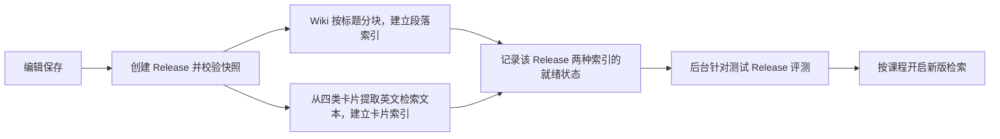
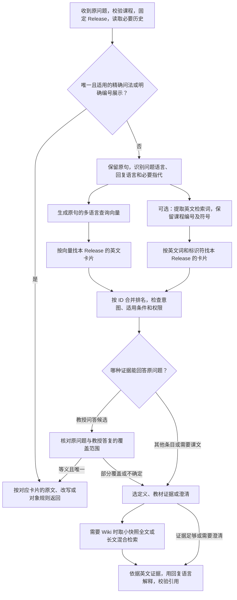

# AI Tutor 多语言提问与英文知识库实施方案

## 目标与交付顺序

课程团队维护一套英文 Wiki 和教学条目。学生用中文、英文或其他已验收的语言提问时，Lecture 在本轮课程的同一 Release 内查找英文材料，按问题意图选择回答方式。第一项工作是建立一组有标准答案和来源 ID 的课程问题，记录现有版本的结果。它将决定后续是否值得增加英文查询改写及模型重排序。

首期改动落在 Backoffice 编辑、Release 索引和两个入口共用的 Lecture 服务。Portal 和后台试跑使用相同的检索与语言策略；Socratic 保持现有路由。这里的设计和指标用于后续开发与验收，尚无线上多语言准确率数据。

## 首版代码与启用方式

编辑端以英文为必填内容，既有中文标签和摘要仍可读取。索引复用教授问答的后台任务和 pgvector 表，代次由 `teaching-v2:` 和 embedding 模型标识组成。部署环境需先具备 [索引迁移](../../server/prisma/migrations/20261126000000_professor_qa_search/migration.sql)。任务优先处理 Live 和测试 Release，整代构建成功后切换。Wiki 继续使用页面段落索引。

后台和学员端默认使用同一新版选择器。显式设置 `TUTOR_QA_LIVE_COURSES` 时，学员端按名单启用，空字符串关闭语义 QA 检索。`TUTOR_QA_SHADOW_COURSES` 中的课程只记录候选与判断，影子配置优先。两个变量均使用逗号分隔的课程内部 ID。精确问法和编号展示保留快速路径。明确的比较题没有匹配到教学卡时，继续检索当前 Release 的正文，没有正文证据时再请学员澄清。教授原文跨语展示采用原文加标注译文，翻译失败时保留原文。

本版没有引入独立的英文查询改写模型。教授问答用词法与向量候选加覆盖判定，其他卡片复用同一查询向量，只取余弦距离不超过 0.55 的前五张；这个初值需要用真实课程题校准。下面的表记录实施前的代码基线，后续章节中的质量目标用于课程验收。

## 实施前的代码基线

| 环节 | 已核对的行为 | 对实施的影响 |
| --- | --- | --- |
| 内容保存与发布 | 条目保存后形成可发布修订，创建 Release 时编译教学包。定义等类型的名称和摘要校验中英文；运行时还校验词表与卡片标签一致。[保存校验](../../server/src/releases/teaching-cards.service.ts#L219) · [教学包校验](../../server/src/ai/tutor/reviewed-package-validator.ts#L149) · [发布快照](../../server/src/releases/releases.service.ts#L213) | 英文单语维护需要同时打通表单、导入、保存、编译、读取。保存和上线仍是两个动作。 |
| 教学条目选择 | 教授问答对登记问法做规范化后精确匹配；定义用触发词、别名和名称。问句、主题和适用条件会影响可用条目。[条目选择](../../server/src/ai/tutor/lecture-teaching.ts#L125) · [教授原文直出](../../server/src/ai/tutor/lecture-teaching.ts#L299) | 即使 Wiki 检索找到正确段落，教授问答也可能漏选。必须在 Lecture 作出澄清或 Wiki 回退决定之前接入卡片候选。 |
| Wiki 分块与检索 | 按 Markdown 标题分段，长段约每 800 token 切块、重叠约 80 token，窗口用字符数近似。Wiki 分支在快照预算内可以给全文；长文查询先生成向量，再并行查向量和关键词，限定当前 Release。[分块](../../server/src/knowledge/chunking.service.ts#L54) · [全文预算](../../server/src/ai/tutor/course-context.ts#L9) · [两路 SQL](../../server/src/ks/prisma-knowledge.client.ts#L146) | 复用 Wiki 的分块策略。现有关键词 SQL 也引用查询向量，若要在 embedding 故障时独立工作，需要解开这项依赖。 |
| 回复语言 | 学员 DTO 的 locale 接受 en-GB、zh-CN；语言判定、澄清文本和部分摘要读取也有中英分支。原文模式直接使用已发布的 answerMd。[学员契约](../../server/src/ai/dto/learner-chat-stream.dto.ts#L40) · [回复语言](../../server/src/ai/tutor/motherbase-dialogue.ts#L10) · [原文返回](../../server/src/ai/tutor/lecture-teaching.ts#L318) | 找到英文材料与用学生的语言回答要分别验证。只换 embedding 无法使西语澄清、教授原文归属等行为正确。 |

## 1．先量出现有问题

**做什么**　由课程编辑给一个有代表性的 Release 标注问题，由后端记录现有路由、命中条目和引用。先用英语、中文和一种实际需要的第三语言；下文以西语为例。

**怎么做**　每题记录语言、原问题、允许的卡片或 Wiki 来源 ID、期望行为、禁止采用的教授答复。纳入原句、同义改写、专业词夹英文、否定句、相似概念、多轮指代、编号展示、库中无答案。各语言既含同义题组，也含该语言学生自然写出的提问。按意图分开调参集和留出集，避免同一题的翻译落到两边。复用现有 [Lecture 测试](../../server/src/ai/tutor/lecture-teaching.spec.ts) 和 [请求级测试](../../server/src/ai/ai-chat-yong.service.spec.ts)。

**为什么**　“找对段落却走错路由”和“根本没找到”需要分别修。只检查最终答复是否流畅，会漏掉这两类问题。

**验收**　每种语言都能产出候选召回、教授直答、引用、回复语言和耗时的基线；当前无法观测的字段标为缺失。留出集中保存仲裁过的期望行为，后续各方案重放相同题目。

## 2．打通英文单语编辑到发布

**做什么**　让编辑仅填英文就能新建、保存并发布四种条目。[编辑入口](../../client/src/components/knowledge/TeachingCardsPanel.tsx) · [已有保存与发布流程](Teaching_Entries_and_Tutor_Flow.md)

| 条目 | 编辑维护什么 | 用什么召回与回答 |
| --- | --- | --- |
| 定义 | 英文名称、核心解释、必要的教材摘录，可选英文别名 | 用名称、别名、主题和简短定义做检索文本；回答从本版卡片与教材锚点取证。 |
| 误区 | 英文错误说法、纠正要点、适用条件、摘录 | 标识“学生可能说的话”和“正确解释”，以错误说法作为主要召回线索。路由区分提问和断言，保留现有误区适用条件。 |
| 教授问答 | 英文标准问题、可选英文改写、教授答复、original 或 rewrite | 索引问题及变体，教授答复作为判定覆盖范围和生成答复的依据。长答复不作为主要问题匹配文本。 |
| 引用对象 | 稳定对象 ID、课程编号、英文名称与摘要、图片或公式 | 精确 ID 和编号优先；描述性提问可按英文名称与摘要召回。渲染前仍验证本轮允许的对象。 |

**怎么做**　先让教学包读取器同时接受旧双语数据与英文单语数据，并统一处理空中文字段；再更新写入校验、词表构建、表单必填项、批量导入和预览。缺少翻译时展示英文或按回复策略生成说明。保存沿用“保存即通过”，学员只读已选 Live 版本。历史双语别名继续可检索，既有 Release 按其快照读取。

**为什么**　只有编辑器放宽校验，发布或加载仍可能失败。保持英文原始材料和来源 ID 可追溯，也便于判断回答是否忠实于教材。

**验收**　四种英文单语样例分别通过新建、导入、保存、创建测试 Release 和 Tutor 读取。旧双语 Release 仍可打开；修改并保存条目后，旧 Live 的答复与引用仍来自旧修订。

## 3．在发布时为教学条目建立检索索引

**做什么**　保留 Wiki 的 KnowledgeChunk，为有明确边界的卡片建立发布版本级索引。一张卡对应一个候选；首期不把教授问题和答复拆成独立 chunk。

**怎么做**　从 Release.snapshotData.teachingPackage 生成每张卡的检索文本，调用现有 [EmbeddingService](../../server/src/ai/embedding/embedding.service.ts#L40)。推荐在现有 PostgreSQL 向量存储中增加独立的卡片索引记录，字段包含 releaseId、cardId、类型、检索文本、向量、内容指纹和索引版本。来源、原文和对象仍按 ID 回读快照。存储迁移及模型维数在开发前评审；代码默认模型可配置，部署实际模型需核对。用同一模型及版本编码查询和内容，切换模型时另建索引代次再切换读取。

**为什么**　Wiki chunk 的身份是页面段落；卡片的身份决定能否直答、是否是误区和允许展示哪个对象。分别存储能独立重建，并保留既有 Wiki 引用逻辑。

两个索引任务在数据上相互独立，可以并行；本机按资源限制串行跑。按 Release、索引代次与 cardId 去重，整代写完并校验条数、指纹、向量维数后原子切换。多实例重建按同一 Release 互斥或用条件更新切换。卡片数为零须能标记“成功、零条”。失败保留本 Release 最近一次兼容的完整索引；从未就绪则用本版规则兜底。先补测试版本，再补需要灰度的 Live 版本。[已有异步索引入口](../../server/src/releases/releases.service.ts#L279) · [已有重建入口](../../server/src/releases/releases.service.ts#L416)

**验收**　对同一 Release 重跑两次无重复，删除的卡片在新 Release 不可召回。模拟半途中断、并发重建、空教学包和模型变更，查询只能看到完整且兼容的一代；A 版本检索不到 B 版本内容。

## 4．把多语言候选接入真实请求

**做什么**　保留可信的精确命中快路径。其他请求在 Lecture 作出最终路由前得到卡片候选，并在需要课文时使用同一 Release 的 Wiki。后端共享这套逻辑，两个客户端不用各自翻译。

**怎么做**

1. 在 [Lecture 编排](../../server/src/ai/ai-chat-yong.service.ts#L319) 保留原始 message、当前课程与 releaseId。问题语言、回答语言、英文检索词分别传递。追问只引用同课同版历史；“为什么？”缺少指代时先澄清。沿用知识开关和教学包来源校验。
2. 原句 embedding 只计算一次，本轮需查卡片和长 Wiki 时复用。在现有 [知识客户端契约](../../server/src/ks/contract/knowledge-client.ts#L71) 增加卡片候选查询；同步修改 [HTTP 客户端](../../server/src/ai/knowledge/http-knowledge.client.ts#L98)、[内部控制器](../../server/src/ks/ks-internal.controller.ts#L91) 与数据库实现。由知识服务持有向量；例如通过聚合查询或本轮查询上下文复用，避免两个入口各自向量化。候选返回来源种类、稳定 ID、排名及命中渠道。
3. 第一版先测“精确规则＋原句向量”。第二版可并行生成英文检索词，英文原问直接取词，保留否定、比较对象、数式、图号。仅在有收益的课程或语言启用。把词法通路与 embedding 解耦。分别取少量候选，先按名次融合去重，例如 RRF；根据离线结果选择候选数、融合参数、是否需要重排序。不同检索渠道的原始分数不可直接当成同一概率。
4. 将候选交回现有选择器，先检查版本、类型、适用及排除条件，再决定教授问答、定义、误区、对象、Wiki 或澄清。中英文正则覆盖不到的问法需增加多语言意图判定；不能让旧筛选在语义候选到达前就丢弃它。短 Wiki 保留全文路径，长 Wiki 在需要时再查；模型配置可与所需上下文并行读取。

**为什么**　原句保留跨语言语义，英文词帮助定位专业名称和编号；翻译带来的延迟只应在能修复漏召回时支付。先取卡片再按需取 Wiki，可避免每个简单编号请求都执行全部检索。

**验收**　同一意图的中、英、西语问法能命中同一英文条目；“图 2”和“图 12”不会混淆。分别模拟改写超时、embedding 不可用、无索引：使用尚可用的同版通路；若仍无足够证据，给出澄清或资料不足提示，日志标明实际分支。

## 5．决定什么时候可以采用教授答复

**做什么**　在“找到了相关教授问答”和“直接采用这条答复”之间加入明确判断，并贯穿原文、改写、引用和回复语言。

| 学生提问，以英文标准题 What is a state variable? 为例 | 期望行为 |
| --- | --- |
| “什么是状态变量？” | 可能与标准题等义。检查提问对象、意图、限定条件和答复覆盖范围，唯一且满足条件时采用教授问答。 |
| “为什么这个模型选温度作状态变量？” | 需要解释选择温度的原因。仅给出定义的教授答复不足，继续找该模型的教材依据。 |
| “状态变量和参数有什么区别？” | 需要比较双方。若只有单方定义，查找另一方及比较依据；证据不足时说明可回答的范围。 |
| “¿Y por qué?” | 用当前对话确定“为什么”指什么；存在多个合理对象时，用西语澄清。 |

**怎么做**　精确原句保留现有唯一命中与适用检查。对语义召回的教授问答，只对排名靠前的少量候选核对原问题、标准问法和已发布答复，输出“等义且完整覆盖／相关但不完整／无关或不确定”及候选 ID；服务端校验 ID、唯一性及适用条件。超时、多个等价候选或结果无效时走证据生成或澄清。相似度阈值和是否调用额外模型由留出集决定，排序分数本身不能授权直答。

回复语言建议依次取学生明确指定的语言、能可靠识别的当前问题语言、同会话语言偏好、界面默认语言。UI locale 可继续表示界面语言，在内部新增独立的回答语言；梳理 DTO、Prompt、澄清文本、流式输出和引用对象摘要。对于 original，建议保留英文教授原文及归属，跨语时另附标明的译文；公式、对象 ID、引用和 Markdown 链接原样保留。对于 rewrite，用学生语言忠实表达并关联来源。此处“原文＋译文”是待产品确认的展示选择；译文生成失败时仍可展示英文原文。

**为什么**　概念相同的两问，要求的答案可能完全不同。教授署名、原文与译文的边界必须在直答路径中保留。

**验收**　等义题能采用教授问答，相近但意图不同的题不误直答；译文有明确标识，直接返回和流式生成两条路径均保留引用白名单。混合语言题和显式指定回答语言的题按优先顺序返回。

## 6．按语言验收、灰度、回退

**做什么**　同一题集依次对照现网基线、原句向量、加入英文词法检索、再加候选重排序。每次只增加一个变量。规则、超时和异常分支用固定候选及模型替身做离线单测；跨语言召回质量另用拟部署的真实模型和固定 Release 测量。

| 观测项 | 建议的首轮验收方式 |
| --- | --- |
| 召回 | 对有标注来源的题，按语言计算 Recall@5，即前五条候选中至少有一条可接受来源的问题占比。首轮可用每种语言 ≥90% 作评审目标，同时单列英文与旧版的差值。 |
| 教授问答 | 同时报采用率与直答准确率，后者分母是实际直接采用教授答复的题数。高风险反例集要求零误直答。展示分子、分母和错误案例；全部拒答不能算通过。 |
| 来源与语言 | 跨课程、跨 Release 和未经允许的对象引用测试要求零越界。明确指定语言、原文归属、改写和译文标识用例全部通过。 |
| 成本与延迟 | 按精确直出、语义判定和 Wiki 生成分别记录首个可见内容的 P50/P95、每问模型调用次数和成本。基线实测后约定上线预算，超过预算则关闭附加分支并复测。 |

**怎么做**　先在 Backoffice 固定测试 Release 重放；随后按课程记录影子候选和拟选路由，仍返回旧结果；再对已验收语言的小流量启用。按 requestId 记录 releaseId、索引版本、语言、候选 ID、命中渠道、最终路由、耗时和回退原因。优先分析候选未命中、候选正确但选错、回答语言错误三类。留出集与线上样本分开统计。若教授误直答增多，先关语义直答；若发生版本串读或大范围异常，关闭整个新选择器，回到现有同版规则与 Wiki。新写入的英文单语快照仍由兼容读取器服务；回退开关只切检索策略。

**为什么**　这能区分英文翻译、语义召回和重排序各自带来的收益，也能单独撤下最容易造成错误归属的功能。

**交付顺序**　① 标注题集和基线；② 英文编写及向后兼容的读取；③ 测试 Release 卡片索引；④ 原句向量候选、教授问答判定与回复语言；⑤ 用对照结果决定英文改写与重排序；⑥ 课程灰度及回退演练。第②、③项可在约定英文卡片字段后并行开发。切 Live 前应能复现一次成功检索、一次近似题拒绝直答和一次同版降级，并记录实际质量、成本和延迟。
