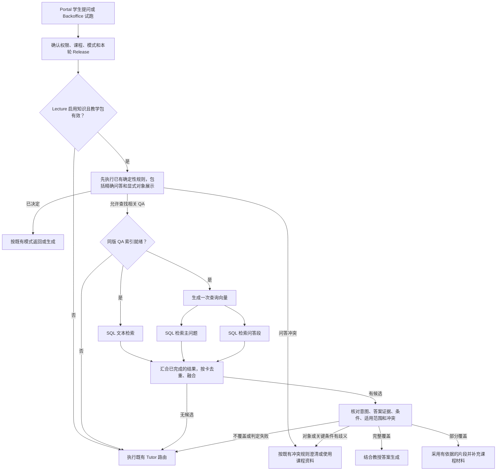

# 教授问答检索实施方案

建议继续使用 PostgreSQL。教授只维护**一个学生主问题和一份教授回答**。发布时，系统自动为问题和答案建立检索索引；学生提问时，先走已有的精确匹配，再用语义和文本检索找候选，最后判断已发布的教授答复能否回答这次提问。**能否找到**和**能否采用**分别验收。

首期已接入 Backoffice 试跑和 Portal 课程级灰度。下节记录本机数据库抽测结果。真实课程的采用准确率和端到端首答时间待手测，后续章节的样本数和质量门槛用于验收。

## 手动试跑与运行配置

1. 在 Backoffice 的「Knowledge → 教学条目」保存一条教授问答，只填学生问题和教授回答。将包含它的新 Release 选为测试版本。Release 发布或历史版本回填会登记构建任务，Admin 服务运行时自动取任务。索引模型与查询模型须一致。
2. 在 Backoffice 对话试跑选择 Lecture、启用课程知识。先问原句，再换一种说法，再问一个条件不同或多了一项任务的问题。后台默认试用新路径。按 requestId 看教学日志：精确快路可直接记录 `qaId`；语义路径的 `teaching.qaSearch` 记录索引状态、候选、判定结果及耗时。`missing` 表示该版本尚无可读索引；`degraded` 表示召回分支有降级；`accepted` 表示判定选中，结合最终 `selectedCardIds` 确定实际采用。`qaCoverage` 记录完整或部分覆盖，`qaEvidenceRanges` 的 start 和 length 是在本版教授答案中的 UTF-16 偏移与长度。
3. Agent 服务未设置 `TUTOR_QA_LIVE_COURSES` 时，学员与后台默认走同一 QA 检索路径。需要分批启用时，将内部 Course ID 写入该变量，以逗号分隔。显式设为空字符串会关闭学员端的语义 QA 检索。`TUTOR_QA_SHADOW_COURSES` 优先于 Live 和后台试用。变更后重启 Agent 服务，并用同一个上线 Release 在后台和学员端各跑一次原题与改写题。
4. 本版使用 `ProfessorQaIndex` 保存每版可读批次、重试次数和租约，`ProfessorQaPart` 以段 0 保存主问题向量和加权全文，以后续段保存答案向量。读取绑定课程和 Release，可重用同课程相同内容的向量。构建器每次领取一个版本，租约到期可恢复。数据库迁移为 `20261126000000_professor_qa_search`。[索引作业](../../server/src/knowledge/professor-qa-index.service.ts) · [检索 SQL](../../server/src/ks/professor-qa-search.ts) · [采用判定](../../server/src/ai/tutor/professor-qa-coverage.ts)

**本机容量抽测**　独立 PostgreSQL 16.15，单客户端串行访问，固定目标 Release 有 200 张短答卡、400 条 1,536 维向量；每组预热 5 次再测 50 次。全库 400 条向量时，检索 p50 / p95 / p99 为 70.20 / 72.52 / 74.84 ms；全库 8,000 条向量时为 70.56 / 72.48 / 72.85 ms。计时覆盖 Node、Prisma、实际 SQL 和融合，查询 embedding 由本地固定向量提供。上线并发、外部模型时间、人工准确率需另测。在已迁移的隔离库配置 `PROFESSOR_QA_TEST_DATABASE_URL` 后，可以从 server 目录运行 `node -r ts-node/register/transpile-only eval/professor-qa/bench.ts` 复测。[基准脚本](../../server/eval/professor-qa/bench.ts)

### 实施文件与复核命令

| 模块 | 本次涉及的文件（相对 Backoffice-dev） |
| --- | --- |
| 编辑与保存回归 | `client/src/components/knowledge/TeachingCardsPanel.tsx`、`client/tests/knowledge-teaching-cards.test.tsx` |
| 数据模型、发布入队与后台任务 | `server/prisma/schema.prisma`、`server/prisma/migrations/20261126000000_professor_qa_search/migration.sql`、`server/src/releases/releases.module.ts`、`server/src/knowledge/professor-qa-index.service.ts`、`server/src/knowledge/professor-qa-parts.ts` |
| 知识库接口与 SQL | `server/src/ks/contract/knowledge-client.ts`、`server/src/ks/contract/embedding-client.ts`、`server/src/ks/prisma-knowledge.client.ts`、`server/src/ks/ks-internal.controller.ts`、`server/src/ks/professor-qa-search.ts`、`server/src/ai/knowledge/http-knowledge.client.ts`、`server/src/ai/embedding/embedding.service.ts` |
| 教学路由与日志 | `server/src/ai/ai-chat-yong.service.ts`、`server/src/ai/tutor/lecture-teaching.ts`、`server/src/ai/tutor/professor-qa-coverage.ts`、`server/src/ai/ai-chat-logger.ts` |
| 验证与基准 | `server/src/ai/ai-chat-yong.service.spec.ts`、`server/src/ai/tutor/professor-qa-coverage.spec.ts`、`server/src/ai/knowledge/http-knowledge.client.spec.ts`、`server/src/ks/professor-qa-search.pg.spec.ts`、`server/eval/professor-qa/bench.ts` |
| 流程文档 | 本文及 [教学条目与 Tutor 流程](Teaching_Entries_and_Tutor_Flow.md) |

服务端使用 `eslint` 检查涉及文件，`tsc --noEmit --incremental false` 做类型检查，`npm test -- --runInBand --runTestsByPath` 指定相关套件。PostgreSQL 用例通过 `PROFESSOR_QA_TEST_DATABASE_URL` 指向独立的已迁移库，embedding 使用可重复的固定向量。客户端使用 `oxlint`、`tsc --noEmit -p tsconfig.app.json` 及 `node --experimental-strip-types --import ./tests/support/register.mjs --test --test-concurrency=1 tests/knowledge-teaching-cards.test.tsx`。

## 一、从现有系统接入

| 现在怎么运行 | 对实施的影响 |
| --- | --- |
| 教授问答保存于 `TutorTeachingCard`。主问题写入 `approvedPayload.question`，教授原文写入 `answerMd`。保存服务把主问题写入 triggers。保存形成可发布修订，学生读取所选 Release 的快照。[保存服务](../../server/src/releases/teaching-cards.service.ts#L122) · [保存与发布流程](Teaching_Entries_and_Tutor_Flow.md) | 新问答只填主问题和答案即可。用完整 `answerMd` 建索引，课程摘要只保留了答复前面一部分。 |
| Lecture 先筛适用和排除条件，再对教授问法做规范化精确比较。唯一适用的精确问答直接进入生成。现有 Wiki 的向量检索查 `KnowledgeChunk`，检索对象是页面正文。[问法匹配](../../server/src/ai/tutor/lecture-teaching.ts#L152) · [唯一性](../../server/src/ai/tutor/lecture-teaching.ts#L208) · [原文与引用](../../server/src/ai/tutor/lecture-teaching.ts#L299) · [Wiki 检索](../../server/src/ks/prisma-knowledge.client.ts#L146) | 将新候选接到 Lecture 的教学条目选择处，早于普通定义选取、澄清或 Wiki 回退。保留显式图表展示、已有精确命中和各自的路由优先规则。 |
| 发布事务固化 `Release.snapshotData.teachingPackage`，提交后异步建 Wiki 索引。学员使用在线课程的 Live 版本，后台试跑可指定测试版本。[发布](../../server/src/releases/releases.service.ts#L210) · [异步索引](../../server/src/releases/releases.service.ts#L279) · [KS 契约](../../server/src/ks/contract/knowledge-client.ts#L16) | QA 索引也从已发布快照构建。后台保存后显示“已保存”，创建测试 Release 即可试跑，设为 Live 后学生才会使用。 |
| 当前教学包发布上限是**所有类型合计 200 张卡**。每轮读取 Release 时会取出 `snapshotData`，教学包还需校验。[数量上限](../../server/src/ai/tutor/teaching-package-publication.ts#L21) · [快照读取](../../server/src/ks/prisma-knowledge.client.ts#L74) · [校验入口](../../server/src/ai/tutor/reviewed-package-validator.ts#L242) | 许多课程和版本累积了几十万条，与一门课一次查几十万条，是两种容量问题。首期先测单版本精确向量排序、快照读取和外部模型延迟，再决定扩容点。 |

多语言方案中涉及相同的卡片检索。本方案细化教授问答部分，两个项目应共用候选接口、发布索引和评测题 ID，避免同一问题被重复向量化和判定。[多语言 Lecture 方案](Multilingual_Lecture_Retrieval_Plan.md)

## 二、阶段 1 · 用同一批题量出漏答和误答

**做什么**　课程编辑和后端共同建立首个可复跑的题集，并记录现有精确匹配结果。建议选 20–40 条真实问答，准备至少 120 个学生问法，含可答与不可答样本。测试样本由评测团队维护，独立于教授编辑表单和生产索引。

**怎么做**　每题记录 `releaseId`、学生问题、必要的上一轮上下文、可接受的 `cardId`、支持答案的原文句子、期待动作（原文／改写／澄清／课程资料）及禁止采用的卡片。覆盖原句、自然同义改写、只在答案出现的术语、跨语言问法、数字或单位变化、否定、条件遗漏、多意图、同题冲突和课程内无答案。按原始意图分开调参集和留出集。同题的翻译和轻微改写应留在同一组。

**为什么**　“找到了同主题问答”可能同时增加命中率和误答率。标到证据句和允许动作，才能定位错误发生在检索、采用判定还是最后的生成。

**怎样验收**　保留每题现有路由、候选或已选 ID、回复及人工判定。列出原句已通过的回归清单、最常漏掉的改写，以及相似度可能很高但条件相反的反例。课程负责人复核争议题后冻结第一版留出集。

## 三、阶段 2 · 保存两项内容，发布时自动建索引

**做什么**　Backoffice 的教授问答主表单保留学生问题和教授回答。答复可以插入课程引用。发布任务从已验证的教学包生成可重建的搜索数据。

**怎么做**

1. 教授问答只录入主问题和教授回答。文本与向量检索使用主问题与回答，旧快照恢复到编辑区时过滤退役字段。[编辑入口](../../client/src/components/knowledge/TeachingCardsPanel.tsx#L443) · [服务端规范化](../../server/src/releases/teaching-cards.service.ts#L122)
2. KS 维护三类派生记录。下表为拟议逻辑结构，实施时评审迁移、索引大小和删除策略。Release 快照始终是教授原文和引用的权威来源。

| 记录 | 关键字段 | 用途 |
| --- | --- | --- |
| 构建批次 | course_id、release_id、generation、快照哈希、模型 ID/维度、文本处理版本、状态、条数 | 标识哪一批可读。每个 Release 只指向一批完整数据。 |
| 问答 | 上述作用域、card_id、规范化问题、问题和答案的加权 tsvector、答复内容哈希 | 每条已发布 QA 一行。按作用域建立 B-tree。全文索引可用 GIN，问题词权重高于答案词。 |
| 问答向量 | 上述作用域、card_id、kind、part_no、原文位置、embedding | `question` 对主问题编码，`answer` 对“主问题 + 答案或一个答案段”编码。唯一键覆盖批次、卡、类型和段号；通过外键关联问答。 |

3. **如何分 chunk。** 现有 Wiki 先按 Markdown H1–H6 分段，超长段用约 3,200 字符窗口，重叠 320 字符（代码按每 4 字符估算 1 token）。QA 首选一问一答作为返回单位。短答只建问题向量、问答向量各一个。长答按段落、编号步骤或小标题切分，每段带主问题，保存原文范围；临近模型输入限制再细分，保留公式、引用和条件句的边界。兼容现有最高 12,000 字符的答复，测试末段命中。即便命中最后一段，仍回到同一张完整卡片判断适用条件。[Wiki 分块](../../server/src/knowledge/chunking.service.ts#L54) · [答复长度](../../server/src/releases/teaching-cards.service.ts#L126)
4. 发布提交后独立调度 Wiki 和 QA 建索引，两者可以并行，按数据库和 embedding 服务预算限制并发。QA 构建先登记待处理批次，再批量向量化。用“课程、模型、文本处理版本、输入内容哈希”复用相同向量；新 Release 仍写自己的一套映射。核对卡数、段数、模型维度和快照哈希后事务性切换可读批次。零张 QA 也应记录构建成功。
5. 作业持久化、幂等重试。同一批只允许一个有效写入者；进程重启后补扫未完成或漏登记的 Release。失败保留上一批同版本有效索引；首次建索引失败走原有 Lecture。模型升级先平行构建新批次，使用相应查询模型切换。按 Live、测试、其他按需版本的顺序回填，保留可回退批次后再清理。

**为什么**　主问题最能表达教师当时要回答什么，答案则包含学生可能直接提到的术语和例子。发布时计算一次，许多学生可以共享；按 Release 建映射，才能支持新旧版答案同时存在。

**怎样验收**　只填两项即可保存、发布和检索。再测改一条后重发、原文但元数据变化、空包、重复触发、发布后进程退出、embedding 中途失败、跨版本回滚。后台测试版能命中新答案，同一时刻学员仍读 Live 旧答案。

## 四、阶段 3 · 用 SQL 找到候选问答

**做什么**　KS 对外增加教授问答候选查询，支持进程内 Prisma 和 HTTP 两种实现。Agent 通过 `KnowledgeClient` 请求候选。KS 核对课程、Release 和可读批次，返回卡 ID、匹配段、各路名次和索引状态。Tutor 再用已校验的同版卡片读取原文。[KS 契约](../../server/src/ks/contract/knowledge-client.ts#L62) · [Prisma 实现](../../server/src/ks/prisma-knowledge.client.ts#L146) · [HTTP 实现](../../server/src/ai/knowledge/http-knowledge.client.ts) · [KS 路由](../../server/src/ks/ks-internal.controller.ts)

**怎么做**　唯一适用的原句沿用快路。精确未命中、当前路由允许使用 QA 时，启动以下两路。主语不清的短追问只借用本次会话可明确解析的对象，换题时使用当前问题。无法消除指代歧义就追问。

| 召回路 | 数据与算法 | 为什么需要 |
| --- | --- | --- |
| 文本 | 对主问题和答案自动分词。中文可复用 `Intl.Segmenter`，英文做统一词形或大小写处理，建库和查询使用相同规则。将分词文本交给 `to_tsvector('simple', …)`，使用带权 `ts_rank_cd` 排名。用参数化词项构造 OR 查询，并去掉空词。对课程编号、单字符变量、单位、否定词和区分大小写的公式标记单独保留。 | 同一术语或编号能精确缩小范围。现有查询工具会丢弃单字符并截到 12 项，不能直接用于整篇答案建索引。[分词实现](../../server/src/common/retrieval-terms.ts#L7) · [PostgreSQL 全文索引](https://www.postgresql.org/docs/current/textsearch-indexes.html) |
| 语义 | 一次生成学生问题的 embedding，复用于“学生问法 ↔ 主问题”和“学生问法 ↔ 问答段”两种余弦距离排序。首期两路各取前 20 张卡。对有多段的答复，先按卡取最佳段再做 Top K。 | 前一路覆盖同义改写，后一路覆盖只有教授答案提到的内容。学生无需猜教授怎么措辞。现有 embedding 服务可复用，建库和查询要校验模型及维度。[Embedding 服务](../../server/src/ai/embedding/embedding.service.ts#L24) |

以下 SQL 展示首期**限定版本后精确计算向量距离**的实现形状，同一语句分别传入 `question` 和 `answer`。表名和列名为拟议结构，参数由 KS 绑定，`$5` 是与该批次匹配的查询向量，`$6` 由服务端封顶。返回最佳段时按距离和段号稳定取第一条。

```sql
WITH scoped AS MATERIALIZED (
  SELECT card_id, part_no, embedding
  FROM qa_search_vector
  WHERE course_id = $1 AND release_id = $2 AND generation = $3 AND kind = $4
), best_per_card AS (
  SELECT DISTINCT ON (card_id)
         card_id, part_no, embedding <=> $5::vector AS distance
  FROM scoped
  ORDER BY card_id, distance, part_no
)
SELECT card_id, part_no, distance
FROM best_per_card
ORDER BY distance, card_id
LIMIT $6;
```

文本路可以在 embedding 请求发出时就开始查。向量分支等 embedding 返回后再执行。每路独立设超时；一路失败可用剩余候选继续覆盖判定，两路都失败走同版原有路由。首期按名次用 RRF 融合，例如每个榜单给同一张卡贡献 `1/(60+名次)`，每张卡每榜最多计一次。去重后取前 5 张进入判断。记录三路独立贡献，在留出集上比较“仅文本／仅主问题向量／加入答案向量／混合”，再定权重和 K。[pgvector 混合检索](https://github.com/pgvector/pgvector#hybrid-search)

**怎样验收**　在真实 PostgreSQL 加载两个课程、两个 Release 的同名卡。对照独立计算的精确距离和词项名次，验证零结果、并列、长答多段、只有文本命中、embedding 超时。所有返回 ID 都属于请求版本，长答不会凭重复段占满候选。独立验证 Prisma 与 HTTP 返回相同候选和降级状态。

## 五、阶段 4 · 决定教授答复可否采用

**做什么**　在 Lecture 中增加候选判定，按本轮覆盖范围采用教授依据。原句走既有快路；对新发现的相关问题，检索分数只决定哪些卡进入判定。



**怎么做**　对前 5 张卡先做便宜的确定性检查：同版有效、适用与排除规则、引用权限。对剩余候选进行一次批量判定，可先复用现有模型接口，输入学生问题、候选主问题和带出处的答案。输出限定为候选 ID、`full / partial / none`、原文证据片段、条件是否一致、歧义点。服务端校验 ID、片段确属原文、条件与对象无冲突，唯一且依据充分时才采用。候选过长时限制预算，同时带入前提和例外；截取材料不足以判定时退出该分支。[Lecture 入口](../../server/src/ai/ai-chat-yong.service.ts#L309) · [检索后重排序方法](https://www.sbert.net/examples/sentence_transformer/applications/retrieve_rerank/README.html)

| 学生问题和已发布答复的关系 | Tutor 动作 |
| --- | --- |
| 与原问等义，前提一致，原文完整覆盖且语言适用 | 按学生语言和提问方式组织，保留教授结论、限定和本轮允许的引用。 |
| 学生只问答复中的一个子问题，原文有充分依据 | 解释学生问到的部分，保留相关限定条件。翻译依课程语言策略并明确标识译文，不能标作教授原话。 |
| 一个问题含两项任务，只支持一项 | 已覆盖的子问题采用对应原文片段。其余部分用同版课程材料补足，依据不足时说明范围。仅主题相关时跳过该卡。 |
| 多张卡都像正确答案但前提相冲突；原文无证据、判定超时或输出无效 | 放弃自动采用。可消歧时追问，否则回到本轮原有教学条目或 Wiki 分支。沿用引用对象白名单和展示权限。 |

**示例**　假设教授主问题是“简单摆的周期与振幅有关吗？”，答复是“在小角度近似下，周期近似与振幅无关；大角度时这一近似失效。”学生问“小幅摆得稍高一点，来回一次的时间基本一样吗？”，语义路能找到同一问答，原文也包含学生需要的限定，可以采用。学生问“摆到 60°，怎么计算精确周期？”，同一条很可能仍排第一，但原文没有给计算方法。应查同版课程资料；若资料也没有，就说明现有依据只覆盖小角度近似。后一题验收时要检查系统是否拒绝把这条问答当作完整答案。

**为什么、怎样验收**　相关性排序解决“值得看什么”，覆盖判定解决“可以用来回答什么”。为同义、相反条件、指代、双问题、重复卡和越权引用分别写用例。验证实际答复保留教授关键结论和条件，引用照既有规则渲染；拒绝采用时仍有明确的下一步。复用[条目选择用例](../../server/src/ai/tutor/lecture-teaching.spec.ts#L83)和[请求级用例](../../server/src/ai/ai-chat-yong.service.spec.ts)。

## 六、阶段 5 · 按实际内容量和并发验证性能

**做什么**　先测当前发布上限下的真实成本，再决定是否使用近似向量索引。一次学生提问的成本包括快照读取和校验、数据库查询、生成查询向量、判定及可能的最终回答生成。只报告 SQL 耗时会低估用户等待。

| 场景 | 怎么测、怎么选 |
| --- | --- |
| 单版本最多 200 张教学卡，全库课程和历史版本持续增长 | 对课、版本、批次建立联合 B-tree，只对本版向量精确排序。用 QA 少、接近上限、长答多段三组数据；保持单版相同，逐级增加其他版本，查看 `EXPLAIN (ANALYZE, BUFFERS)` 的实际扫描行、缓冲区、排序和返回条数。单版向量行数取决于答案段数。 |
| 热门课并发高 | 在独立测试环境按实测峰值的 0.5、1、2 倍回放，并测冷、热缓存与发布构建同时进行的情况。记录 QPS、连接池等待、数据库 CPU/I/O、外部请求耗时、每百问调用次数与费用。若快照读取/校验主导，优先按 Release ID 与快照哈希做有界的已校验包缓存；下一步再评审轻量元数据和按卡读取。 |
| 将来放宽单版本上限 | 先验证整包发布、快照传输和校验承载能力。再在独立环境以更大单版测试集比较精确查询和 HNSW。ANN 需另写按距离 `ORDER BY … LIMIT` 的候选查询，按卡聚合、确保同版候选充足；上文的精确聚合 SQL 不应原样用于 ANN。带 Release 过滤可能导致近似搜索返回过少，测同版 Recall@K，并依安装版本评估分区或 iterative scan。将索引构建时间、内存和召回损失一起比较。[pgvector 过滤与近似索引](https://github.com/pgvector/pgvector#filtering) |
| 存储和构建成本 | 按现有 1,536 维 float32 粗估，短答两条向量的数值部分约 12 KiB。十万份短答映射若各存两条向量，约 1.14 GiB；另计表行、文本、索引、长答额外向量和多版本副本。构建时记录实际向量数、平均段数及磁盘占用。生产 pgvector 版本与索引现状实施前只读核对，仓库迁移曾删除 Wiki 的 HNSW 索引。[向量维度](../../server/prisma/migrations/20261026000000_add_knowledge_chunk/migration.sql#L14) · [后续迁移](../../server/prisma/migrations/20261029053806_add_main_system_prompt/migration.sql#L3) |

**为什么**　当全文 SQL 与查询向量并行时，召回等待约为 `max(文本查询, embedding + 两路向量查询的实际完成时间)`，随后才是融合和判定。原题唯一精确命中可以省掉查询 embedding 和覆盖判定，仍需生成回答。并发可缩短单次等待，也会增加连接池和提供方压力，必须同时看吞吐量与尾延迟。

**怎样验收**　分开报告 SQL、整段召回、覆盖判定、首个实际答案片段、完整响应的 p50/p95/p99，并区分原句、语义完整覆盖、部分覆盖、回退四条路径。试点可先用“目标并发下 QA 查询的数据库阶段 p95 ≤100 ms”定位问题；阈值由阶段 1 的环境基线确认。最终上线同时比较现网首答时间、超时率、准确率和每百问成本，不能从卡片数量直接承诺毫秒数。

## 七、质量门槛、发布与回退

| 验收项 | 建议试点门槛与分母 |
| --- | --- |
| 找得到 | 在标有可用教授答复的留出题中，正确卡进入前 5 的比例（Recall@5）建议 ≥90%。原句、同义问法、仅答案含线索、跨语言分别报告。 |
| 答得对 | 在系统实际采用教授答复的题中，人工确认结论、条件和来源都正确的比例建议 ≥95%。同时报告“正确采用数／全部可用 QA 题数”，须优于旧系统；每项列分子、分母与错题，样本不足时增加评测题。 |
| 该拒绝时拒绝 | 指定反例集中的错误原文直出为 0；跨课程、跨 Release、未发布内容泄漏及不允许的引用为 0。原先通过的精确命中与重复卡冲突用例全部通过。 |
| 运行可恢复 | 断开 embedding、文本查询、判定服务，分别验证单路工作或同版回退。构建失败和回滚期间仍能使用旧路由，后台可凭 requestId 解释每次选用或放弃的原因。 |

**交付顺序与负责人**

1. **课程编辑 + 后端**完成标注和旧路由基线，选出两三个真实漏答案例作为端到端验收题。
2. **Backoffice + KS**并行做表单简化和 Release 派生索引。先约定已发布数据格式和兼容规则，再评审数据库迁移。索引在测试版实现幂等重建后，接入文本、向量和融合 SQL。
3. **Tutor + 测试**可用固定候选先开发覆盖判定与路由测试；KS 候选接口通过隔离测试后再联调真实数据库。用单 worker 跑相关用例，另以独立测试库测 SQL 与容量。质量和时延对比采用同版、同题、同配置。
4. **在 Backoffice 做影子对照**：同一问题保留原回答，新路径仅记录候选、证据和拟采用动作。记录 Release、模型和索引版本、分路耗时、结果与回退原因；默认记录 ID 和判定摘要。对未达标分组先分析漏召回或误判，再调整 K、分词或判定规则。
5. **按课程灰度到 Portal**：建议先开放单门课，再分批扩大。出现跨版本读取、反例错直出或首答延迟超过已同意预算，关闭该课程的语义 QA 开关，立即恢复原有 Lecture；索引批次可单独回切。上线前演练一次“测试版新答案、Live 旧答案、关闭开关恢复旧行为”。

首轮评审建议确定三件事：试点课程和标注负责人、允许的首答延迟与每百问成本、跨语言回答的验收标准。它们影响灰度门槛；题集准备和当前基线测量可以先开始。
