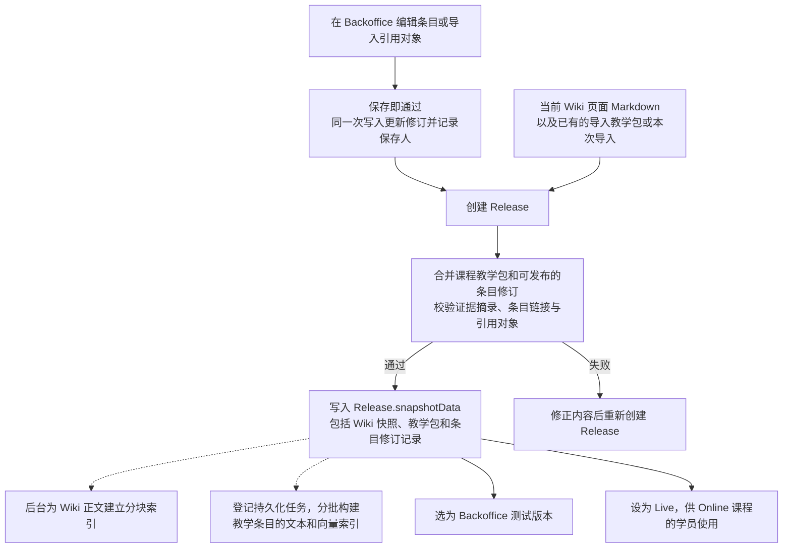
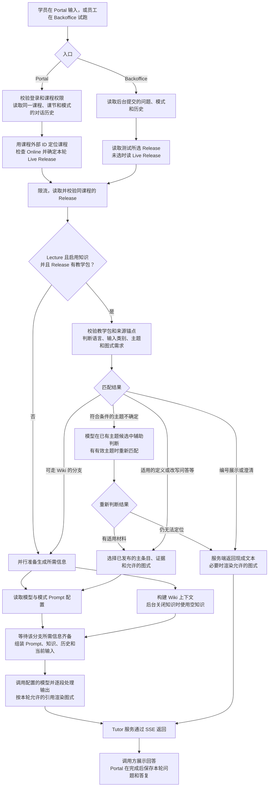
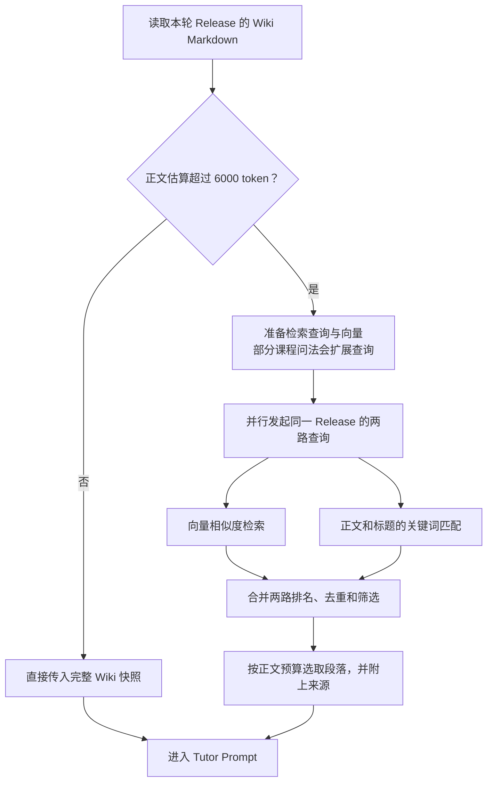

# 教学条目的保存、检索与 AI Tutor 流程

Backoffice「Knowledge → 教学条目」新建时可选择定义、误区、教授问答、引用对象。新条目和本地修改显示「未保存」，保存成功后显示「已保存」。已有旧类型可按原类型保存，也可改为适用的现行类型。

## 1. 保存与发布

四种类型共用 PostgreSQL 的 `TutorTeachingCard` 表。单条保存与批量导入都会校验并更新同一个修订，同时写入 `draft` 和 Release 使用的 `approved`。原有 `reviewerId` 字段记录保存人，`approvedRevision` 对应此次保存的 `revision`。历史上尚未通过的修改可重新保存，再纳入下一次 Release。 [数据库模型](../../server/prisma/schema.prisma#L56) · [保存服务](../../server/src/releases/teaching-cards.service.ts)

发布时，服务端将定义和误区的教材摘录定位到同次 Wiki 快照，生成可验证的来源锚点。教授问答和引用对象允许没有摘录。编译后的教学包保存在 `Release.snapshotData.teachingPackage`，与原始编辑记录分开。已发布版本可独立读取，课程可以分别指向编辑、测试和 Live 版本。 [Release 创建和上线](../../server/src/releases/releases.service.ts) · [教学包编译](../../server/src/ai/tutor/teaching-package-publication.ts)

## 2. 四种类型如何存储和匹配

下表记录现有实现。定义的最终内容结构待定。误区主要面向 Socratic，本次保留其现有行为。

| 类型 | Backoffice 保存的主要内容 | Lecture 运行时的匹配方式 |
| --- | --- | --- |
| **定义** `concept` | 主题、概念 ID、中英文名称和摘要、触发词、核心知识、可选解释、教材原文摘录、适用及排除条件、关联条目。 | 在所选 Release 内用触发词、双语名称和教学包词表别名匹配。中文用包含匹配，英文按词边界匹配。明确的追问可以借用上一问的概念，当前问命中优先。选中的条目及课文锚点进入 Prompt。 |
| **误区** `misreading` | 与定义共用表单和 JSON 结构。触发词描述学生常见的错误说法，核心知识和解释记录如何纠正，原文摘录提供依据。 | 在概念理解或解释应用类输入中，按触发词、适用条件、排除条件和主题筛选。系统识别为提问时会排除误区条目，避免把提问当成错误断言。误区用于提供纠正线索，单独命中时还需要定义等主条目才能走教学包生成路径。 |
| **教授问答** `professor_qa` | 学生主问题、教授答复 Markdown、可选引用。主问题参与精确匹配。 | 唯一且适用的精确问法优先。启用语义检索的 Lecture 在同版索引内并行查全文和生成查询向量，按主问题和答复段的名次融合候选。完整覆盖时根据教授答案生成，部分覆盖时采用已核实的原文片段，并用课程材料补充。无可用候选时继续原有课程材料路径。[手测与启用](Professor_QA_Retrieval_Implementation_Plan.md#手动试跑与运行配置) |
| **引用对象** `ref_obj` | 手工保存与导入都需要课程内编号、英文名称、英文摘要和一项图片或 LaTeX。中文名称、中文摘要和自定义显示名可选。对象 ID 与条目 ID 相同，旧编号可作为别名。公式存在 JSON 中，图片存在文件存储中，条目保存文件名。 | 可通过 `[标题](refobj:对象ID)` 按 ID 引用，也可按课程编号、旧编号、名称和摘要中的线索匹配。追问“这张图”时可利用历史里的同一 Release 对象。按编号展示唯一对象时，中文对话优先显示中文摘要，缺少中文时显示英文原文。解释型请求可把对象和相关 Wiki 段落交给模型。 |

后台搜索按课程加载条目后，在浏览器对草稿的名称、编号、主问题和引用别名做文本过滤。学员端的教学条目匹配在服务端对已发布教学包执行。Wiki 正文另有一条检索路径，长正文的向量和关键词检索针对 `KnowledgeChunk`，教学条目则按上表的规则匹配。 [编辑器与列表搜索](../../client/src/components/knowledge/TeachingCardsPanel.tsx) · [教学条目匹配](../../server/src/ai/tutor/lecture-teaching.ts) · [引用匹配](../../server/src/ai/tutor/lecture-exhibits.ts) · [图片存储](../../server/src/files/files.service.ts)

## 3. 从输入到回答

Portal 调用 `/api/ai-tutor`，服务端再请求 `/api/user/ai/chat-stream`。Backoffice 的普通试跑走 `/api/ai/chat-stream`。目前两个入口都绑定到 `AiChatYongService`。Socratic 走 Wiki 和对应模式的 Prompt。教学包分支的服务端直出包括满足条件的编号展示及澄清文本，主题分类只在满足候选、输入长度等条件时辅助匹配。运行日志可按 `requestId` 核对 Release、模型、选中条目、证据和输出对象。 [Tutor 路由绑定](../../server/src/ai/ai.module.ts#L96) · [对话实现](../../server/src/ai/ai-chat-yong.service.ts)

## 4. Wiki 正文如何检索

例如，学员输入“什么是向量？”。如果该问法唯一命中一条已发布、适用的教授问答，Tutor 依据教授答复生成本轮解释。如果该问法只命中“向量”定义，Tutor 会把选中的定义和教材摘录交给模型。进入 Wiki 分支或教授答案只能覆盖部分问题时，按正文长度决定读取完整快照或检索分块。 [上下文组装](../../server/src/ai/tutor/course-context.ts) · [向量与关键词检索](../../server/src/ks/prisma-knowledge.client.ts#L146) · [发布索引](../../server/src/knowledge/indexing.service.ts)

## 5. 一轮请求中的并行与串行

| 环节 | 实际执行顺序 |
| --- | --- |
| 打开 Portal Tutor | 会话历史和欢迎语并行读取。这发生在打开对话时。 |
| 提交问题 | Portal 依次校验权限、读对话和检查可用性。Tutor 确定 Release、限流并加载快照后，才进行教学包匹配。 |
| Wiki 生成分支 | 模型及 Prompt 配置与 Wiki 上下文并行准备，两者齐备后组装 Prompt。若给了多个正文查询，主查询和补充主题查询可并行。 |
| 长正文的单次查询 | 先生成查询向量，再并行发起向量 SQL 和关键词 SQL，最后合并结果。个别主题的补充查询仍按代码顺序调用。 |
| 教学包与生成 | 教学包先匹配，再决定采用教授依据、澄清、进入 Wiki，或生成。主题匹配不确定且满足条件时，先等待主题分类模型的结果，再决定是否需要生成回答。 |
| 旁路任务 | Tutor 日志异步写入。Release 创建后的 Wiki 索引也异步构建，创建响应可以先返回。 |

[Portal 对话入口](../../../LearningGuidePortal-dev/app/api/ai-tutor/route.ts) · [Tutor 配置与上下文并行](../../server/src/ai/ai-chat-yong.service.ts#L430) · [Wiki 多查询](../../server/src/ai/tutor/course-context.ts#L134) · [Wiki 两路 SQL](../../server/src/ks/prisma-knowledge.client.ts#L146)
