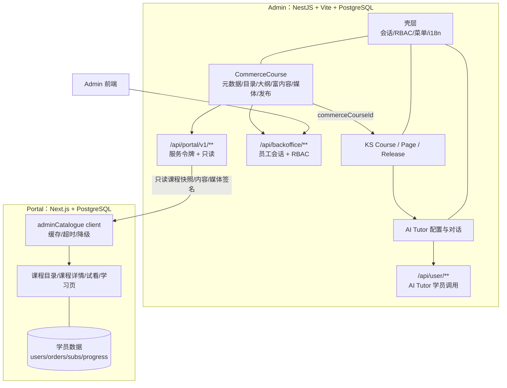
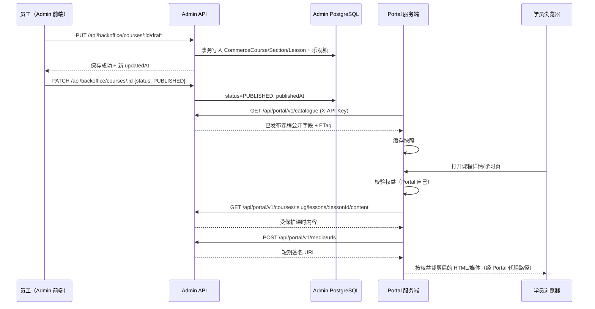
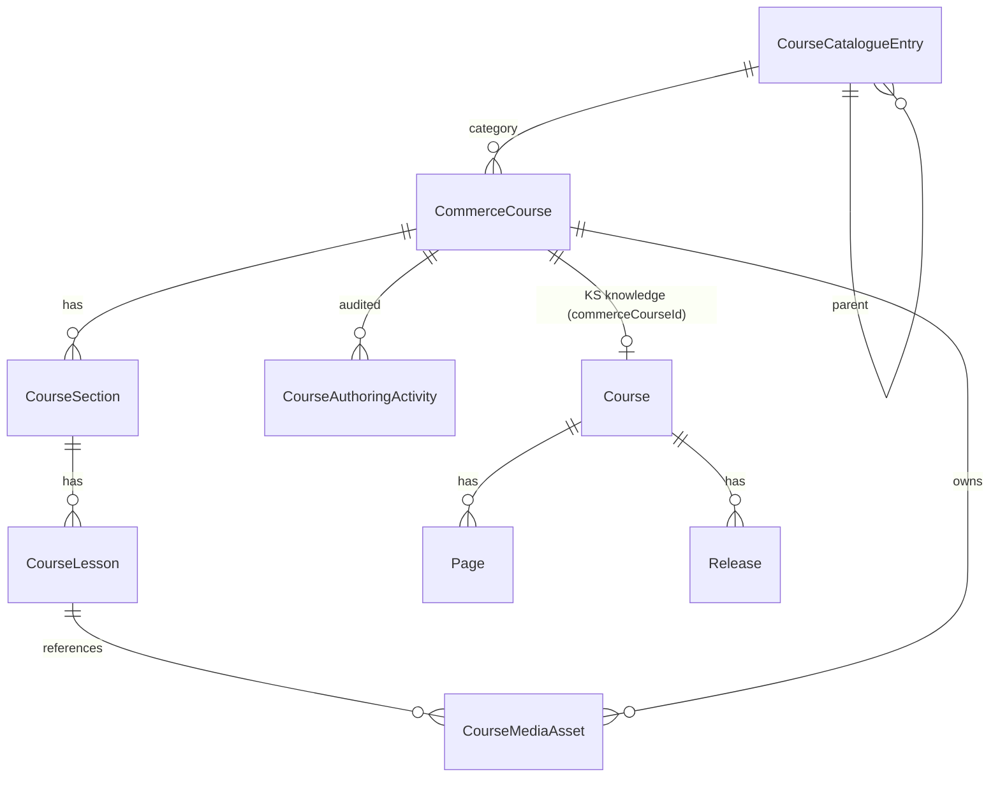

# Course 模块开发架构设计（Admin ↔ Portal）

| 项 | 内容 |
|---|---|
| 状态 | Draft（待评审冻结） |
| 日期 | 2026-10-26 |
| 范围 | Admin 的 Course（商品课程）模块 + Admin 对外课程服务 API + Portal 消费侧改造 + 数据迁移路线 |
| 不在范围 | KS（Knowledge）与 AI Tutor 的模块内部实现；Order / Reporting / Student / HelpDesk |
| 单一事实来源 | 本文档。与 `docs/System_Architecture_4_Components.md`、`docs/Engine_Split_Implementation.md`、`docs/BackOffice_Portal_Implementation.md` 冲突时以本文档为准并回写修订 |
| 代码基线 | Admin：当前工作区；Portal：`dev` @ `0cda9fc`（详见 §1.4） |

> **修订 R1（2026-10-26）：课程内容模型已升级为 v2（对齐 Figma `course-management`）。**
> 本文档的**架构决策、边界、Admin/Portal 分工、服务 API、迁移路线仍然有效**；
> 但 §4 的课程字段模型（`ProductCourse` 映射、Prisma 草案中的 `CommerceCourse/CourseSection/CourseLesson` 简单结构）
> 已被**更完整的 v2 模型**取代，并新增了**课程包导入/导出**。
> 请以 `docs/Course_Module_Import_Export_Design.md` 为准；本文档 §4 仅作为"最小骨架"参考保留。
> Portal 对新模型（多语言/展品/学习点/测试/试用/UAT/版本）的渲染改造列为后续独立阶段。

---

## 0. 结论摘要（TL;DR）

1. **课程主数据从 Portal 迁到 Admin。** Admin 成为课程的唯一写入者；Portal 只读消费，继续作为学员数据（用户、订单、订阅、权益、进度、小组、通知）的唯一写入者。
2. **拆成两个课程实体，通过 ID 关联：**
   - `CommerceCourse`（Admin 新建）：商品元数据、分类目录、章节/课时大纲、富内容、媒体、公开首课、上下架/归档、归属。
   - `Course`（Admin 现有 KS 域）：知识页 `Page`、`Release` 快照、AI Tutor 配置。
   - 关联字段：KS `Course.commerceCourseId` → `CommerceCourse.id`。
3. **KS / AI Tutor 与 Course 在同一个 NestJS 服务、同一个 Vite 前端、同一个数据库内。** 因此**内部协作不需要 HTTP API**，通过共享 DB 表、NestJS service/DI、共享 TypeScript 契约完成。HTTP API 只对外（Portal）。
4. **对 Portal 提供只读服务 API：`/api/portal/v1/**`**，服务令牌鉴权（`X-API-Key`），与员工侧 `/api/backoffice/**`（Cookie 会话 + RBAC）分开。Portal 不写课程。
5. **媒体归 Admin 所有。** Admin 存私有对象并签发短期 URL；Portal 在自己校验权益后，再向 Admin 请求受保护媒体签名。
6. **迁移保留既有 ID**（course/section/lesson），因为 Portal 的 `studyEvents` / `studyRecords` / 权益按这些 ID 引用；不做 ID 重映射。
7. **富内容复用 Portal 的 `LessonContent` 契约**（`contracts/lesson-content.ts` 的类型与限额），Admin 侧引入 TipTap 编辑器，保证编辑与渲染一致。
8. **分四阶段落地：** P0 契约冻结 → P1 Admin 完整课程管理 → P2 迁移与双跑 → P3 切换收口与 Portal 写入路径退役。

---

## 1. 背景与现状

### 1.1 业务目标

- Admin（`https://admin.ilovelearningguide.com/`）负责课程的创建、编辑、分类、上下架、发布与归档。
- Portal（`https://www.ilovelearningguide.com/zh-CN/portal`）负责课程展示、试看、购买、学习与 AI Tutor 学员侧体验。
- 当前 Portal 的课程直接存放在 Portal 工程内（`product.json` / 持久化层 + 内嵌过渡后台），属于过渡版本。
- 最终目标：课程在 Admin 维护管理，Portal 通过 Admin 接口展示及处理。

### 1.2 Portal 现状（过渡版本）

- 课程聚合：`services/productStore.ts` 的 `ProductCourse`，字段涵盖 `slug / title / subtitle / description / cover / thumbnailPath / level / tags / categoryId / subjectId / referencePrice / discount / status / sections / authorIds / archivedAt`，课程内容为 `sections[] → lessons[] → contents[]`。
- 富内容契约：`contracts/lesson-content.ts`（`LessonContent`、`LessonNode`、`LESSON_CONTENT_LIMITS`、`COURSE_MEDIA_MAX_BYTES`）。
- 课程编写：`services/courseAuthoring.ts`（`applyCourseDraft`、`validateCourseMetadata`、`selectAuthorCourses`），配合 `components/portal/CourseManager.tsx`、`CourseOutlineEditor.tsx`、`CourseMetadataEditor.tsx`、`LessonContentEditor`（TipTap）。
- 课程后台接口（Portal 内嵌）：`app/api/backoffice/courses/*`（列表、创建、`PATCH` 状态、`DELETE` 归档、`POST` 加课时、`PUT draft`）。
- 媒体：`services/courseMedia.ts`（文件签名校验、25 MiB 上限、私有存储、Range 读取）+ `services/persistence/vfs.ts` + S3（`DATA_S3_BUCKET`）。
- 学员域：`users / sessions / plans / quotes / orders / subscriptions / entitlements / studyRecords / studyEvents / conversations / notifications`。
- AI Tutor：`services/productTutor.ts` 仍在本进程内直连 OpenRouter，并按课程 slug 读取本地知识包 `knowledge/<slug>`。

### 1.3 Admin 现状

- 壳层与后台：`client/src/App.tsx`（`ShellRoute`、`MenuGuard`）、`client/src/backoffice/**`、`server/src/backoffice/**`（会话、RBAC、员工账号、审计、邮件）。
- 课程菜单：`client/src/backoffice/pages/ModulePages.tsx` 的 `CoursePage` 仍是占位页。
- KS 课程模型：`server/prisma/schema.prisma` 的 `Course / Page / Release / CourseAiConfig`，`Course.externalId` 存 Portal 的 `course.slug`。
- 同步方向（当前）：`server/src/sync/portal-source.service.ts` 从 Portal 拉 `/api/integration/catalogue`（只读标题与课时标题），**但该端点目前在 Portal 中不存在**，说明过渡链路本身未闭合。
- Agent 拆分：`docs/Engine_Split_Implementation.md`，`/api/user/**`（服务密钥）与 `/api/ks/**`（内部令牌）已存在，`/api/user` 由 Portal 调用。

### 1.4 Portal 代码基线

- 本地路径：`D:\Program\First-Light-TechHK\LearningGuidePortal`。
- 分支：`dev`，本地 HEAD `0cda9fc`，`origin/dev` 同样指向 `0cda9fc`（`git rev-list --count dev..origin/dev` 为 0）。
- **注意：** 本次 `git fetch origin` 因网络 `Connection was reset` 失败，无法确认远端是否有更新。文档分析以本地 `dev @ 0cda9fc` 为基线；开工前必须重新同步并在本文档登记实际基线 commit。

### 1.5 Scope / Non-scope

**In scope**
- Admin 商品课程域的完整 CRUD、分类目录、章节课时大纲、富内容、媒体、公开首课、发布/归档、归属。
- Admin 对 Portal 的只读课程服务 API。
- Portal 侧数据源切换、内嵌课程后台退役、媒体签名对接。
- 课程与分类目录（可选含 plans/价格）的数据迁移。

**Out of scope（本文档只描述边界，不设计内部）**
- KS 的页面编辑器、Release 机制、AI 配置与对话内部。
- Order / Reporting / Student / HelpDesk 的实现。
- Portal 的支付、订阅、权益、学习进度、小组、通知逻辑。

---

## 2. 职责边界与总体架构

### 2.1 组件与数据归属

| 组件 | 归属 | 写入的数据 | 读取的数据 |
|---|---|---|---|
| Admin Course（新建） | **你** | 商品课程、分类目录、章节/课时、富内容、媒体、上下架、归属、课程审计 | 员工会话/RBAC、KS 课程关联 |
| Admin KS | KS 团队 | 知识页、Release、AI 配置 | `CommerceCourse`（标题/元数据/大纲锚点） |
| Admin AI Tutor | AI 团队 | AI 配置、对话记录、线上版本指针 | KS Release、`CommerceCourse.aiTutorOnline` 语义 |
| Admin 壳层 | **你** | 会话、员工、偏好、审计 | 角色矩阵 |
| Portal | Portal 团队 | 用户、订单、订阅、权益、学习进度、小组、通知 | 课程目录/内容/媒体（经 Admin API） |

### 2.2 你的定位（入口与框架负责人）

你负责 Admin 的整体入口与框架，以及 Course 模块本身：

1. 壳层：登录、会话、RBAC、菜单、路由、i18n、布局、antd 主题与设计 token。
2. Course 模块：后端 `server/src/commerce-courses/`、前端 `/course` 页面。
3. 对外服务 API：`/api/portal/v1/**` 及服务令牌鉴权、版本化、限流、错误码。
4. 共享基础设施：数据库迁移、媒体存储、统一响应信封、全局异常、审计。
5. 与 KS / AI Tutor 的接口交接：课程锚点、生命周期、菜单挂载、权限登记。

### 2.3 与 KS / AI Tutor 的协作（同进程，不跨 HTTP）

**关键前提：** KS、AI Tutor、Course 同属一个 NestJS 服务与一个数据库（见 `docs/BackOffice_Portal_Implementation.md` §2）。因此内部**不需要 "admin-api"**：

- 通过共享 DB 表与 Prisma service 读写，跨模块调用用 NestJS DI（`PrismaService`、domain service）。
- 通过共享 TypeScript 契约统一类型（建议 `server/src/commerce-courses/contracts/*` 或在 `server/src/common/contracts` 下）。
- 生命周期通知如果需要解耦，用进程内事件（`EventEmitter2`）或共享 service 调用，不新增 HTTP 层。

协作契约：

| 协作点 | 归属 | 约定 |
|---|---|---|
| 课程身份 | 你 | `CommerceCourse.id` / `slug` 是唯一课程锚点 |
| 课程标题/元数据主数据 | 你 | 以 `CommerceCourse` 为准；KS 不再从 Portal 拉标题，改为引用或镜像；退役 `PortalSourceService` |
| 课程与知识库的关联 | 你 + KS | KS `Course` 新增 `commerceCourseId`（唯一、可空），一个商品课程最多一个 KS 课程 |
| 知识页与 Release | KS | 仍为 `Course → Page → Release`，结构不变 |
| AI 可用性 | AI Tutor | 由 `Release` + `Course.aiTutorOnline` 决定，与商品上下架独立，但共用同一课程锚点 |
| 菜单/路由/权限 | 你 | `MenuGuard`、`route-access.ts`、`permissions.ts`；`/course`、`/knowledge`、`/ai-tutor` 各自独立授权 |
| 共享 UI / i18n | 你 | 提供 `AppShell` / `MainLayout` / `WorkspaceAccessProvider` / antd 主题；KS/AI 只填内容区 |
| 课程生命周期 | 你 | 同一数据库事务内写 `CommerceCourse`；下游通过共享 service 或进程内事件消费 |
| 发布语义 | 你定 | `CommerceCourse.status = PUBLISHED` 决定 Portal 可见；KS 发布与 AI 上线互不阻塞 |

### 2.4 与 Portal 的对接（需要你提供对外服务 API）

Portal 是**独立部署的 Next.js 应用，不能共享数据库**，因此必须由你提供只读 HTTP 服务 API：

- 员工管理面：`/api/backoffice/**`（Cookie 会话 + RBAC），只给 Admin 前端与员工使用。
- Portal 消费面：`/api/portal/v1/**`（服务令牌 + 只读），只给 Portal 服务端使用。
- 既有学员 Agent 调用：`/api/user/**`（服务密钥）保持不变。
- 既有 KS 内部调用：`/api/ks/**`（`KS_SERVICE_TOKEN`）保持不变。

命名上不建议叫 "admin-api"：它既容易与员工后台混淆，也会让 Portal 误以为能写。本文档统一称 **Portal Integration API**。

### 2.5 总体架构图



### 2.6 关键数据流



---

## 3. 架构决策记录（ADR）

### ADR-01 商品课程与 KS 课程拆成两个实体

- **决策：** 新增 `CommerceCourse` 域，承接 Portal 现有 `ProductCourse`；KS 保留 `Course/Page/Release`；以 `KS Course.commerceCourseId → CommerceCourse.id` 关联。
- **理由：** 贴近 `docs/System_Architecture_4_Components.md`（Admin 决定卖什么课、KS 决定课里教什么知识、Agent 决定怎么教）。商品生命周期（上下架、封面、价格）与知识发布（Release）节奏不同，耦合会导致任一方改动阻塞另一方。
- **代价：** 需要维护两套课程记录与关联；标题存在双写风险。
- **缓解：** 明确 `CommerceCourse` 为标题/元数据主数据；KS 侧仅引用或用只读镜像，不独立编辑标题。

### ADR-02 Admin 单一写入者，Portal 只读

- **决策：** 课程内容只允许在 Admin 写；Portal 通过 `/api/portal/v1/**` 只读。
- **理由：** 消除 `product.json` 与 Admin 数据库的双写；Portal 内嵌后台是过渡形态，必须退役。
- **代价：** Portal 的课程页面从本地读取改为跨服务读取，引入网络延迟与失败模式。
- **缓解：** Portal 侧缓存最近成功快照 + 明确降级（§7.4）。

### ADR-03 迁移保留既有 ID

- **决策：** 课程、章节、课时、媒体的 ID 在迁移中原样保留（不重新生成）。
- **理由：** Portal 的 `studyEvents`、`studyRecords`、`entitlements`、conversations、media URL 都引用这些 ID；重映射会破坏学习进度与历史记录。
- **代价：** Admin 需接受历史 ID 形态（可能非 UUID）。
- **缓解：** `slug` 唯一约束 + 迁移 dry-run 校验 ID 集合一致。

### ADR-04 富内容契约复用 Portal

- **决策：** Admin 的课时富内容继续使用 `LessonContent` / `LessonNode` 契约与 `LESSON_CONTENT_LIMITS`，编辑器采用 TipTap（Portal 已用），保存前复用同一套 HTML 清洗与媒体引用校验。
- **理由：** 避免"Admin 编辑器产出的内容 Portal 渲染不了"；迁移成本最低。
- **代价：** Admin 需引入 TipTap 相关依赖与编辑器组件。
- **缓解：** 先移植 Portal 的编辑器组件与清洗函数，再按 Admin 设计 token 调整样式。

### ADR-05 媒体归 Admin，短期签名

- **决策：** 媒体对象存 Admin 的私有存储（S3 或本地开发），Portal 不自建课程媒体库；Portal 在权益校验通过后向 Admin 请求短期签名 URL。
- **理由：** 媒体是课程内容的一部分，随课程主数据一起归属 Admin；避免两处存储与两套权限。
- **代价：** 受保护媒体的可访问性依赖 Admin 可用性。
- **缓解：** 签名 URL TTL 10 分钟，Portal 服务端按需续签；Admin 侧记录访问审计。

### ADR-06 发布语义分离

- **决策：** `CommerceCourse.status = PUBLISHED` 只决定 Portal 目录可见性与可购买性；KS `Release` 与 `aiTutorOnline` 决定 AI Tutor 可用性。两者互不阻塞。
- **理由：** 课程可以先上线商品页（含试看），AI Tutor 稍后开放；也可下架商品但保留历史学员的 AI 访问。
- **代价：** 需要向产品/运营明确"已发布但 AI 未就绪"的展示口径。

### ADR-07 API 命名空间与鉴权分离

- **决策：** 员工侧 `/api/backoffice/**` 用 Cookie 会话 + RBAC；Portal 侧 `/api/portal/v1/**` 用服务令牌；不复用员工会话，也不让 Portal 触碰员工接口。
- **理由：** 两类调用者的信任模型不同；服务令牌只存服务端，泄露面可控。
- **代价：** 新增一套路由登记与限流。

### ADR-08 渐进迁移，保留回滚窗口

- **决策：** 先建 Admin 能力（P1），再迁移与双跑（P2），最后切换并退役 Portal 写入（P3）；P2 结束前保留 Portal 旧快照与写入开关。
- **理由：** 课程是收入与学习入口，不能一次性切断；双读校验可在切换前发现数据差异。

---

## 4. 领域模型

### 4.1 概念模型



说明：

- `Course`/`Page`/`Release` 是现有 KS 模型，不改内部结构，只新增关联列。
- `CourseMediaAsset` 既是课程资产，也可能被课时富内容引用（`contents[].nodes[].url`）。
- `CourseCatalogueEntry` 自关联形成"分类 → 科目"两级目录（Portal 现有 `catalogue` 的含义）。

### 4.2 ProductCourse → CommerceCourse 字段映射

| Portal `ProductCourse` | Admin `CommerceCourse` | 说明 |
|---|---|---|
| `id` | `id` | 原样保留（ADR-03） |
| `slug` | `slug` | `@unique`；迁移后仍用于 Portal 路由 |
| `title` | `title` | 标题主数据 |
| `subtitle` | `subtitle` | |
| `description` | `description` | `Text` |
| `category`（枚举字符串） | 迁移时映射到 `categoryId`；保留 `legacyCategory String?` 过渡 | 过渡期兼容旧展示 |
| `thumbnailPath` / `cover` | `coverAssetId` | 媒体迁移后改写为 Admin 资产 ID |
| `level` | `level` | `BEGINNER / INTERMEDIATE / ADVANCED`（存大写，出参转小写以兼容 Portal） |
| `tags` | `tags Json?` | `string[]` |
| `categoryId` / `subjectId` | `categoryId` / `subjectId` | 指向 `CourseCatalogueEntry` |
| `referencePrice` / `discount` | 同名字段 | 分为 `Int?`（最小货币单位 / 百分比） |
| `status` | `status` | `DRAFT / PUBLISHED / ARCHIVED` |
| `authorIds` | `CommerceCourseAuthor[]` 关联 | 员工 ID 列表；迁移时无法映射的保留 `legacyAuthorIds Json?` |
| `sections[].id` / `title` | `CourseSection.id` / `title` | ID 保留 |
| `sections[].archivedAt` | `CourseSection.archivedAt` | |
| `lessons[].id` / `title` | `CourseLesson.id` / `title` | ID 保留 |
| `lessons[].body` | `CourseLesson.body` | `Text` |
| `lessons[].summary` | `CourseLesson.summary` | 公开大纲简介，不得由受保护内容派生 |
| `lessons[].durationMinutes` | `CourseLesson.durationMinutes` | |
| `lessons[].videoDurationSeconds` | `CourseLesson.videoDurationSeconds` | |
| `lessons[].isPublic` | `CourseLesson.isPublic` | 公开首课标记 |
| `lessons[].contents` | `CourseLesson.contents Json?` | 直接存 `LessonContent[]`，用契约校验 |
| `archivedAt` / `archivedSections` | `archivedAt` + section 级 `archivedAt` | |
| `createdAt` / `updatedAt` | 同名字段 | 保留时间戳，便于排序与审计 |

`catalogue → CourseCatalogueEntry`：

| Portal `CatalogueEntry` | Admin `CourseCatalogueEntry` |
|---|---|
| `id` | `id`（保留） |
| `name` / `description` | 同名 |
| `parentId` | `parentId`（自关联，两级） |
| `status` | `status`（`ACTIVE/ARCHIVED`） |
| `createdAt` / `updatedAt` | 同名 |

`plans → CoursePlan`（是否本期迁入由 §12 开放问题决定；接口先预留只读）：

| Portal `ProductPlan` | Admin `CoursePlan` |
|---|---|
| `id` | `id`（保留） |
| `courseId` / `scope` / `scopeId` | 同名 |
| `name` / `termMonths` / `device` | 同名 |
| `amountMinor` / `currency` | 同名 |
| `stripeLookupKey`（Portal 用 `configuredStripePrice`） | `stripeLookupKey String?` |
| `aiPoints` / `trialEligible` | 同名 |
| `available`（运行时派生） | 不落库，接口按环境派生 |

### 4.3 Prisma 草案

> **已被取代（R1）：** 下列结构是"最小骨架"，只覆盖课程/章节/课时/媒体。
> Figma 模型还包含多语言、展品、学习点、触发器、推荐阅读、知识/应用测试、试用、版本、运营位，
> 以 `docs/Course_Module_Import_Export_Design.md` §3 的 v2 模型为准。

> 以下为设计草案，字段名与现有 schema 风格保持一致；实际迁移时以 Prisma Migrate 为准，禁止手改数据库。

```prisma
enum CommerceCourseStatus {
  DRAFT
  PUBLISHED
  ARCHIVED
}

enum CourseLevel {
  BEGINNER
  INTERMEDIATE
  ADVANCED
}

enum CourseMediaKind {
  IMAGE
  VIDEO
  PDF
  AUDIO
  MODEL3D
}

enum CatalogueStatus {
  ACTIVE
  ARCHIVED
}

enum PlanScope {
  COURSE
  CATEGORY
  EVERYTHING
}

enum PlanDevice {
  PC
  MOBILE
}

model CommerceCourse {
  id               String                @id @default(uuid())
  slug             String                @unique
  title            String
  subtitle         String?
  description      String                @db.Text
  status           CommerceCourseStatus  @default(DRAFT)
  level            CourseLevel?
  tags             Json?                 // string[]
  legacyCategory   String?               // 迁移过渡：保留 Portal 旧枚举
  categoryId       String?
  category         CourseCatalogueEntry? @relation("CourseCategory", fields: [categoryId], references: [id])
  subjectId        String?
  subject          CourseCatalogueEntry? @relation("CourseSubject", fields: [subjectId], references: [id])
  coverAssetId     String?
  cover            CourseMediaAsset?     @relation("CourseCover", fields: [coverAssetId], references: [id])
  referencePrice   Int?
  discount         Int?
  publishedAt      DateTime?
  archivedAt       DateTime?
  legacyAuthorIds  Json?                 // 迁移过渡：无法映射到员工账号的作者
  createdAt        DateTime              @default(now())
  updatedAt        DateTime              @updatedAt

  sections    CourseSection[]
  media       CourseMediaAsset[]         @relation("CourseMedia")
  authors     CommerceCourseAuthor[]
  activities  CourseAuthoringActivity[]
  plans       CoursePlan[]
  ksCourse    Course?                    // 反向：KS Course.commerceCourseId

  @@index([status, updatedAt])
  @@index([categoryId, subjectId])
}

model CourseSection {
  id         String          @id @default(uuid())
  courseId   String
  course     CommerceCourse  @relation(fields: [courseId], references: [id], onDelete: Cascade)
  title      String
  sortOrder  Int
  archivedAt DateTime?
  createdAt  DateTime        @default(now())
  updatedAt  DateTime        @updatedAt

  lessons CourseLesson[]

  @@unique([courseId, id])
  @@index([courseId, sortOrder])
}

model CourseLesson {
  id                   String          @id @default(uuid())
  courseId             String
  sectionId            String
  section              CourseSection   @relation(fields: [sectionId], references: [id], onDelete: Cascade)
  title                String
  summary              String?         @db.Text
  body                 String          @db.Text @default("")
  durationMinutes      Int             @default(0)
  videoDurationSeconds Int?
  isPublic             Boolean         @default(false)
  contents             Json?           // LessonContent[]
  sortOrder            Int
  createdAt            DateTime        @default(now())
  updatedAt            DateTime        @updatedAt

  @@unique([courseId, id])
  @@index([sectionId, sortOrder])
}

model CourseMediaAsset {
  id           String          @id @default(uuid())
  courseId     String
  course       CommerceCourse  @relation("CourseMedia", fields: [courseId], references: [id], onDelete: Cascade)
  kind         CourseMediaKind
  originalName String
  mimeType     String
  extension    String
  size         Int
  storageKey   String          @unique
  checksum     String?         // sha256，可选；用于迁移校验
  createdBy    String?         // employeeId
  createdAt    DateTime        @default(now())

  coverFor CommerceCourse? @relation("CourseCover")

  @@index([courseId, kind])
}

model CourseCatalogueEntry {
  id          String          @id @default(uuid())
  name        String
  description String          @default("")
  parentId    String?
  parent      CourseCatalogueEntry?  @relation("CatalogueParent", fields: [parentId], references: [id])
  children    CourseCatalogueEntry[] @relation("CatalogueParent")
  status      CatalogueStatus @default(ACTIVE)
  sortOrder   Int             @default(0)
  createdAt   DateTime        @default(now())
  updatedAt   DateTime        @updatedAt

  coursesAsCategory CommerceCourse[] @relation("CourseCategory")
  coursesAsSubject  CommerceCourse[] @relation("CourseSubject")

  @@unique([parentId, name])
  @@index([parentId, sortOrder])
}

model CoursePlan {
  id             String        @id
  courseId       String?       // "*" 表示非单课
  course         CommerceCourse? @relation(fields: [courseId], references: [id])
  name           String
  scope          PlanScope
  scopeId        String
  termMonths     Int
  device         PlanDevice
  amountMinor    Int
  currency       String        @default("usd")
  stripeLookupKey String?
  aiPoints       Int           @default(0)
  trialEligible  Boolean       @default(false)
  createdAt      DateTime      @default(now())
  updatedAt      DateTime      @updatedAt

  @@index([scope, scopeId])
}

model CommerceCourseAuthor {
  courseId   String
  course     CommerceCourse @relation(fields: [courseId], references: [id], onDelete: Cascade)
  employeeId String         @db.Uuid
  createdAt  DateTime       @default(now())

  @@id([courseId, employeeId])
  @@index([employeeId])
}

model CourseAuthoringActivity {
  id               BigInt   @id @default(autoincrement())
  courseId         String?
  actorEmployeeId  String?  @db.Uuid
  action           String
  detail           Json?
  requestId        String?
  createdAt        DateTime @default(now()) @db.Timestamptz(6)

  @@index([courseId, createdAt(sort: Desc)])
}
```

KS 侧新增关联列（不改变现有结构）：

```prisma
model Course {
  // ...现有字段保持不变...
  commerceCourseId String? @unique
  commerceCourse   CommerceCourse? @relation(fields: [commerceCourseId], references: [id], onDelete: SetNull)
}
```

### 4.4 不变量与校验

1. `slug` 全局唯一，创建后默认不可改（Portal 路由与历史链接依赖）；如需改名，必须走"新 slug + 旧 slug 重定向表"（后续增强，不在 P1）。
2. `CommerceCourse.status = PUBLISHED` 的必要条件（服务端强制）：
   - 至少 1 个未归档章节、1 个未归档课时；
   - `coverAssetId` 指向本课程的图片资产；
   - 所有课时 `contents` 通过 `LessonContent` 校验且引用的媒体属于本课程；
   - `isPublic` 的课时不超过 1 个（与 Portal"公开首课"语义一致）。
3. 课时 `isPublic = true` 仅对已发布课程生效；未发布课程不对外暴露任何内容。
4. `CourseSection.sortOrder` 与 `CourseLesson.sortOrder` 在课程内连续（保存时归一化）。
5. `contents` 校验复用 `LESSON_CONTENT_LIMITS`：内容条数、节点数、HTML 字符数、课时总字节、触发器秒数、选项数。
6. 媒体引用完整性：`contents[].url` / `contents[].nodes[].url` 中的媒体资产必须存在且 `courseId` 匹配；封面必须是 `IMAGE`。
7. 归档是软删除：`status = ARCHIVED` + `archivedAt`，不物理删除课程/章节/课时/媒体；Portal 历史学习记录仍可解析。
8. 删除章节/课时也走软删除（`archivedAt`），保存草稿时通过 `removedSectionIds` / `removedLessonIds` 标记。

### 4.5 与 KS 课程的关联规则

- 创建 `CommerceCourse` 时**不强制**立即创建 KS `Course`；KS 团队可在需要知识库时创建并回填 `commerceCourseId`。
- 一个 `CommerceCourse` 最多关联一个 KS `Course`（`@unique`）；一个 KS `Course` 也可暂不关联（历史数据）。
- `KS Course.title` 在关联后应跟随 `CommerceCourse.title`；实现方式二选一，需与 KS 团队确认：
  - **推荐：** 读取时联表，KS 不再持久化独立标题；
  - 备选：Admin 在改名事务内同步更新 KS 标题（简单但存在双写）。
- 退役 `server/src/sync/portal-source.service.ts`：KS 不再从 Portal 拉目录；如仍需"从 Portal 导入历史课程"，改为一次性迁移脚本（§9）。

---

## 5. Admin 后端设计

### 5.1 模块结构

```text
server/src/commerce-courses/
  commerce-courses.module.ts
  commerce-courses.controller.ts        # /api/backoffice/courses
  portal-catalogue.controller.ts       # /api/portal/v1
  services/
    commerce-courses.service.ts        # 聚合读写、发布/归档、乐观锁
    course-draft.service.ts            # 章节/课时/内容保存与校验
    course-media.service.ts            # 上传、签名、引用校验
    course-catalogue.service.ts        # 分类目录
    course-plan.service.ts             # plans（可选）
    portal-catalogue.service.ts        # 对外只读投影
  repositories/
    commerce-course.repository.ts
    course-media.repository.ts
    course-catalogue.repository.ts
  dto/
    create-course.dto.ts
    update-course-status.dto.ts
    save-course-draft.dto.ts
    upsert-section.dto.ts
    upsert-lesson.dto.ts
    ownership.dto.ts
    catalogue.dto.ts
    media-url.dto.ts
  contracts/
    lesson-content.ts                  # 从 Portal 移植类型与限额
    portal-catalogue.ts                # 对外响应类型
  lesson-content.validator.ts
  media-signature.ts
```

分层沿用现有硬约束：Controller 只做解析/校验/取会话/调 service/返回信封；业务规则在 services；SQL/Prisma 访问在 repositories。

### 5.2 员工侧 API（`/api/backoffice/courses`）

> 统一响应信封沿用 `server/src/common/interceptors/transform.interceptor.ts`；错误沿用 `server/src/common/filters/all-exceptions.filter.ts`。

| 方法 | 路径 | 动作 | 说明 |
|---|---|---|---|
| `GET` | `/api/backoffice/courses` | VIEW | 列表：`search/status/categoryId/subjectId/level/page/pageSize`，返回 `courses/total/page/pages/counts` |
| `POST` | `/api/backoffice/courses` | CREATE | 创建课程（`title/description/categoryId/subjectId`），返回 `course` |
| `GET` | `/api/backoffice/courses/:id` | VIEW | 课程详情（含章节、课时、内容、媒体引用） |
| `PUT` | `/api/backoffice/courses/:id/draft` | EDIT_EXISTING | 保存整份草稿（含 `expectedUpdatedAt`），冲突返回 409 |
| `PATCH` | `/api/backoffice/courses/:id` | PUBLISH/EDIT | 状态流转：`draft/published/archived`，`expectedUpdatedAt` 必填 |
| `DELETE` | `/api/backoffice/courses/:id` | DELETE | 归档（软删除），`expectedUpdatedAt` 必填 |
| `PUT` | `/api/backoffice/courses/:id/ownership` | EDIT_EXISTING | 分配作者（`email`），仅 Full |
| `POST` | `/api/backoffice/courses/:id/media` | EDIT_EXISTING | 上传媒体（multipart，`file` + `usage`） |
| `GET` | `/api/backoffice/media/:courseId/:assetId` | VIEW | 员工预览媒体（可带 `Range`） |
| `DELETE` | `/api/backoffice/media/:courseId/:assetId` | DELETE | 删除未被引用的媒体 |
| `GET` | `/api/backoffice/catalogue` | VIEW | 分类目录 |
| `POST` | `/api/backoffice/catalogue` | CREATE | 新建分类/科目 |
| `PATCH` | `/api/backoffice/catalogue/:id` | EDIT_EXISTING | 改名/描述/状态 |
| `GET` | `/api/backoffice/plans` | VIEW | plans 列表（若本期迁入） |
| `POST/PATCH` | `/api/backoffice/plans[/:id]` | CREATE/EDIT | plans 维护（若本期迁入） |

列表/详情响应中的 `contents` 仅在 `GET /:id` 返回；列表只返回计数与摘要，避免大载荷。

**草稿保存语义：**

- `PUT /draft` 接收完整聚合：`title/description/metadata/sections/lessons` + `removedSectionIds/removedLessonIds` + `expectedUpdatedAt`。
- 服务端在一个事务内 upsert 章节、课时，软删除移除项，校验富内容与媒体引用，最后更新 `updatedAt`。
- `expectedUpdatedAt` 不匹配 → 409 `COURSE_STALE_VERSION`，前端提示刷新。

**状态流转：**

```text
DRAFT --publish--> PUBLISHED --unpublish--> DRAFT
PUBLISHED --archive--> ARCHIVED --restore--> DRAFT
```

- `publish` 前执行 §4.4 的发布校验；失败返回 422 + 逐项原因。
- `archive` 不删除数据；Portal 立即不可见（catalogue 过滤）。
- 发布/归档均写 `CourseAuthoringActivity`。

### 5.3 权限矩阵落点

现有 `ROLE_MATRIX`（`server/src/backoffice/modules/rbac/permissions.ts`）已定义 Course 级别：

| 角色 | Course 级别 | 允许 |
|---|---|---|
| `ADMIN` | FULL | 全部 |
| `OPERATION_ADMIN` | FULL | 全部 |
| `GRAPHIC_DESIGNER` | EDIT | 查看 + 修改既有课程内容；不能新建/删除/发布/分配归属 |
| `COURSE_CREATOR` | VIEW | 只读 |
| `OPERATION_AI` | VIEW | 只读 |
| `FINANCE` | VIEW | 只读 |

实现要点：

- `server/src/backoffice/nest/route-access.ts` 新增：
  - `first === 'backoffice' && second === 'courses'` → `{ kind: 'menu', menus: ['course'], action }`
  - `first === 'portal'` → `{ kind: 'service' }`
  - `first === 'backoffice' && second === 'catalogue' | 'plans'` → `menus: ['course']`
- `actionFor` 扩展：`/backoffice/courses/:id` 的 `PATCH` 若 body 为 `published/archived` → `PUBLISH`；`DELETE` → `DELETE`；`PUT /draft`、`/ownership`、媒体上传 → `EDIT_EXISTING`；`POST /courses` → `CREATE`。
- 前端 `client/src/backoffice/lib/workspaceAccess.tsx` 扩展 Course 工作区，按 `readOnly/canEdit/canCreate/canDelete/canPublish` 隐藏/禁用按钮（与 Knowledge 一致）。
- 移除 `permissions.ts` 中"Course 菜单为占位、Graphic Designer 的编辑降级到 Knowledge"的注释与偏差说明；Course 自身的 EDIT 从此真实生效。

### 5.4 媒体存储与签名

- 存储：生产用 S3（私有桶），开发用本地文件系统；建议新增环境变量：
  - `COURSE_MEDIA_BUCKET`、`COURSE_MEDIA_PREFIX`、`AWS_REGION`
  - `COURSE_MEDIA_SIGN_TTL_SECONDS`（默认 600）
- 上传校验：从 Portal `services/courseMedia.ts` 移植格式表、文件签名校验（jpg/png/gif/webp/pdf/mp4/mov/webm/mp3/wav/ogg/flac/obj/glb）、25 MiB 上限、`.obj/.glb` 结构校验。
- 存储键：`course-media/<courseId>/<assetId>.<ext>`；数据库存 `storageKey` 与元数据。
- 签名：`GET /api/portal/v1/media/:courseId/:assetId/url` 返回 `{ url, expiresAt }`；仅 Portal 服务令牌可调用，Admin 校验资产属于该课程。
- 员工预览：`GET /api/backoffice/media/...` 直接流式返回（支持 `Range`），用于编辑器预览，不生成公开 URL。
- 引用完整性：保存草稿时 `assertCourseMediaReferences`（移植 Portal 同名逻辑）。

### 5.5 审计

- `CourseAuthoringActivity` 记录：`CREATE / UPDATE_DRAFT / PUBLISH / UNPUBLISH / ARCHIVE / RESTORE / ASSIGN_OWNER / MEDIA_UPLOAD / MEDIA_DELETE / CATALOGUE_CHANGE`。
- `detail` 存变更摘要（字段名、旧值/新值、影响 ID 数量），**禁止写入富内容正文或媒体二进制**。
- 复用现有审计约束：不得写入形如 `password=` / `token=` 的明文。

### 5.6 错误码

| HTTP | code | 场景 |
|---|---|---|
| 400 | `COURSE_INVALID_INPUT` | DTO 校验失败 |
| 401 | `SESSION_REQUIRED` | 员工未登录（沿用现有） |
| 403 | `COURSE_FORBIDDEN` | 角色级别不足 / 非本课程作者 |
| 404 | `COURSE_NOT_FOUND` | 课程/章节/课时/媒体不存在 |
| 409 | `COURSE_STALE_VERSION` | `expectedUpdatedAt` 不匹配 |
| 409 | `COURSE_SLUG_TAKEN` | slug 冲突 |
| 413 | `MEDIA_TOO_LARGE` | 超过 25 MiB |
| 415 | `MEDIA_UNSUPPORTED` | 扩展名/MIME/文件签名不合法 |
| 422 | `COURSE_PUBLISH_BLOCKED` | 发布前置条件不满足（逐项原因） |
| 503 | `MEDIA_STORAGE_UNAVAILABLE` | 生产未配置媒体存储 |

---

## 6. Admin 前端设计

### 6.1 路由与导航

在 `client/src/App.tsx` 的 `ShellRoute` 下，把现有 `course` 占位路由替换为真实模块：

```text
/:locale/course                 课程列表（默认落地页，保持 DEFAULT_LANDING_MENU）
/:locale/course/new             （可选）新建课程表单，或用列表页弹窗
/:locale/course/:courseId       课程编辑器（大纲 + 课时内容 + 元数据 + 媒体）
```

- 保持 `MenuGuard menu="course"`；`WorkspaceAccessProvider menu="course"` 包裹编辑器，提供 `canEdit / canCreate / canDelete / canPublish`。
- 侧边栏顺序不变（`MENU_ORDER` 固定），Course 仍是第一项。
- 从 Portal 跳转过来时（内嵌后台退役后），使用 Admin 的深链 `/{locale}/course/{courseId}`。

### 6.2 页面结构

```text
CourseListPage
  ├─ 页头：标题 + Create（无权限隐藏）
  ├─ 统计：total / draft / published / archived / lessons
  ├─ Tabs：Courses | Catalogue（Catalogue 仅 Full）
  ├─ 筛选：search / status / category / subject / level
  ├─ 表格：课程（封面+标题+副标题）/ 分类 / 状态 / 课时数 / 更新时间 / 操作
  │   操作：Edit / Preview / Ownership(Full) / Archive / Publish|Unpublish|Restore
  └─ 分页：默认 10，可选 10/25/50

CourseEditorPage
  ├─ 顶部：返回 / 标题 / 状态徽标 / 保存草稿 / 发布|取消发布 / 归档
  ├─ 左栏：章节-课时大纲（拖拽排序、增删、归档）
  ├─ 中栏：课时编辑器
  │   ├─ 基础：标题 / 摘要 / 时长 / 视频时长 / 是否公开首课
  │   ├─ 富内容：LessonContent[]（TipTap HTML + 节点）
  │   └─ 媒体：上传/选择/预览（图片/视频/PDF/音频/3D）
  └─ 右栏：元数据（副标题/描述/分类/科目/级别/标签/参考价/折扣/封面）
```

### 6.3 组件移植清单（Portal → Admin）

| Portal 组件/模块 | Admin 落点 | 改造点 |
|---|---|---|
| `components/portal/CourseManager.tsx` | `client/src/components/course/CourseList.tsx` | API 路径改 `/api/backoffice/courses`；移除 owner/operator 概念，改用 `useWorkspaceAccess` |
| `CourseOutlineEditor.tsx` | `components/course/CourseOutlineEditor.tsx` | 保留交互；类型改本地契约；样式换 Admin token |
| `CourseMetadataEditor.tsx` | `components/course/CourseMetadataEditor.tsx` | 分类改为 Admin `catalogue` 数据源 |
| `LessonContentEditor`（TipTap） | `components/course/LessonContentEditor.tsx` | 引入 TipTap 依赖；上传走 Admin 媒体接口 |
| `CourseMediaPreview.tsx` | `components/course/CourseMediaPreview.tsx` | `url` 改为员工预览接口或签名响应 |
| `CourseCatalogueManager.tsx` | `components/course/CatalogueManager.tsx` | 仅 Full 可见 |
| `services/lessonContent.ts`（清洗/引用解析） | `client/src/components/course/lessonContent.ts` + 服务端同名 | 前后端共用同一套规则（服务端为权威） |
| `contracts/lesson-content.ts` | `server/src/commerce-courses/contracts/lesson-content.ts` + 前端镜像 | 单一类型来源；前端只做展示校验 |

**依赖：** Admin 需新增 `@tiptap/react`、`@tiptap/starter-kit`、`@tiptap/extension-image`、`@tiptap/extension-table`、`@tiptap/extension-task-list`、`@tiptap/extension-task-item`、`@tiptap/extension-text-align`、`@tiptap/extension-highlight`、`@tiptap/extension-subscript`、`@tiptap/extension-superscript`、`@tiptap/pm`、`sanitize-html`、`katex`（如保留公式）。版本参考 Portal `package.json`（TipTap 3.x）。

### 6.4 状态与草稿保护

- 使用现有 Zustand 模式（参考 `client/src/stores/knowledgeStore.ts`）新增 `courseStore.ts`：
  - `list / loadCourse / saveDraft / setStatus / uploadMedia / loadCatalogue`
  - 统一错误处理与 409 冲突提示。
- 未保存保护：复用 `client/src/components/ai/useUnsavedGuard.ts` 的模式，离开路由/关闭页签时提示。
- 乐观锁：保存成功后更新本地 `updatedAt`；409 时提示"课程已被他人修改"，提供"重新加载"或"覆盖保存（需确认）"。
- 自动保存（可选，P1 不强制）：仅在编辑态做本地草稿缓存，不做后台定时写，避免与乐观锁冲突。

### 6.5 i18n 与视觉

- 文案键加到 `client/src/backoffice/messages/en-GB.json` / `zh-CN.json`，命名空间 `course.*`（现有 `course.title` / `course.description` 占位键可复用）。
- 错误码到文案的映射集中在 `course.errors.*`，不在组件里拼中文。
- 视觉沿用 `docs/design/README.md` 的 BackOffice 规范：主色 `#1d6bff`、卡片圆角 12、输入 44 高、弹窗 832 宽、表格行高 50、状态点颜色（published 绿 / draft 黄 / archived 灰）。
- 复用 `components/ui/*`（`Button/Input/Select/Table/Modal/Tabs/Tag/Panel/Card`）与 `backoffice/components/icons.tsx`。

### 6.6 关键交互流程

1. **创建课程**：列表页 Create → 填写标题/描述/分类 → 创建后进入编辑器（状态 DRAFT）。
2. **编辑大纲**：左侧增删章节/课时、拖拽排序 → 中间编辑课时 → 保存草稿（整份提交）。
3. **上传媒体**：选择文件 → 前端做扩展名/大小预校验 → 上传 → 返回资产 → 插入到富内容或设为封面。
4. **发布**：点击 Publish → 服务端校验 → 失败则高亮问题项（缺封面、缺课时、媒体失效等）→ 成功则状态变 PUBLISHED。
5. **归档/恢复**：Archive 需二次确认；恢复回到 DRAFT，需重新发布。
6. **预览**：右侧/弹窗展示课程详情与公开首课效果，复用 Portal 的展示组件样式（只读）。

### 6.7 与 KS / AI Tutor 的页面协作

- Course 编辑器不内嵌 KS 知识页或 AI 配置；在编辑器右栏提供**跳转入口**：
  - `Open Knowledge` → `/{locale}/knowledge?courseId=...`（KS 页面读取 query 选中课程）
  - `Open AI Tutor` → `/{locale}/ai-tutor?courseId=...`
- 跳转参数以 `commerceCourseId` 为准；KS/AI 页面负责把 `commerceCourseId` 解析到自己的 `Course`。
- 若 KS 尚无对应课程，跳转页显示"尚未创建知识库"并提供创建入口（由 KS 团队实现）。

---

## 7. Admin ↔ Portal 服务接口（Portal Integration API）

### 7.1 设计原则

1. **只读**：Portal 不得通过本 API 写课程；所有写操作只在 Admin 员工端。
2. **版本化**：路径前缀 `/api/portal/v1`，破坏性变更升 `v2`，不原地改语义。
3. **tolerant reader**：Portal 必须忽略未知字段、对缺失可选字段有默认值；Admin 新增字段不算破坏性变更。
4. **最小暴露**：列表接口不返回富内容与受保护媒体 URL；受保护内容按课时单独取。
5. **显式失败**：连接失败/429/5xx 返回明确错误码，绝不静默返回空目录。
6. **可缓存**：`ETag` + `If-None-Match`；Portal 服务端缓存最近成功快照。

### 7.2 鉴权与配置

- 请求头：`X-API-Key: <PORTAL_SERVICE_TOKEN>`（沿用 `server/src/common/guards/api-key.guard.ts` 的模式；生产使用独立密钥，不与 `AUTH_TOKEN` 混用）。
- 仅允许 Portal 服务端调用；令牌不得出现在浏览器、前端 bundle 或日志中。
- 限流：按令牌固定窗口，默认 600 次/分钟；超出返回 429 + `Retry-After`。
- Admin 侧环境变量：
  - `PORTAL_SERVICE_TOKEN`（必填，≥32 字符）
  - `PORTAL_API_ALLOWED_ORIGINS`（可选，仅用于运维排查，不参与鉴权）
- Portal 侧环境变量：
  - `ADMIN_API_BASE_URL`（如 `https://admin.ilovelearningguide.com`）
  - `ADMIN_API_TOKEN`（与 `PORTAL_SERVICE_TOKEN` 相同）
  - `ADMIN_API_TIMEOUT_MS`（默认 5000）
  - `ADMIN_API_CACHE_TTL_SECONDS`（默认 60）

### 7.3 端点契约

所有响应均为 JSON，统一信封：

```json
{ "ok": true, "data": {}, "requestId": "..." }
```

错误：

```json
{ "ok": false, "code": "COURSE_NOT_FOUND", "message": "Course not found.", "requestId": "..." }
```

#### 7.3.1 `GET /api/portal/v1/catalogue`

已发布课程目录（不含归档、不含未发布）。支持 `ETag` / `If-None-Match`，命中返回 `304`。

响应 `data`：

```json
{
  "version": 1,
  "generatedAt": "2026-10-26T08:00:00.000Z",
  "courses": [
    {
      "id": "epicureanism",
      "slug": "epicureanism",
      "title": "Epicureanism",
      "subtitle": "Pleasure, desire and the good life",
      "description": "A guided introduction...",
      "category": { "id": "european-humanities", "name": "European Humanities" },
      "subject": { "id": "ancient-philosophy", "name": "Ancient Philosophy" },
      "legacyCategory": "European Humanities",
      "coverAssetId": "asset_...",
      "coverUrl": "/api/course-media/epicureanism/asset_...",
      "level": "beginner",
      "tags": ["ethics", "hellenistic"],
      "lessonCount": 8,
      "totalDurationMinutes": 210,
      "hasPublicPreview": true,
      "publishedAt": "2026-10-01T00:00:00.000Z",
      "updatedAt": "2026-10-20T00:00:00.000Z"
    }
  ]
}
```

说明：

- `coverUrl` 是 Portal 可用的稳定代理路径（Portal 侧再按需转签名），不是长期公开 S3 URL。
- `level` 出参用小写，兼容 Portal 现有类型。

#### 7.3.2 `GET /api/portal/v1/courses/:slug`

课程详情：元数据 + 章节/课时**元数据**，不含 `body`、`contents`、受保护媒体 URL。

```json
{
  "version": 1,
  "course": {
    "id": "epicureanism",
    "slug": "epicureanism",
    "title": "Epicureanism",
    "subtitle": "...",
    "description": "...",
    "status": "published",
    "level": "beginner",
    "tags": ["ethics"],
    "category": { "id": "european-humanities", "name": "European Humanities" },
    "subject": { "id": "ancient-philosophy", "name": "Ancient Philosophy" },
    "coverAssetId": "asset_...",
    "publishedAt": "...",
    "updatedAt": "...",
    "sections": [
      {
        "id": "foundations",
        "title": "Foundations",
        "sortOrder": 0,
        "lessons": [
          {
            "id": "pleasure-and-the-good-life",
            "title": "Pleasure and the Good Life",
            "summary": "Epicurus on pleasure as the stable absence of pain and disturbance.",
            "durationMinutes": 25,
            "videoDurationSeconds": 0,
            "isPublic": true,
            "sortOrder": 0
          }
        ]
      }
    ]
  }
}
```

#### 7.3.3 `GET /api/portal/v1/courses/:slug/preview`

公开首课（`isPublic = true`）的完整内容，供未登录/未购买学员试看。只返回该课时，且仅返回公开媒体。

```json
{
  "version": 1,
  "lesson": {
    "id": "pleasure-and-the-good-life",
    "title": "Pleasure and the Good Life",
    "summary": "...",
    "durationMinutes": 25,
    "isPublic": true,
    "body": "...",
    "contents": [
      {
        "id": "c1",
        "title": "Lecture",
        "type": "text",
        "mode": "lecture",
        "html": "<p>...</p>",
        "nodes": []
      }
    ]
  },
  "media": [
    { "assetId": "asset_...", "url": "/api/course-media/epicureanism/asset_...", "expiresAt": null }
  ]
}
```

#### 7.3.4 `GET /api/portal/v1/courses/:slug/lessons/:lessonId/content`

受保护课时内容。**Portal 必须先完成自己的权益校验**（`checkEntitlement`）再调用；Admin 只校验服务令牌与课程发布状态，不感知学员身份。

响应：`{ version, lesson: { id, title, body, contents, ... }, media: [...] }`。

- 若课时不属于该课程、课程未发布或课时已归档 → `404 COURSE_NOT_FOUND`。
- 建议 Portal 对已购学员做短缓存（如 60 秒），避免学习页频繁请求。

#### 7.3.5 `POST /api/portal/v1/media/urls`

批量换取短期签名 URL（用于课时内媒体）。

请求：

```json
{ "courseId": "epicureanism", "assetIds": ["asset_a", "asset_b"] }
```

响应：

```json
{
  "version": 1,
  "urls": [
    { "assetId": "asset_a", "url": "https://...signed...", "expiresAt": "2026-10-26T08:10:00.000Z" }
  ]
}
```

- 单次最多 100 个资产；不存在/不属于该课程/未发布的资产直接省略（Portal 渲染占位）。
- 公开首课的媒体可由 `/preview` 直接返回代理路径，无需额外签名。

#### 7.3.6 `GET /api/portal/v1/plans?courseId=...`

课程相关 plans（`scope=course` 时必须带 `courseId`；分类/全站 plans 不带）。响应字段与 Portal `ProductPlan` 保持一致，`available` 由 Admin 按环境计算；Stripe Price 解析仍以 Portal 为准（见 §12）。

#### 7.3.7 错误码

| HTTP | code | 说明 |
|---|---|---|
| 401 | `PORTAL_TOKEN_MISSING` / `PORTAL_TOKEN_INVALID` | 缺失或无效令牌 |
| 403 | `PORTAL_FORBIDDEN` | 令牌被吊销/来源受限 |
| 404 | `COURSE_NOT_FOUND` | slug/课时不存在或未发布 |
| 410 | `COURSE_ARCHIVED` | 课程已归档（Portal 应展示下架态） |
| 429 | `RATE_LIMITED` | 超限，带 `Retry-After` |
| 503 | `CATALOGUE_UNAVAILABLE` | Admin 内部不可用 |

### 7.4 缓存、超时与降级

Portal 侧（新增 `services/adminCatalogue.ts`，仅服务端）：

1. **内存缓存**：`catalogue` 60 秒、`course` 300 秒、`preview` 60 秒；按 `slug` 分键。
2. **持久化最近成功快照**：`systemRoot()/admin_catalogue_snapshot.json`，进程重启后仍可降级；带 `fetchedAt` 与 `etag`。
3. **请求策略**：5 秒超时；GET 失败重试 2 次（指数退避 200ms/600ms）；429 遵守 `Retry-After`。
4. **降级顺序**：内存缓存 → 持久化快照 → 明确错误页（`503` 文案 + 重试按钮）。**不得**把空数组当作"没有课程"。
5. **一致性**：发布/归档后最多 60 秒目录延迟；课程详情最多 300 秒。若产品要求"发布即见"，Portal 可在收到 Admin 的发布通知（可选 webhook，P2 再评估）后主动失效缓存。
6. **可观测性**：记录 `requestId`、耗时、是否命中缓存、降级原因；Portal 日志不得打印令牌。

### 7.5 信任边界与内容裁剪

- Admin 只返回 `PUBLISHED` 且未归档的课程；归档后立即从 catalogue 消失（缓存 TTL 内可能短暂可见）。
- `/courses/:slug` **永不**返回 `body` / `contents` / 受保护媒体 URL；只返回元数据与 `summary`。
- 受保护内容只经 `/lessons/:id/content` 返回；调用方必须是持有服务令牌的 Portal 服务端。
- **权益判定在 Portal**：Portal 用 `checkEntitlement` 判定后，才向 Admin 取内容/签名；Admin 不接收学员身份，避免把用户数据引入 Admin。
- 内容经服务间传输后，Portal 仍只把裁剪后的内容下发给浏览器；未购学员拿不到受保护课时内容。
- 残余风险：若 Portal 服务端被攻破，受保护内容可被批量拉取。这与现状（内容本来就存 Portal）风险等级相同；后续可评估"按学员短期令牌 + 逐课时签名"的增强方案（不在 P1）。

### 7.6 媒体 URL 与 Portal 代理

- Admin 签名 URL 只给 Portal 服务端；Portal 对浏览器继续使用现有稳定路径 `/api/course-media/<courseId>/<assetId>`。
- Portal 的 `app/api/course-media/[courseId]/[assetId]/route.ts` 改为**代理**：
  1. 用现有 `canReadCourseMedia` 判定（公开首课/权益/作者）。
  2. 通过 `/api/portal/v1/media/urls` 换取签名 URL。
  3. 服务端流式转发（支持 `Range`），并保留现有安全响应头。
- 好处：已有课程内容里的 `/api/course-media/...` URL 不需要批量改写，历史页面与已购学员无感。
- 直链签名 URL 不下发浏览器，避免过期/转发问题。

---

## 8. Portal 改造设计

### 8.1 新增模块

```text
services/adminCatalogue.ts        # Admin API 客户端（server-only）+ 缓存 + 降级
services/adminCatalogueCache.ts   # 内存 + 持久化快照
contracts/admin-catalogue.ts      # 响应类型（tolerant，可选字段）
lib/adminCourseAdapter.ts         # Admin 响应 → 现有 ProductCourse 读模型
```

`adminCourseAdapter` 的职责：把 Admin 的 `course/sections/lessons` 投影成 Portal 现有 `ProductCourse` 形状（`id/slug/title/description/category/status/sections` 等），使以下下游代码**零改动**：

- `lib/coursePage.ts`（`buildCoursePage`）
- `lib/myLearningOverview.ts`
- `components/portal/LessonContentPlayer.tsx`
- `lib/knowledgeProgress.ts`

### 8.2 数据源切换清单

| Portal 现有函数/页面 | 改法 |
|---|---|
| `productStore.listPublishedCourses()` | 改为读 `adminCatalogue.getCatalogue()` 并映射 |
| `productStore.getProductCourse(slug)` | 改为 `adminCatalogue.getCourse(slug)` + 映射；`published` 过滤由 Admin 保证 |
| `productStore.getCoursePage(slug, userId)` | 数据源换 Admin；权益/进度仍走 Portal 本地 |
| `app/[locale]/portal/page.tsx`（热门课程） | 使用 Admin 目录快照 |
| `app/[locale]/portal/courses/page.tsx`（全部课程/分类 Tab） | 使用 Admin 目录 + `category/subject` |
| `app/[locale]/portal/courses/[slug]/page.tsx` | 使用 Admin 课程详情 |
| `.../[slug]/public-lesson/*` | 使用 `/preview` |
| `app/[locale]/learn/[courseId]/*` | 课时内容改 `/lessons/:id/content` |
| `app/api/course-media/[courseId]/[assetId]/route.ts` | 改为 Admin 签名代理（§7.6） |
| `app/api/portal/courses/route.ts` | 改为读 Admin 快照（或保留为薄封装） |
| `app/api/backoffice/courses/*` | **删除/下线**，路由 302 到 Admin |
| `components/portal/CourseManager.tsx` 等 | **移动**到 Admin（§6.3），Portal 删除 |
| `services/courseAuthoring.ts` | 随内嵌后台下线删除 |

### 8.3 页面与路由影响

- Portal 的课程展示页 URL 不变（`/portal`、`/portal/courses`、`/portal/courses/[slug]`），只换数据源。
- Portal 内嵌后台 `/backoffice/courses`：
  - P2：显示"课程管理已迁移至 Admin"并提供外链；保留只读查看 1 个迭代。
  - P3：删除页面与 API。
- Portal 的 `ProductCourse` 写入函数（`createCourse/updateCourseDraft/setCourseStatus/addLesson...`）在 P2 加 feature flag，P3 删除。

### 8.4 Portal 保留的学员域

以下仍由 Portal 独占写入，不迁 Admin：

- `users / sessions / accounts / verificationTokens / passwordResetTokens / emailBindingTokens`
- `plans`（是否迁 Admin 见 §12）、`quotes / orders / orderActivities / stripeEvents / paymentSettings`
- `subscriptions / entitlements`
- `studyRecords / studyEvents / conversations / notifications`
- `portalContent`（首页文案、横幅等站点内容）
- 学习小组（study groups）、LiveKit 相关

### 8.5 Portal 课程域收敛后的数据形态

- P3 起 `product.json` / 持久化数据中的 `courses` 与 `catalogue` 变为**只读缓存**或直接删除；`plans` 视 §12 决策。
- 学习记录中的 `courseId / lessonId` 继续沿用迁移保留的 ID，不需要数据回填。
- Portal 不再需要 `courses/catalogue` 的写入迁移脚本。

---

## 9. 数据迁移

### 9.1 源与目标

| 项 | 源（Portal） | 目标（Admin） |
|---|---|---|
| 课程聚合 | `product.json` 的 `courses`（或 SQL 持久化等价表） | `CommerceCourse` + `CourseSection` + `CourseLesson` |
| 分类目录 | `catalogue` / `catalogueMigrations` | `CourseCatalogueEntry` |
| 媒体 | Portal 私有存储 `course_media/<courseId>/<assetId>.bin`（S3 `DATA_S3_BUCKET` 或本地 VFS） | Admin 私有存储 `course-media/<courseId>/<assetId>.<ext>` |
| plans（可选） | `plans` | `CoursePlan` |
| 作者 | `authorIds`（Portal 用户 ID） | `CommerceCourseAuthor`（员工 ID，映射不上的进 `legacyAuthorIds`） |
| 学习/订单/订阅 | 不迁移 | 留在 Portal |

### 9.2 前置条件

1. Admin 的 `CommerceCourse` 模型、媒体存储、员工账号已就绪（P1 完成）。
2. 迁移脚本与 Portal 生产数据副本可访问；Portal 数据已做备份。
3. 确认 Portal 实际持久化后端：`STORAGE_BACKEND` / `DATABASE_URL` / `DATA_S3_BUCKET`（见 `services/persistence/config.ts`）。本地 `product.json` 与 S3 单对象两种形态都要覆盖。
4. 确认媒体文件可读（本地 VFS 或 S3），并具备跨桶复制权限。
5. 冻结窗口：迁移期间 Portal 课程编辑暂停（内嵌后台上写开关）。

### 9.3 迁移步骤

1. **导出**：从 Portal 导出 `courses`、`catalogue`、`plans` 与媒体清单（`courseId/assetId/size/mime`），生成 `manifest.json`。
2. **规范化**：
   - `category` 旧枚举 → `CourseCatalogueEntry`（不存在则按名称创建，`parentId = null`）。
   - `categoryId/subjectId` 校验指向存在的目录项；孤儿引用记录并置空（报告）。
   - `level` 统一大写；`tags` 去重。
   - `contents` 按 `LessonContent` 契约校验；不合法的内容保留原文并标记，阻止该课程发布，人工修复。
3. **导入 Admin**：按课程聚合事务写入；保留 ID 与 `createdAt/updatedAt`；作者映射失败进 `legacyAuthorIds`。
4. **媒体迁移**：逐个复制对象到 Admin 存储；计算 sha256 写入 `checksum`；更新 `coverAssetId` 与内容中的媒体引用（保持 `/api/course-media/<courseId>/<assetId>` 形式不变）。
5. **校验**：数量、ID 集合、媒体可读性、封面类型、发布前置条件；生成差异报告。
6. **双读**：Portal 同时拉 Admin 快照与本地数据，比对差异（§9.6）。
7. **切换**：Portal 数据源切 Admin；本地课程写入关闭；内嵌后台显示迁移提示。
8. **观察期**：至少 2 周；保留回滚开关与旧快照。

### 9.4 ID 与 slug 规则

- `course.id`、`section.id`、`lesson.id`、`asset.id` 全部保留。
- `slug` 必须全局唯一；若 Portal 存在重复（历史脏数据），迁移前人工确认并建立别名表（Portal 侧 301）。
- 迁移后**不允许**直接修改既有 `slug`；改名需求走"新增 slug + 旧 slug 301"的后续增强。
- Admin 新建课程使用 UUID；Portal 历史 ID 可能是短横线字符串，两者共存，接口不假设 ID 形态。

### 9.5 媒体迁移细节

- 目标键：`course-media/<courseId>/<assetId>.<extension>`；`storageKey` 唯一。
- 原 Portal 单对象格式为"4 字节头长度 + JSON 头 + 二进制"（`services/courseMedia.ts` 的 `assetPath`/`uploadCourseMedia`）。迁移脚本必须解析该封装并只复制二进制主体，元数据写入 DB。
- 迁移后 Admin 的读取不再使用 Portal 的封装格式，避免把过渡实现带入新域。
- 迁移报告包含：成功数、失败数（含原因）、大小总计、缺失资产、被引用但未找到的资产。

### 9.6 双读校验

Portal 增加临时脚本/管理接口（仅 P2 使用）：

- 对每个 `slug`：比对 `course.id/title/sections[].id/lessons[].id/lessonCount/status/category`。
- 比对媒体：`coverAssetId` 可读、内容引用的 assetId 在 Admin 存在。
- 差异输出：`missing_in_admin / missing_in_portal / field_mismatch / media_missing`。
- 通过门槛：差异为 0，或人工确认的已知差异清单（需签字）。

### 9.7 回滚

- 保留 Portal 旧数据与 `course_catalogue_write_enabled` 开关（默认关闭）。
- 若切换后出现严重问题：打开开关恢复 Portal 写入，数据源回退本地快照，Admin 侧保留新增数据（后续合并）。
- 回滚不删除 Admin 数据，避免二次迁移成本。

### 9.8 dry-run 清单模板

```text
[ ] 源快照时间：____   源后端：local | s3   版本/commit：____
[ ] 课程数：__  章节数：__  课时数：__  媒体数：__  总大小：__
[ ] slug 重复：__（清单）
[ ] 目录项：新建 __ / 复用 __ / 孤儿引用 __
[ ] contents 校验失败：__（课程/课时清单）
[ ] 媒体缺失：__（assetId 清单）
[ ] 作者映射失败：__（进入 legacyAuthorIds）
[ ] 发布前置条件不满足：__（课程清单）
[ ] 双读差异：__（分类计数）
[ ] 结论：通过 / 阻塞（原因：____）
```

---

## 10. 分阶段实施路线

| 阶段 | 目标 | 主要交付 | 退出条件 |
|---|---|---|---|
| **P0 契约冻结** | 设计与接口定稿 | 本文档评审通过；`LessonContent` / Portal API / Prisma 草案定稿；与 KS/AI、Portal 团队对齐 | 三方签字确认；开放问题有结论 |
| **P1 Admin 完整课程管理** | Admin 能独立维护课程 | `commerce-courses` 模块、员工侧 API、Admin 前端列表/编辑器、媒体存储、RBAC、审计、`/api/portal/v1` 只读接口（可先给 Portal 联调） | Admin 内可完成建课→编大纲→传媒体→发布→归档；单测/e2e 通过；Portal 可用测试令牌拉通目录 |
| **P2 迁移与双跑** | 数据切换且可回滚 | 迁移脚本、媒体复制、双读校验、Portal 数据源切换（feature flag）、内嵌后台只读提示 | 双读差异为 0/已确认；Portal 课程页/学习页回归通过；观察期无 P0/P1 事故 |
| **P3 切换收口** | 单一写入者 | 删除 Portal 课程写入 API/组件/`courseAuthoring`；`product.json` 课程域退役；退役 `PortalSourceService`；文档回写 | 代码中无课程写入路径；Portal 仅读 Admin；KS 标题来源改为 `CommerceCourse` |

**里程碑依赖：**

- P1 依赖：媒体存储选型确认（S3 桶/权限）、TipTap 依赖引入、Admin 路由与 RBAC 扩展。
- P2 依赖：Portal 生产数据导出权限、迁移窗口、Portal 团队配合 feature flag。
- P3 依赖：P2 观察期结束、KS 团队确认标题主数据切换。

---

## 11. 测试与验收

### 11.1 Admin 自动化

| 层 | 覆盖 |
|---|---|
| 单元 | `commerce-courses.service`（状态流转、发布校验、乐观锁）、`lesson-content.validator`（限额/非法 HTML/媒体引用）、`course-media.service`（格式/签名校验）、`portal-catalogue.service`（只返回已发布/裁剪字段） |
| e2e | 六角色 × Course 接口权限；创建→草稿→发布→Portal 可见→归档→Portal 404；409 冲突；媒体上传/越权/超限；catalogue CRUD |
| 契约 | `GET /api/portal/v1/*` 的响应快照测试（字段稳定性、ETag/304、错误码） |

### 11.2 Portal 回归

| 场景 | 验证 |
|---|---|
| 课程目录/分类 Tab | 数据与 Admin 一致；分类筛选正确；空目录显示"暂无课程"而非错误 |
| 课程详情 | 大纲、课时数、时长、封面正确；未登录可见试看入口 |
| 公开首课 | `/preview` 内容可播放；受保护媒体不可绕过 |
| 学习页 | 已购学员能取到内容；未购学员 403/购买引导；媒体 Range 正常 |
| 失败降级 | Admin 不可用时展示最近快照；无快照时明确错误与重试 |
| 缓存 | 发布后 ≤60 秒目录更新（或 webhook 失效） |
| 历史数据 | 学习进度、已完成课时、权益不受迁移影响 |

### 11.3 人工验收

1. Admin 新建课程并发布，Portal 目录出现。
2. 修改课时富内容并保存，Portal 学习页显示新内容。
3. 上传视频/PDF/图片，Portal 播放/预览正常。
4. 取消发布，Portal 目录消失、直接访问详情返回下架态。
5. Graphic Designer 只能编辑既有课程，看不到新建/删除/发布。
6. Operation Admin 看不到 Knowledge 菜单，但可完整管理 Course。
7. 迁移后抽 3 门课核对章节/课时/媒体/进度。

### 11.4 工程质量门禁

```bash
cd server && npx prisma generate && npm run build && npm test && npm run test:e2e
cd client && npx tsc -p tsconfig.app.json --noEmit && npm run lint && npm run build
```

Portal 侧按其仓库既有脚本执行 `typecheck / lint / test:unit / test:integration`（以 Portal 团队为准）。

---

## 12. 风险与开放问题

| # | 风险/问题 | 影响 | 处置 |
|---|---|---|---|
| 1 | Portal 远端无法 fetch（本次网络失败） | 设计基于本地 `0cda9fc`，可能与最新 dev 有差异 | 开工前重新同步；文档登记实际基线 |
| 2 | plans/价格是否本期迁 Admin | 影响 `/plans` 接口与 `CoursePlan` 是否落地 | 建议 P1 只读代理 Portal plans，P2 再决定迁入；需产品确认 |
| 3 | 富内容编辑器移植成本 | P1 工期 | 直接移植 Portal TipTap 组件与清洗函数；先保证功能一致再做视觉微调 |
| 4 | 内容经 Portal 服务端中转的信任边界 | Portal 被攻破可批量拉取内容 | 与现状风险同级；后续评估按学员短期令牌 |
| 5 | 目录缓存延迟 | 发布后最长 60 秒可见 | 产品确认可接受；否则 P2 评估 webhook 主动失效 |
| 6 | 媒体跨环境/跨桶权限 | 迁移与签名失败 | 提前申请 S3 权限；本地开发用文件系统；生产缺失存储时明确 503 |
| 7 | KS 标题双写 | 标题不一致 | 优先"读取时联表"，KS 不持久化独立标题 |
| 8 | `slug` 改名需求 | 历史链接失效 | P1 不支持改名；后续加别名表与 301 |
| 9 | Portal 现有课程 ID 非 UUID | 与 Admin 默认 UUID 混用 | 接口不假设 ID 形态；DB 用 `String` |
| 10 | 归档课程的历史学习记录 | 学员无法回看 | 归档只隐藏目录与购买；学习页按权益仍可访问，需产品确认 |
| 11 | AI Tutor 学员侧仍在 Portal 直连 OpenRouter | 与 Admin AI 配置不一致 | 属 AI 团队迁移范围；本文档只约定课程锚点与发布语义 |
| 12 | 服务令牌轮换 | 切换期中断 | 支持双令牌过渡（`PORTAL_SERVICE_TOKEN` + `PORTAL_SERVICE_TOKEN_PREVIOUS`） |

---

## 13. 附录

### 13.1 与 KS / AI Tutor 的接口交接清单（内部）

| 交接项 | 提供方 | 消费方 | 形式 |
|---|---|---|---|
| `CommerceCourse` 读模型与类型 | 你 | KS / AI | 共享 TypeScript 类型 + service |
| `commerceCourseId` 关联 | 你 | KS | Prisma 字段 + service 解析 |
| 课程创建/改名/归档事件 | 你 | KS / AI | 进程内事件（可选）或 service 调用 |
| 菜单与权限登记 | 你 | KS / AI 页面 | `permissions.ts` / `route-access.ts` |
| 壳层与 i18n | 你 | KS / AI 页面 | `AppShell` / `MainLayout` / messages |
| 课程跳转入口 | 你 | KS / AI | `?courseId=` 深链约定 |

### 13.2 与 Portal 团队的交接清单

| 交接项 | 提供方 | 说明 |
|---|---|---|
| OpenAPI/REST 契约 | 你 | `/api/portal/v1/**`，含示例与错误码 |
| 测试环境令牌 | 你 | 仅服务端配置 |
| 测试数据 | 你 | 至少 1 门已发布课程（含公开首课、视频/PDF/图片） |
| 缓存/降级要求 | 你 | §7.4 |
| 媒体代理改造点 | 你 | §7.6 |
| 内嵌后台下线时间表 | 你 + Portal | P2 只读、P3 删除 |

### 13.3 相关文件索引

**Admin**
- `server/prisma/schema.prisma`
- `server/src/backoffice/modules/rbac/permissions.ts`
- `server/src/backoffice/nest/route-access.ts`
- `server/src/common/guards/api-key.guard.ts`、`service-token.ts`
- `server/src/common/interceptors/transform.interceptor.ts`、`filters/all-exceptions.filter.ts`
- `server/src/courses/*`（KS 现有，不改内部）
- `server/src/sync/portal-source.service.ts`（P3 退役）
- `client/src/App.tsx`
- `client/src/backoffice/pages/ModulePages.tsx`
- `client/src/backoffice/lib/workspaceAccess.tsx`
- `client/src/backoffice/messages/{en-GB,zh-CN}.json`
- `docs/design/README.md`

**Portal**
- `services/productStore.ts`
- `services/courseAuthoring.ts`
- `contracts/course-authoring.ts`、`contracts/lesson-content.ts`
- `services/courseMedia.ts`、`services/persistence/vfs.ts`、`services/persistence/config.ts`
- `app/api/backoffice/courses/*`、`app/api/portal/courses/route.ts`、`app/api/course-media/[courseId]/[assetId]/route.ts`
- `components/portal/CourseManager.tsx`、`CourseOutlineEditor.tsx`、`CourseMetadataEditor.tsx`、`CourseCatalogueManager.tsx`
- `app/[locale]/portal/page.tsx`、`app/[locale]/portal/courses/**`
- `app/[locale]/learn/[courseId]/**`

### 13.4 术语

| 术语 | 含义 |
|---|---|
| 商品课程 / CommerceCourse | Admin 中承载商品、目录、大纲、富内容、媒体与发布的课程实体 |
| KS 课程 / Course | Admin 现有知识库课程，承载 `Page`、`Release`、AI 配置 |
| Portal Integration API | Admin 对 Portal 提供的只读服务接口 `/api/portal/v1/**` |
| 公开首课 | 每个课程最多一个 `isPublic` 课时，供未购买学员试看 |
| 双读 | 切换前 Portal 同时读取本地与 Admin 快照并比对差异 |
| 乐观锁 | 通过 `expectedUpdatedAt` 防止并发覆盖 |

### 13.5 变更记录

| 日期 | 变更 | 作者 |
|---|---|---|
| 2026-10-26 | 初稿：确定两实体、Admin 单一写入、Portal 只读服务 API、迁移路线 | - |


