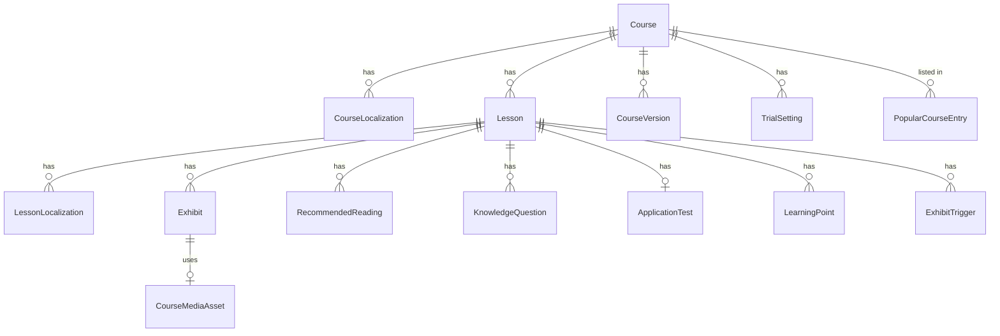
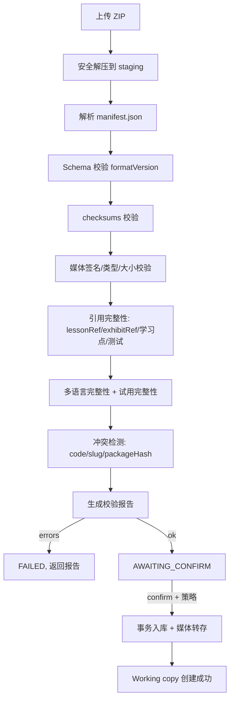

# Course 模块：课程模型 v2 与课程包导入/导出设计

| 项 | 内容 |
|---|---|
| 状态 | **Frozen（2026-10-26 评审通过，P1a 开发中）** |
| 日期 | 2026-10-26 |
| 关联 | 本文件修订 `docs/Course_Module_Architecture_Design.md`（下称 v1 文档）中与课程字段模型相关的章节 |
| 范围 | ① 课程内容模型 v2（对齐 Figma `course-management`）；② 课程素材文件的批量导入/导出；③ `docs/Modeling Life Data` 的导入可行性评估 |
| 不在范围 | Portal 展示与学习页对新模型（展品/学习点/测试/试用/UAT）的渲染改造（作为后续独立阶段）；KS / AI Tutor 内部 |
| 依据 | `docs/design/figma/course-management/*`（CM01–CM14、S01–S20）、Portal `/portal/courses` 现状、产品经理的跨环境课程包需求 |

---

## 0. 结论摘要（TL;DR）

1. **Figma 的课程模型远大于 v1 文档**。v1 基于 Portal `ProductCourse`（章节/课时/富内容），而 Figma 增加了多语言、学习模式、展品（Exhibits）、视频学习点、展品触发器、推荐阅读、知识测试、应用测试、试用截止、Working copy → UAT → Approve → Go Live、版本历史、热门课程、发现横幅、Online/Hidden/Offline。**v1 的字段模型（§4.2/§4.3）升级为 v2**。
2. **商品课程 / KS 课程两实体拆分、Admin 单一写入、Portal 只读消费**等 v1 结论继续有效；只有"课程内容模型"被替换。
3. **课程包采用自包含 ZIP**（`manifest.json` + 全量媒体 + 可选源文件 + `checksums.sha256`），可从一个环境导出、原样导入另一个环境（SIT → UAT → PROD）。
4. **导入落点为 Working copy / Draft**，之后按 Figma 流程 Publish to UAT → Approve → Go Live；PROD 不再手工配置课程。
5. **API 与页面都要支持，API 是底层原语**：页面给员工用（上传/校验/报告），API/CLI 给环境晋级与自动化用（可重复、可断点、可审计）。
6. **`Modeling Life Data` 可以导入，但不建议做"通用原始文件摄取"**。推荐：用其 `xlsx` 作为结构源、媒体作为素材，通过一次性转换器生成**标准课程包**，再走同一导入 API；Figma 的 `.docx` / sheet / 批量展品上传是**逐课时编辑期**的辅助导入，与"整包迁移"是两条不同的通道。
7. **课程包导入/导出是长任务**：采用异步作业（导入/导出 job）+ 进度轮询 + 校验报告 + 幂等键，避免大文件（视频可达数百 MB）阻塞请求。

---

## 1. 范围与术语

| 术语 | 含义 |
|---|---|
| 课程包 / Course Package | 一个自包含 ZIP，包含课程全部元数据与媒体，用于跨环境迁移或备份 |
| 源素材 / Source Material | 编辑期原始文件（docx、xlsx、图片、视频），不是课程包 |
| Working copy | 课程当前可编辑草稿（Figma 的 Current / Working copy） |
| UAT | 发布到预发布环境供测试的内容版本 |
| Approve for release | 对 UAT 内容确认已测试；之后可 Go Live |
| Version | 每次 Go Live 生成的不可变版本，可恢复 |
| Exhibit | 课时内的展品（图片 / 视频 / 3D），可批量上传、可被文本插入 |
| Learning Point (LP) | 学习点：视频按时间点、文本按 H1 标题 |
| 编号 | 课程 `C001`、课时 `L002`、展品 `E021`、问题 `K-0201` |

---

## 2. 现有设计再评估（v1 vs Figma）

### 2.1 差异清单

| 维度 | v1 文档（基于 Portal `ProductCourse`） | Figma `course-management` | 结论 |
|---|---|---|---|
| 课程元数据 | `title/subtitle/description/category/level/tags` | 课程编号、分类（单值）、学习模式、学习语言、封面、双语标题/简述/概览、What you'll learn、This course provides | 需扩展 |
| 语言 | 单语 | 多语言（EN/中文），逐语言完整材料；可加不可减 | 新增 |
| 课时 | `body + contents(LessonContent[])` | 课时标题/简介（双语）、展品、视频+学习点+触发器、文本+学习点、推荐阅读 | 升级 |
| 展品 | 无独立实体（内嵌在富内容） | 独立 `Exhibit`（图/视频/3D、缩略图、来源、双语标题描述、编号） | 新增 |
| 测试 | 无 | Knowledge Test（问题+参考答案）+ Application Test（情景+参考答案） | 新增 |
| 试用 | `isPublic` 单课时 | Trial：逐课时视频截止点 + 文本截止学习点 + 复核状态 | 升级 |
| 状态 | DRAFT/PUBLISHED/ARCHIVED | Working copy / UAT / Approved / Live；Online/Hidden/Offline；版本与恢复 | 升级 |
| 运营位 | 无 | Popular Courses、Discovery Banner | 新增（Operations） |
| 审核流 | 无 | Publish to UAT → Approve → Go Live（含通知学员） | 新增 |
| 导入/导出 | 无 | 有逐课时导入（docx/sheet/批量展品）+ 未定义的整包迁移 | 新增（本文档） |

### 2.2 结论

- **课程内容模型升级为 v2**，Entity 与字段以 Figma 为准（§3）。
- **v1 的 Prisma 草案（`CommerceCourse/CourseSection/CourseLesson/CourseMediaAsset`）不足以承载 Figma**，但仍可作为 v2 的骨架（课程/章节/课时/媒体），新增语言、展品、学习点、测试、试用、版本、运营位等实体。
- **两实体（商品课程 / KS 课程）、Admin 单一写入、Portal 只读 API、保留历史 ID、媒体归 Admin** 等 v1 架构决策不变。
- **Portal 现有 `ProductCourse` 渲染**在本阶段不追新模型；Portal 仍按 v1 的"章节/课时/富内容"读取，新字段（展品/测试/试用/UAT）通过接口预留、后续阶段再渲染。这样 Admin 可以先建好完整能力，Portal 分批跟进。

---

## 3. 课程内容模型 v2（对齐 Figma）

> **已确认决策（2026-10-26）：课程层级为"课程 → 课时"两层，取消章节（`CourseSection`）。**
> 排序由课时的 `sortOrder` 承担；若历史数据有章节，迁移时把章节信息并入课时描述或保留在 `legacy` JSON。

### 3.1 概念模型



### 3.2 实体与关键字段

> 下列为设计层字段，最终以 Prisma Migrate 落地；命名沿用现有 schema 风格。

**Course（商品课程 v2）**

- `id`、`code`（`C001`，唯一，创建时分配；跨环境迁移保留）
- `slug`（唯一）
- `status`：`WORKING / IN_UAT / APPROVED / LIVE`
- `liveStatus`：`ONLINE / HIDDEN / OFFLINE`
- `learningMode`：`VIDEO_ONLY / TEXT_ONLY / VIDEO_AND_TEXT`（创建时锁定）
- `learningLanguages`：`string[]`（`en-GB` / `zh-CN`；只增不减）
- `defaultContentLanguage`
- `category`：单值枚举（Art & Humanities / History / Science / Philosophy …，与 Figma 一致）
- `coverAssetId`
- `currentUatVersionId` / `liveVersionId` / `editingVersionId`（指针）
- `approvedAt` / `approvedBy` / `lastUatPublishedAt`
- `createdAt` / `updatedAt`

**CourseLocalization（课程级多语言文本）**

- `courseId` + `language`
- `title`（≤30）、`shortDescription`（≤225）、`overview`（≤650）
- `whatYouLearn Json`（最多 6 条）
- `provides Json`（最多 6 条：preset 或 custom，含 icon、双语）

**Lesson（课时）**

- `id`、`code`（`L002`）、`courseId`、`sortOrder`
- 关联 `LessonLocalization`、`Exhibit`、`RecommendedReading`、`KnowledgeQuestion`、`ApplicationTest`、`LearningPoint`、`ExhibitTrigger`

**LessonLocalization（课时多语言）**

- `lessonId` + `language`
- `title`（≤25）、`description`（≤60）
- `videoAssetId` / `videoDurationSeconds`
- `textHtml`（富文本，学习点由 H1 派生）
- `textLearningPoints Json`（标记哪些 H1 是学习点）

**Exhibit（展品）**

- `id`、`code`（`E021`）、`lessonId`
- `type`：`IMAGE / VIDEO / MODEL3D`
- `mediaAssetId`、`thumbnailAssetId`
- `sourceText`（可选）
- `localized Json`：`{ [language]: { title, description } }`

**LearningPoint（学习点）**

- `id`、`lessonId`、`language`、`code`（`2.3`）、`title`
- `timeSeconds`（视频模式）或 `anchorHeading`（文本模式）
- `sortOrder`

**ExhibitTrigger（展品触发器，视频模式）**

- `lessonId`、`exhibitId`、`timeSeconds`

**RecommendedReading（推荐阅读）**

- `lessonId`、`language`、`type`（`BOOK / ARTICLE / PAPER`）、`title`、`author`、`whyRecommended`、`sortOrder`

**KnowledgeQuestion（知识测试题）**

- `lessonId`、`code`（`K-0201`）、`question`、`referenceAnswer`、`sortOrder`、`enabled`

**ApplicationTest（应用测试）**

- `lessonId`、`scenario`、`referenceAnswer`、`enabled`

**TrialSetting（试用）**

- `courseId`、`lessonId`、`videoCutoffSeconds`、`textCutoffLearningPointId`、`status`（`READY / RE_CONFIRM / LOCKED`）

**CourseVersion（版本）**

- `id`、`courseId`、`versionNo`、`snapshotData Json`（完整内容快照）、`sourceVersionId`（恢复来源）、`wentLiveAt`、`createdBy`

**CourseMediaAsset**（沿用 v1）

- 增加 `kind` 覆盖 `IMAGE/VIDEO/PDF/AUDIO/MODEL3D`，并支持缩略图资产。

**PopularCourseEntry / DiscoveryBanner（Operations）**

- 运营位，独立于课程内容；导出课程包时默认不包含（避免把环境运营状态带到 PROD）。

### 3.3 编号体系

- 课程 `C###`、课时 `L###`、展品 `E###`、知识题 `K-####`：在**环境内唯一**，创建时分配。
- 课程包内以 `code` 互相引用（`lessonRef`、`exhibitRef`）。
- 导入时：若目标环境不存在同 `code`，直接沿用；若冲突，按 §5.4 策略处理（默认拒绝，可选重新分配并记录映射）。

### 3.4 多语言与完整性

- 课程创建时确定 `learningMode`；`learningLanguages` 初始至少 1 种，之后可加不可减。
- 增加语言后，**所有课时**必须补齐该语言的：视频+学习点、文本+学习点、展品标题描述、Knowledge/Application Test（若启用）、试用截止点。
- 完整性检查用于：Publish to UAT（最小集）、Approve / Go Live（全部必填）、导出（标记 `incomplete`）。
- 具体分级（Import / Publish UAT / Approve / Go Live / Export）见 §17.4；试用复核见 §17.5。
- 缺失项定位到"课程/课时/语言/字段"，供 UI 高亮。

### 3.5 发布状态机

```text
WORKING --publishToUat--> IN_UAT --approve--> APPROVED --goLive--> LIVE(新版本)
   ^                          |                    |                  |
   |------ 任何保存 -----------|（取消 approval）   |                  |
   |                                                              Restore version
   +------------------------------------------------ (版本恢复到 WORKING)
```

- `liveStatus` 与内容版本独立：`ONLINE`（列出可学）、`HIDDEN`（不列出，已报名可学）、`OFFLINE`（不可学，数据保留）。
- 任何保存都会使 working copy 变为"Unpublished changes"并取消 approve。
- Go Live 生成新 `CourseVersion`，可选通知已报名学员。

### 3.6 与 v1 / Portal `ProductCourse` 的关系

| v2 实体 | 对应 v1 / Portal | 迁移方式 |
|---|---|---|
| `Course` | `CommerceCourse` | 保留骨架字段，新增状态/语言/编号 |
| `LessonLocalization.textHtml` | `CourseLesson.body` / `LessonContent` | 兼容：一期仍可存旧富内容，v2 逐步替换 |
| `Exhibit` | 旧富内容里的媒体节点 | 新增实体；旧内容保留为 `legacy contents` |
| `LessonLocalization.videoAssetId` | 旧 `contents` 的 video 节点 | 提取为独立字段 |
| `TrialSetting` | `Lesson.isPublic` | 升级为逐课时试用截止 |
| `CourseVersion` | KS `Release`（不同域） | 商品课程自己的版本，不与 KS Release 混用 |

**兼容原则：** v1 的 `sections/lessons/contents` 读模型在 Portal 侧继续可用；Admin v2 额外维护新实体。迁移脚本把旧 `contents` 映射为 v2 的 `video/text + exhibits`，无法映射的保留为 `legacyContents`。

---

## 4. 课程包格式（Package Spec v1）

### 4.1 目录结构

```text
<course-code>-<slug>-<utcTimestamp>.lgcourse.zip
├── manifest.json
├── checksums.sha256
├── media/
│   ├── cover.jpg
│   ├── exhibits/E021.jpg
│   ├── exhibits/E021.thumb.jpg
│   ├── exhibits/E022.mp4
│   ├── video/L001/en.mp4
│   └── video/L001/zh-CN.mp4
└── source/                     # 可选，仅供追溯，导入不解析
    ├── lesson01-en.docx
    └── modeling life课程信息.xlsx
```

- 扩展名 `.lgcourse.zip` 或 `.zip`；内部结构固定。
- 所有媒体用相对路径引用；禁止绝对路径、`..`、符号链接。

### 4.2 `manifest.json`（v1）

```json
{
  "format": "lg-course-package",
  "formatVersion": 1,
  "packageId": "pkg_01J...",
  "exportedAt": "2026-10-26T10:00:00.000Z",
  "source": { "environment": "SIT", "courseCode": "C001", "sourceVersion": "working" },
  "contentHash": "sha256:...",
  "incomplete": false,
  "course": {
    "code": "C001",
    "slug": "modeling-life",
    "category": "Science",
    "learningMode": "VIDEO_AND_TEXT",
    "learningLanguages": ["en-GB", "zh-CN"],
    "defaultContentLanguage": "en-GB",
    "cover": "media/cover.jpg",
    "localized": {
      "en-GB": {
        "title": "Modeling Life",
        "shortDescription": "See how mathematics models life...",
        "overview": "Centred on dynamical systems and feedback...",
        "whatYouLearn": [
          "Model real biological systems mathematically.",
          "Learn the basics of a programming language"
        ],
        "provides": [
          { "type": "preset", "key": "dualMode", "title": "Video & text dual-mode learning", "titleZh": "视频与文本双模式学习" },
          { "type": "custom", "title": "Expert-led tours", "titleZh": "专家导览", "icon": 1 }
        ]
      },
      "zh-CN": {
        "title": "生命的建模",
        "shortDescription": "...",
        "overview": "...",
        "whatYouLearn": ["..."],
        "provides": [{ "type": "preset", "key": "dualMode", "title": "视频与文本双模式学习" }]
      }
    },
    "lessons": [
      {
        "code": "L001",
        "order": 1,
        "exhibits": [
          {
            "code": "E001",
            "type": "IMAGE",
            "file": "media/exhibits/E001.jpg",
            "thumbnail": "media/exhibits/E001.thumb.jpg",
            "source": "Wikimedia Commons",
            "localized": {
              "en-GB": { "title": "A cup of coffee", "description": "Four state variables..." },
              "zh-CN": { "title": "一杯咖啡", "description": "四个状态变量……" }
            }
          }
        ],
        "localized": {
          "en-GB": {
            "title": "State Spaces, Vector Spaces and Trajectories",
            "description": "A system can be thought of as...",
            "video": {
              "file": "media/video/L001/en.mp4",
              "durationSeconds": 692,
              "learningPoints": [
                { "code": "1.1", "timeSeconds": 0, "title": "State Variables and State Spaces" }
              ],
              "exhibitTriggers": [
                { "timeSeconds": 10, "exhibitRef": "E001" }
              ]
            },
            "text": {
              "html": "<p>...</p>",
              "learningPoints": [
                { "code": "1.1", "heading": "State Variables and State Spaces", "level": 1 }
              ]
            }
          },
          "zh-CN": { "...": "..." }
        },
        "recommendedReading": {
          "en-GB": [
            { "type": "BOOK", "title": "Modeling Life", "author": "Garfinkel, Shevtsov, Guo", "why": "pp 16-23" }
          ],
          "zh-CN": []
        },
        "knowledgeTest": {
          "enabled": true,
          "questions": [
            { "code": "K-0201", "question": "What is a state?", "referenceAnswer": "A state is..." }
          ]
        },
        "applicationTest": {
          "enabled": true,
          "scenario": "Imagine you are advising...",
          "referenceAnswer": "..."
        }
      }
    ],
    "trial": {
      "enabled": true,
      "lessons": [
        { "lessonRef": "L001", "videoCutoffSeconds": null, "textCutoffLearningPoint": "1.4", "status": "READY" }
      ]
    }
  }
}
```

### 4.3 媒体与校验

- `checksums.sha256`：每行 `<sha256>  <相对路径>`，覆盖 `manifest.json` 除外的所有文件。
- 媒体类型白名单沿用 v1/Ṕortal：图片（jpg/png/gif/webp）、视频（mp4/mov/webm）、音频、PDF、3D（obj/glb）；导入时做**文件签名校验**（不仅看扩展名）。
- 视频上限：与 Figma 一致（单视频 ≤500 MB，1080p）；整包上限可配（默认 2 GB，可调）。
- 缩略图：视频/3D 必须有方形缩略图（≥400×400）；缺失时导入报错或自动生成（`sharp`，可配置）。

### 4.4 版本与来源

- `source.sourceVersion`：`working` / `live` / `version:5`；导出时固定为某一时刻的不可变快照。
- 导出 `working` 时若课程未发布，`incomplete` 可能为 `true`；导入 PROD 后仍为 Working copy，需走 Approve → Go Live。
- 运营位（Popular Courses / Banner）不在课程包内；如需迁移，另设 Operations 包（后续）。

### 4.5 兼容与演进

- `formatVersion` 整数；导入方必须支持 `<= 当前版本`；未知字段忽略（tolerant reader），未知必填字段报错。
- 破坏性变更升 `formatVersion`，并保留旧版本解析器一段时间。
- `packageId` + `contentHash` 用于幂等与去重。

---

## 5. 导入 / 导出实现方式（Admin 侧）

### 5.1 为什么"API + 页面"都要

| 场景 | 更适合 |
|---|---|
| 客户在 SIT 建好课程，整包迁移到 UAT/PROD | **API / CLI**（可重复、可纳入发布脚本、可断点、可审计） |
| 员工临时导入一份课程包、看校验报告 | **页面**（上传、可视化错误、选择冲突策略） |
| 大文件（视频数百 MB） | API 分块/异步 + CLI 断点；页面用异步作业展示进度 |
| 备份/回滚 | API 导出固定版本 |

结论：**API 是底层能力，页面是它的封装**。两者共用同一套作业与校验逻辑，不重复实现。

### 5.2 接口（员工侧，沿用 RBAC）

> 导入/导出属于高权操作，要求 Course 菜单 `PUBLISH`（即 `FULL`）；见 §9。

| 方法 | 路径 | 说明 |
|---|---|---|
| `POST` | `/api/backoffice/courses/import` | 上传课程包，创建导入作业；`multipart/form-data`（`file`）或分块 |
| `POST` | `/api/backoffice/courses/import/:jobId/chunks/:index` | 分块上传（大文件），带 `Upload-Length`、`Content-Range` |
| `GET` | `/api/backoffice/courses/import/:jobId` | 作业状态/进度/校验报告 |
| `POST` | `/api/backoffice/courses/import/:jobId/confirm` | 校验通过后确认导入（选择冲突策略/目标状态） |
| `POST` | `/api/backoffice/courses/import/:jobId/cancel` | 取消并清理 |
| `POST` | `/api/backoffice/courses/:id/export` | 创建导出作业（`version=working\|live\|version:N`） |
| `GET` | `/api/backoffice/courses/export/:jobId` | 导出状态 |
| `GET` | `/api/backoffice/courses/export/:jobId/download` | 下载生成的 ZIP（支持 `Range`） |

**请求示例（导入）：**

```http
POST /api/backoffice/courses/import
Content-Type: multipart/form-data
Idempotency-Key: 3f2a...

file=<course.lgcourse.zip>
```

响应：

```json
{ "ok": true, "data": { "jobId": "imp_01J...", "status": "VALIDATING" } }
```

**作业状态：**

```json
{
  "ok": true,
  "data": {
    "jobId": "imp_01J...",
    "status": "AWAITING_CONFIRM",
    "stage": "VALIDATED",
    "progress": 100,
    "package": { "courseCode": "C001", "slug": "modeling-life", "lessons": 8, "mediaFiles": 42, "mediaBytes": 356000000, "incomplete": false },
    "conflicts": [{ "kind": "COURSE_CODE", "existingCourseId": "...", "existingCode": "C001" }],
    "report": {
      "errors": [],
      "warnings": [{ "code": "THUMBNAIL_MISSING", "path": "media/exhibits/E022.mp4", "message": "Video requires a square thumbnail" }]
    }
  }
}
```

### 5.3 异步作业模型

新增表：

```prisma
enum CoursePackageJobKind { IMPORT EXPORT }
enum CoursePackageJobStatus {
  UPLOADING VALIDATING AWAITING_CONFIRM IMPORTING
  EXPORTING READY FAILED CANCELLED
}

model CoursePackageJob {
  id              String               @id @default(uuid())
  kind            CoursePackageJobKind
  status          CoursePackageJobStatus @default(UPLOADING)
  courseId        String?              // 导入成功后回填 / 导出源课程
  actorEmployeeId String?              @db.Uuid
  idempotencyKey  String?              @unique
  packageHash     String?
  sourceFileName  String?
  bytesTotal      Int?
  bytesReceived   Int?   @default(0)
  stage           String?
  progress        Int?   @default(0)
  manifest        Json?                 // 校验后摘要
  report          Json?                 // 错误/警告
  conflicts       Json?
  storageKey      String?              // 临时上传 / 导出产物
  error           String?
  requestId       String?
  createdAt       DateTime @default(now()) @db.Timestamptz(6)
  updatedAt       DateTime @updatedAt @db.Timestamptz(6)

  @@index([kind, status, createdAt])
  @@index([actorEmployeeId, createdAt])
}
```

- 执行方式：DB 队列 + `FOR UPDATE SKIP LOCKED`（多实例安全），见 §20。
- 大文件落临时区：`course-package-staging/<jobId>/`，完成后删除；失败清理。
- 进度：按阶段（解压/校验/媒体/入库）与字节数更新，UI 轮询（1–2 秒）或 SSE。

### 5.4 导入流程与校验



**校验项：**

- 安全：路径穿越、符号链接、zip 炸弹（解压总量/文件数上限）、扩展名与文件签名一致。
- 结构：`manifest` 必填字段、`formatVersion` 支持、`learningMode/languages` 合法、编号唯一。
- 引用：课时/展品/学习点/触发器/测试引用可解析。
- 媒体：`checksums` 匹配、类型/大小、缩略图要求、视频时长可读。
- 完整性：多语言材料齐备（缺失只产生 warning；`incomplete=true` 时允许导入但禁止 Go Live）。
- 冲突：`course.code`、`slug`、`packageHash` 是否已存在。

**媒体转存：** 入库时把 staging 的媒体复制到 Admin 私有存储（`course-media/<newCourseId>/...`），先转存后提交 DB，失败则回滚并清理 staging。

### 5.5 冲突策略

`confirm` 时传：

```json
{ "onConflict": "ABORT | CREATE_NEW_COURSE | NEW_VERSION", "reassignCodes": false }
```

| 策略 | 行为 |
|---|---|
| `ABORT`（默认） | 存在同 code/slug 即拒绝 |
| `CREATE_NEW_COURSE` | 生成新课程 code/slug（可加 `-imported-<ts>` 后缀），保留包内原始 code 于 `legacyCode` |
| `NEW_VERSION` | 仅当目标存在同 code 课程：把包内容作为该课程的新版本导入到 Working copy（覆盖前需确认） |

`reassignCodes=true` 时，包内 `L/E/K` 编号在目标冲突则重新分配，并在报告里给出映射表。

### 5.6 导出流程

- `POST .../export` → 作业；读取课程快照（`working` 直接读当前，`live` 读 `liveVersionId` 的 `snapshotData`，`version:N` 读对应版本）。
- 生成 `manifest.json` → 打包媒体（从私有存储流式读取）→ 生成 `checksums.sha256` → 输出 ZIP 到 staging → `READY`，提供带一次性下载令牌的下载链接。
- 导出默认**不含**运营位、员工/审计、内部 ID（只含 `code` 与相对路径）。
- 媒体缺失时导出失败并列出缺失项（不允许生成"坏包"）。

### 5.7 安全要求

- 上传必须登录且 `PUBLISH`；服务端二次校验，不信任前端。
- Zip 解压：限制条目数、单文件/总量、禁止 `..` 与绝对路径、禁止符号链接。
- 文件签名校验复用 `course-media` 的校验器；不可执行文件类型直接拒绝。
- 病毒扫描：可选接入（上传后、确认前）；未接入时记录为已知风险。
- 幂等：`Idempotency-Key` + `packageHash`，重复请求返回同一作业。
- 审计：导入/导出各写一条 `CourseAuthoringActivity`（含 `packageId`、`contentHash`、结果）。
- 限流与配额：按员工/时间窗口限制作业数；整包大小上限可配。

### 5.8 CLI 与环境晋级

新增脚本（放在 Admin `server/scripts/` 或独立 `tools/`）：

```bash
# 从 SIT 导出课程包
node scripts/course-package.mjs export --base https://admin-sit.example --token $TOKEN --course C001 --version working --out modeling-life.zip

# 导入到 UAT（校验后确认）
node scripts/course-package.mjs import --base https://admin-uat.example --token $TOKEN --file modeling-life.zip --conflict NEW_VERSION

# 晋级到 PROD
node scripts/course-package.mjs import --base https://admin.example --token $TOKEN --file modeling-life.zip --conflict CREATE_NEW_COURSE
```

- CLI 鉴权：**迁移专用令牌**（scoped `course:package:import` / `course:package:export`，仅 ADMIN 可签发，可轮换），避免用员工 Cookie。
- 支持断点续传（分块接口）、失败重试、`--dry-run`（只校验不导入）。
- 典型晋级链：`SIT working → UAT working → 测试 → UAT approve → PROD working → PROD approve → Go Live`。若产品希望"UAT 已 approve 的内容直接作为 PROD working"，导出 `version` 时用 `sourceVersion=working` 并在 PROD 重新走流程（推荐，状态不跨环境搬运）。

---

## 6. Admin 前端设计

### 6.1 Course Overview（CM01）入口

- 页头 `+ Create Course` 旁新增 `Import Course`（`PUBLISH` 才显示）。
- 表格行操作新增 `Export`（下拉：Working copy / Live version / 指定版本）。
- 列表新增"Import/Export 作业"入口，展示进行中与历史作业。

### 6.2 导入向导

```text
步骤 1 上传    拖拽/选择 .zip（显示大小，超限即拒）
步骤 2 校验    进度条 + 阶段（解压/校验/媒体/完整性/冲突）
步骤 3 报告    错误（阻断）/ 警告（可继续）/ 冲突选择（ABORT/CREATE_NEW/NEW_VERSION）
步骤 4 导入    进度 + 结果；成功跳转课程编辑器（Working copy）
```

- 报告可导出（JSON/CSV），错误定位到文件行/字段。
- 大文件上传显示速率与剩余时间；支持取消。
- 无障碍与 Figma 视觉：沿用 `docs/design/README.md` 的弹窗/表格规范（弹窗 832 宽、输入 44 高、状态色）。

### 6.3 导出向导

- 选择版本 → 生成 → 下载；显示包大小、媒体数量、是否 `incomplete`。
- 结束后提供"复制 CLI 命令"（便于运维在另一环境执行）。

### 6.4 与 Figma 逐课时导入的关系

Figma 的逐课时导入是**编辑期**能力，和"整包迁移"是两条通道，共用底层校验：

| Figma 功能 | 归属 | 与整包导入的关系 |
|---|---|---|
| `S09 Import .docx`（文本编辑器） | 编辑期 | 解析 docx→HTML + H1 学习点；不涉及整包 |
| `S13 Knowledge Test import from sheet` | 编辑期 | 解析 xlsx/csv 题表，追加到当前课时 |
| `S19 Import Understanding all lessons` | 编辑期 | 一次性导入全部课时的 KT/AT |
| `S20 Import recommended reading` | 编辑期 | 导入全部课时阅读清单 |
| `S06/S07 batch exhibits upload` | 编辑期 | 批量媒体上传，类型识别 |
| **整包导入/导出（本文档）** | 迁移/备份 | 包含上述全部结果 + 媒体二进制 |

实现顺序建议：先整包（迁移刚需），再做逐课时导入（编辑效率）。

---

## 7. `Modeling Life Data` 导入评估

### 7.1 文件清单与映射

| 文件 | 映射到 v2 / 课程包 |
|---|---|
| `modeling life课程信息.xlsx` | **结构主源**：`course info` → 课程元数据；`Lessons` → 课时/学习点/视频节点/展品触发器；`exploration-reading list` → 推荐阅读 + 展品；`knowledge test` / `application test` → 测试 |
| `Lesson 1/2 文本课件.docx` | 课时文本内容（`textHtml`）。结构复杂（无 H1、271 段、20 表格、12 图），需转换 + 人工校对 |
| `Lesson 1/2视频课件.mp4` | 课时视频（`videoAssetId`），时长可读 |
| `lesson1-exhibit-1/2.png` | 展品图片 |
| `lesson1-exhibit1/2缩略图.png` | 展品缩略图 |
| `课程封面.png` | 课程封面 |

### 7.2 xlsx 是天然模板

- 5 个 sheet 与 Figma 的导入模板语义一致；`Lessons` 里已经有"文本 Learning point / 视频 Learning point / 视频开始节点 / exhibit 弹窗触发节点 / exhibit 标题 / 简述 / 来源"等列。
- 因此 **xlsx 可作为课程结构的权威来源**，比 docx 可靠得多。

### 7.3 docx 的复杂度与两种策略

| 策略 | 做法 | 优点 | 缺点 |
|---|---|---|---|
| A. 转换器解析（推荐用于本样例） | 按课标题/表格边界切分，提取段落/表格/图片为 HTML；内嵌图片按哈希去重生成展品草稿 | 一次成型，接近成品 | docx 排版不规范时需人工校对；图片与展品编号需人工确认 |
| B. 逐课时 `.docx` 导入（Figma S09） | 作者在文本编辑器里导入 docx，手动设 H1 学习点 | 可控、贴近产品交互 | 人力成本高，不适合"整包迁移" |

**结论：** 对 `Modeling Life` 这类客户交付素材，用 **A（一次性转换器）** 生成标准课程包；产品内的通用能力只做 **B** 的规范化导入（要求文档用 H1 标记学习点）。

### 7.4 媒体映射

- mp4 → `LessonLocalization.video`（EN）；中文视频若缺，标记 `incomplete`。
- png → `Exhibit`（图片 + 缩略图）；封面 → `Course.cover`。
- 视频/3D 若无缩略图则用 `sharp` 从首帧生成方形缩略图（可配置），避免导入失败。
- 大视频（139 MB / 21 MB）在课程包内直接包含；导出/导入走流式与分块。

### 7.5 推荐方案（可落地）

1. 写一个**一次性转换脚本**（`scripts/modeling-life-to-package.mjs`）：
   - 读 xlsx → 课程/课时/学习点/触发器/阅读/测试；
   - docx → `textHtml`（按标题/表格切分，图片转存并登记）；
   - 媒体 → 复制到包内 `media/`，生成缩略图；
   - 产出 `manifest.json` + `checksums.sha256` → `modeling-life.lgcourse.zip`。
2. 通过 **导入 API** 导入到目标环境（先 SIT 验证，再 UAT/PROD）。
3. 人工在 Admin 里补齐：展品标题/描述、中文材料、学习点校验、试用截止点。
4. 以这门课作为导入/导出与 v2 模型的**端到端验收样例**。

### 7.6 明确的"不做"

- 不做"上传任意 docx/xlsx 自动变成课程"的通用向导（结构不可控、维护成本高）。
- 不解析 `source/` 里的原始文件 by import API（仅随包留存，供追溯）。

---

## 8. 与 Portal 的关系（本阶段）

- `/api/portal/v1/**` 继续按 v1 契约提供"章节/课时/富内容"读模型，保证 Portal 现有页面不受影响。
- v2 新字段（展品、学习点、触发器、测试、试用、UAT）通过**新增** `/api/portal/v2/**` 暴露，默认关闭、就绪后按开关启用（见 §22）。
- 课程包导出/导入**不涉及 Portal**；Portal 只消费发布后的 Live 快照。
- 媒体仍由 Admin 存私有对象并签发短期 URL（v1 §7.6）。

---

## 9. 权限与审计

| 操作 | 要求 |
|---|---|
| 查看导入/导出作业 | Course `VIEW` |
| 创建导入/导出作业 | Course `PUBLISH`（`FULL`） |
| 确认导入 / 选择冲突策略 | Course `PUBLISH`（`FULL`） |
| 下载导出包 | 作业创建者或 `FULL` |
| CLI 迁移令牌 | 仅 ADMIN 签发，scope 限定 `course:package:*`，可轮换 |

审计：`CourseAuthoringActivity` 增加 `IMPORT_STARTED / IMPORT_CONFIRMED / EXPORT_CREATED / EXPORT_DOWNLOADED`，记录 `jobId`、`packageId`、`contentHash`、`courseCode`、结果、`requestId`。

---

## 10. 分阶段路线（对 v1 P0–P3 的调整）

> **已确认优先级：课程包导入/导出优先（package-first）。**
> 注意：存储模型必须**完整覆盖课程包内容**（否则导入会丢字段），"最小"指的是 **UI 范围**最小化，而不是数据模型缩减。

| 阶段 | 内容 |
|---|---|
| **P0 契约冻结** | v2 Prisma schema + 包格式 v1 + 导入/导出 API 契约定稿（见 §14–§17）；产品确认完整性规则、冲突策略、语言口径 |
| **P1a 课程包能力（优先）** | 完整 v2 存储模型；媒体存储；`CoursePackageJob` 异步作业；**导入/导出 API + CLI**；最小 UI（列表、课程详情只读、导入向择、导出、作业列表）；发布工作流动作（Publish to UAT / Approve / Go Live / 状态 / 恢复版本）；`Modeling Life` 转换器与端到端样例 |
| **P1b 完整编辑器** | Figma CM01–CM14 的可视化编辑（多语言、展品、学习点、触发器、KT/AT、Trial）；逐课时导入（docx / sheet / 批量展品） |
| **P2 迁移与双跑** | 用整包导入把 SIT 课程迁到 UAT；Portal 读 v1 投影；观察期 |
| **P3 切换收口** | Portal 只读 Admin；后续再启动 Portal 对新模型的渲染改造 |

---

## 11. 测试与验收

### 11.1 导入/导出

- 单元：manifest 解析、schema 校验、checksums、路径安全、冲突策略、编号重分配、媒体签名校验、完整性检查。
- e2e：导出 working/live/version → 导入（三种冲突策略）→ 状态为 Working copy → 完整性/字段逐项比对；幂等重复导入；坏包（缺 checksum、坏媒体、zip 炸弹）被拒。
- 大文件：≥500 MB 视频分块上传与断点续传。
- 安全：zip slip、符号链接、错误 MIME、超限、越权（非 FULL）均被拒。

### 11.2 Modeling Life 样例

- 转换器产出包 → 导入 SIT → 人工核对：课程信息、2 个课时、学习点、展品、阅读、KT/AT、视频时长、封面。
- 导出该课程 → 导入另一环境 → 双读比对课程数/课时数/媒体数/checksum 一致。

### 11.3 人工验收

1. 从列表导入 `.zip`，看到校验报告与冲突项，确认后进入 Working copy。
2. 导出 Live 版本，包内 `manifest.json` 与媒体完整、`checksums` 正确。
3. CLI 从 SIT 导出并在 UAT 导入成功。
4. 非 FULL 角色看不到导入/导出入口，直接调 API 返回 403。

---

## 12. 风险与开放问题

| # | 风险/问题 | 处置 |
|---|---|---|
| 1 | v2 编辑器工作量远超 v1 | 先做"导入/导出 + 最小 v2 模型"，完整编辑器分批；需确认优先级 |
| 2 | 课程包体积大（视频数百 MB） | 流式 + 分块 + 异步作业 + 可配置上限；必要时"媒体包"可选拆分 |
| 3 | 跨环境媒体权限/S3 权限 | 统一用 Admin 私有存储；导入时服务端转存，不依赖目标环境外部桶 |
| 4 | docx 结构不规范 | 只对规范化文档做通用导入；Modeling Life 用一次性转换器 + 人工校对 |
| 5 | 编号冲突 | 默认拒绝；可选重分配并输出映射 |
| 6 | 语言/试用的"完整性"口径 | 需产品确认哪些缺失算 warning、哪些阻断 Go Live |
| 7 | 运营位（热门课程/横幅）是否随包迁移 | **已确认：不随包迁移**（见 §18）；如需，另设 Operations 包 |
| 8 | 病毒扫描 | 可选；未接入时记录风险并限制类型 |
| 9 | 多实例作业执行 | 单实例先用；多实例需 DB 锁或队列 |
| 10 | v1 旧 `contents` 与 v2 展品的映射 | **已确认：尽力映射，无法映射的保留 `legacyContents`**（见 §21） |

---

## 13. 附录

### 13.1 错误码（导入/导出）

| HTTP | code | 说明 |
|---|---|---|
| 400 | `PACKAGE_INVALID_ZIP` | 非法 ZIP / zip slip / 符号链接 |
| 400 | `PACKAGE_MANIFEST_INVALID` | manifest 缺失或字段非法 |
| 415 | `PACKAGE_FORMAT_UNSUPPORTED` | `formatVersion` 不支持 |
| 422 | `PACKAGE_CHECKSUM_MISMATCH` | 文件校验和不符 |
| 422 | `PACKAGE_MEDIA_INVALID` | 媒体类型/签名/缩略图不合规 |
| 409 | `PACKAGE_CONFLICT` | code/slug 冲突且策略为 ABORT |
| 413 | `PACKAGE_TOO_LARGE` | 超过整包/单文件上限 |
| 403 | `PACKAGE_FORBIDDEN` | 非 FULL 或令牌 scope 不足 |
| 404 | `PACKAGE_JOB_NOT_FOUND` | 作业不存在 |
| 410 | `PACKAGE_EXPORT_EXPIRED` | 下载令牌过期 |
| 503 | `PACKAGE_STORAGE_UNAVAILABLE` | 存储不可用 |

### 13.2 相关文件索引

- Figma：`docs/design/figma/course-management/`（`manifest.json` 列出全部画板；`0-1.metadata.json` 含文本节点）
- 样例素材：`docs/Modeling Life Data/`
- v1 文档：`docs/Course_Module_Architecture_Design.md`
- Admin 参考：`server/src/commerce-courses/`（待建）、`server/src/courses/*`、`server/src/common/guards/*`、`server/prisma/schema.prisma`
- Portal 参考：`services/productStore.ts`、`services/courseMedia.ts`、`contracts/lesson-content.ts`

### 13.3 变更记录

| 日期 | 变更 |
|---|---|
| 2026-10-26 | 初稿：v2 模型（对齐 Figma）、课程包格式 v1、导入/导出 API 与作业、Modeling Life 导入评估 |
| 2026-10-26 | R2：确认 package-first 优先级；补充 §14 完整 v2 Prisma schema、§15 接口契约（请求/响应/错误码）、§16 包字段与限制、§17 发布工作流 |
| 2026-10-26 | R3：确认"课程→课时"两层；确认完整性口径（UAT 最小集、Course Information 必填项、RE_CONFIRM 阻断 Approve/Go Live） |
| 2026-10-26 | R4：确认运营位不随包迁移、分类自动创建；新增 §18 运营位与分类 |
| 2026-10-26 | R5：确认媒体上限（视频 500 MB）、缩略图策略、P1 不接入病毒扫描；新增 §19 |
| 2026-10-26 | R6：确认 DB 队列 + SKIP LOCKED 与并发/重试参数；新增 §20 |
| 2026-10-26 | R7：确认章节拍平 + legacy 保留；新增 §21 v1→v2 迁移映射 |
| 2026-10-26 | R8：确认 /api/portal/v2 并存、v1 合成章节、v2 开关启用；新增 §22 |
| 2026-10-26 | R9：用户确认冻结设计并进入 P1a；状态更新为 Frozen（开发待启动） |

---

## 14. 附录 A：v2 Prisma 完整草案

> 目标：**存储模型完整覆盖课程包内容**，保证"导出→导入"不丢字段。UI 可以先最小化（P1a），但表结构不缩减。
> 与 v1 的 `CommerceCourse` 命名为同一实体，字段扩展；KS 的 `Course` 模型不改，只加 `commerceCourseId`。

```prisma
// ===== 枚举 =====

enum CourseLifecycleStatus {
  WORKING   // 可编辑草稿
  IN_UAT    // 已发布到 UAT
  APPROVED  // 已审批，可上线
  LIVE      // 已上线（存在 liveVersionId）
}

enum CourseLiveStatus {
  ONLINE   // 列出、可学
  HIDDEN   // 不列出，已报名可学
  OFFLINE  // 不可学，数据保留
}

enum LearningMode {
  VIDEO_ONLY
  TEXT_ONLY
  VIDEO_AND_TEXT
}

enum ExhibitType {
  IMAGE
  VIDEO
  MODEL3D
}

enum ReadingType {
  BOOK
  ARTICLE
  PAPER
}

enum TrialRowStatus {
  READY
  RE_CONFIRM
  LOCKED
}

enum LearningPointSource {
  VIDEO
  TEXT
}

enum CourseMediaKind {
  IMAGE
  VIDEO
  PDF
  AUDIO
  MODEL3D
}

// ===== 课程聚合 =====

model CommerceCourse {
  id                    String                @id @default(uuid())
  code                  String                @unique          // C001
  slug                  String                @unique
  categoryId            String?
  category              CourseCatalogueEntry? @relation("CourseCategory", fields: [categoryId], references: [id])
  learningMode          LearningMode
  defaultContentLanguage String               @default("en-GB")
  learningLanguages     Json                                   // string[]
  coverAssetId          String?
  cover                 CourseMediaAsset?     @relation("CourseCover", fields: [coverAssetId], references: [id])

  lifecycleStatus       CourseLifecycleStatus @default(WORKING)
  liveStatus            CourseLiveStatus      @default(HIDDEN)
  liveVersionId         String?
  currentUatVersionId   String?
  approvedAt            DateTime?
  approvedBy            String?               @db.Uuid        // employeeId
  lastUatPublishedAt    DateTime?

  legacyCategory        String?                                // 迁移过渡
  legacyAuthorIds       Json?                                  // 迁移过渡
  createdAt             DateTime              @default(now())
  updatedAt             DateTime              @updatedAt

  localizations CourseLocalization[]
  lessons       Lesson[]
  versions      CourseVersion[]
  media         CourseMediaAsset[]            @relation("CourseMedia")
  trialRows     TrialSetting[]
  authors       CommerceCourseAuthor[]
  activities    CourseAuthoringActivity[]
  plans         CoursePlan[]
  ksCourse      Course?

  @@index([lifecycleStatus, updatedAt])
  @@index([liveStatus])
  @@index([categoryId])
}

model CourseLocalization {
  id               String         @id @default(uuid())
  courseId         String
  course           CommerceCourse @relation(fields: [courseId], references: [id], onDelete: Cascade)
  language         String                              // en-GB / zh-CN
  title            String                              // <=30
  shortDescription String?                             // <=225
  overview         String?        @db.Text             // <=650
  whatYouLearn     Json?                               // string[] <=6
  provides         Json?                               // [{type,key?,title,titleZh?,icon?}] <=6

  @@unique([courseId, language])
}

model Lesson {
  id        String         @id @default(uuid())
  courseId  String
  course    CommerceCourse @relation(fields: [courseId], references: [id], onDelete: Cascade)
  code      String                                    // L002
  sortOrder Int
  createdAt DateTime       @default(now())
  updatedAt DateTime       @updatedAt

  localizations    LessonLocalization[]
  exhibits         Exhibit[]
  readings         RecommendedReading[]
  questions        KnowledgeQuestion[]
  applicationTest  ApplicationTest?
  learningPoints   LearningPoint[]
  triggers         ExhibitTrigger[]

  @@unique([courseId, code])
  @@index([courseId, sortOrder])
}

model LessonLocalization {
  id                   String           @id @default(uuid())
  lessonId             String
  lesson               Lesson           @relation(fields: [lessonId], references: [id], onDelete: Cascade)
  language             String
  title                String                              // <=25
  description          String?                            // <=60
  videoAssetId         String?
  video                CourseMediaAsset? @relation("LessonVideo", fields: [videoAssetId], references: [id])
  videoDurationSeconds Int?
  textHtml             String?          @db.Text
  textLearningPoints   Json?                                // [{code,heading,level}]

  @@unique([lessonId, language])
}

model Exhibit {
  id              String          @id @default(uuid())
  lessonId        String
  lesson          Lesson          @relation(fields: [lessonId], references: [id], onDelete: Cascade)
  code            String                       // E021
  type            ExhibitType
  mediaAssetId    String?
  media           CourseMediaAsset? @relation("ExhibitMedia", fields: [mediaAssetId], references: [id])
  thumbnailAssetId String?
  thumbnail       CourseMediaAsset? @relation("ExhibitThumbnail", fields: [thumbnailAssetId], references: [id])
  sourceText      String?
  localized       Json                         // { [lang]: { title, description } }
  createdAt       DateTime        @default(now())
  updatedAt       DateTime        @updatedAt

  @@unique([lessonId, code])
}

model LearningPoint {
  id            String              @id @default(uuid())
  lessonId      String
  lesson        Lesson              @relation(fields: [lessonId], references: [id], onDelete: Cascade)
  language      String
  code          String                        // 2.3
  title         String
  source        LearningPointSource
  timeSeconds   Int?                          // 视频模式
  anchorHeading String?                       // 文本模式
  sortOrder     Int

  @@unique([lessonId, language, code])
}

model ExhibitTrigger {
  id          String  @id @default(uuid())
  lessonId    String
  lesson      Lesson  @relation(fields: [lessonId], references: [id], onDelete: Cascade)
  exhibitId   String
  language    String
  timeSeconds Int

  @@unique([lessonId, exhibitId, language])
}

model RecommendedReading {
  id             String      @id @default(uuid())
  lessonId       String
  lesson         Lesson      @relation(fields: [lessonId], references: [id], onDelete: Cascade)
  language       String
  type           ReadingType
  title          String
  author         String?
  whyRecommended String?     @db.Text
  sortOrder      Int

  @@index([lessonId, language, sortOrder])
}

model KnowledgeQuestion {
  id              String  @id @default(uuid())
  lessonId        String
  lesson          Lesson  @relation(fields: [lessonId], references: [id], onDelete: Cascade)
  code            String                     // K-0201
  question        String  @db.Text
  referenceAnswer String? @db.Text
  sortOrder       Int
  enabled         Boolean @default(true)

  @@unique([lessonId, code])
}

model ApplicationTest {
  id              String  @id @default(uuid())
  lessonId        String  @unique
  lesson          Lesson  @relation(fields: [lessonId], references: [id], onDelete: Cascade)
  scenario        String  @db.Text
  referenceAnswer String? @db.Text
  enabled         Boolean @default(true)
}

model TrialSetting {
  id                       String         @id @default(uuid())
  courseId                 String
  course                   CommerceCourse @relation(fields: [courseId], references: [id], onDelete: Cascade)
  lessonId                 String
  videoCutoffSeconds       Int?
  textCutoffLearningPointId String?
  status                   TrialRowStatus @default(LOCKED)

  @@unique([courseId, lessonId])
}

// ===== 版本 =====

model CourseVersion {
  id              String         @id @default(uuid())
  courseId        String
  course          CommerceCourse @relation(fields: [courseId], references: [id], onDelete: Cascade)
  versionNo       Int
  snapshotData    Json                         // 完整内容快照（等价 manifest.course，不含二进制）
  sourceVersionId String?                      // 恢复来源
  wentLiveAt      DateTime?
  createdBy       String?        @db.Uuid
  createdAt       DateTime       @default(now())

  @@unique([courseId, versionNo])
  @@index([courseId, wentLiveAt])
}

// ===== 媒体（沿用 v1，增加 kind/checksum） =====

model CourseMediaAsset {
  id           String          @id @default(uuid())
  courseId     String
  course       CommerceCourse  @relation("CourseMedia", fields: [courseId], references: [id], onDelete: Cascade)
  kind         CourseMediaKind
  originalName String
  mimeType     String
  extension    String
  size         Int
  storageKey   String          @unique
  checksum     String?                             // sha256
  createdBy    String?         @db.Uuid
  createdAt    DateTime        @default(now())

  coverFor         CommerceCourse?     @relation("CourseCover")
  exhibitMedia     Exhibit[]           @relation("ExhibitMedia")
  exhibitThumbnail Exhibit[]           @relation("ExhibitThumbnail")
  lessonVideos     LessonLocalization[] @relation("LessonVideo")

  @@index([courseId, kind])
}

// ===== 运营位（默认不随课程包迁移）=====

model PopularCourseEntry {
  id        String         @id @default(uuid())
  courseId  String
  course    CommerceCourse @relation(fields: [courseId], references: [id], onDelete: Cascade)
  sortOrder Int
  createdAt DateTime       @default(now())

  @@unique([courseId])
  @@index([sortOrder])
}

model DiscoveryBanner {
  id          String   @id @default("singleton")
  enabled     Boolean  @default(false)
  courseId    String?
  localized   Json                         // { [lang]: { headline, subheading, button } }
  updatedAt   DateTime @updatedAt
}
```

**与 v1 的差异**：v1 `CourseSection` 在 v2 中取消——Figma 是"课程 → 课时"两层（没有章节），课时用 `sortOrder` 排序。若历史数据有章节，迁移时把章节标题并入课时描述或保留在 `legacy` JSON。

**KS 关联（不变）：**

```prisma
model Course {
  // ...现有字段...
  commerceCourseId String?         @unique
  commerceCourse   CommerceCourse? @relation(fields: [commerceCourseId], references: [id], onDelete: SetNull)
}
```

---

## 15. 附录 B：接口契约（P1a 范围）

> 所有接口走员工会话 + `route-access` 守卫；响应信封沿用 `transform.interceptor.ts`。
> 时间均为 ISO-8601 UTC；`language` 取值 `en-GB` / `zh-CN`。

### 15.1 课程列表

`GET /api/backoffice/courses?search=&lifecycleStatus=&liveStatus=&categoryId=&page=&pageSize=`

- 权限：Course `VIEW`
- 响应：

```json
{
  "ok": true,
  "data": {
    "courses": [
      {
        "id": "uuid",
        "code": "C001",
        "slug": "modeling-life",
        "title": "Modeling Life",
        "category": { "id": "...", "name": "Science" },
        "learningMode": "VIDEO_AND_TEXT",
        "learningLanguages": ["en-GB", "zh-CN"],
        "lessonCount": 2,
        "lifecycleStatus": "WORKING",
        "liveStatus": "HIDDEN",
        "workingNote": "UNPUBLISHED_CHANGES",
        "liveVersionNo": 4,
        "updatedAt": "2026-10-26T10:00:00.000Z",
        "updatedBy": { "employeeId": "...", "displayName": "Jack" }
      }
    ],
    "total": 1, "page": 1, "pages": 1,
    "counts": { "total": 1, "working": 1, "inUat": 0, "approved": 0, "live": 0 }
  }
}
```

### 15.2 课程详情

`GET /api/backoffice/courses/:id`

- 权限：Course `VIEW`
- 响应返回完整 v2 结构（元数据 + 各语言 + 课时 + 展品 + 学习点 + 测试 + 试用 + 版本摘要），字段与 §16 的 manifest `course` 一致，另加数据库 `id` 与 `liveVersion`。
- 列表不返回大字段；详情才返回 `textHtml`、`overview` 等。

### 15.3 导入（创建作业）

`POST /api/backoffice/courses/import`

- 权限：Course `PUBLISH`
- 头：`Idempotency-Key`（可选）、`Content-Type: multipart/form-data`
- 体：`file=<.lgcourse.zip>`（≤ 单次上限，默认 200 MB）
- 响应：

```json
{ "ok": true, "data": { "jobId": "imp_...", "status": "VALIDATING" } }
```

**大文件（>单次上限）分块：**

| 方法 | 路径 | 说明 |
|---|---|---|
| `POST` | `/import/sessions` | 体 `{fileName, bytesTotal, packageHash?}` → `{jobId, chunkSize}` |
| `PUT` | `/import/:jobId/chunks/:index` | 二进制块 + `Content-Range` |
| `POST` | `/import/:jobId/complete` | 体 `{chunks: n}` → 开始校验 |

### 15.4 作业状态

`GET /api/backoffice/courses/import/:jobId`

- 权限：Course `VIEW`（创建者或 FULL）
- 响应：

```json
{
  "ok": true,
  "data": {
    "jobId": "imp_...",
    "status": "AWAITING_CONFIRM",
    "stage": "VALIDATED",
    "progress": 100,
    "package": { "packageId": "pkg_...", "courseCode": "C001", "slug": "modeling-life", "lessons": 2, "mediaFiles": 8, "mediaBytes": 165000000, "incomplete": false },
    "conflicts": [],
    "report": { "errors": [], "warnings": [] }
  }
}
```

`status` 取值：`UPLOADING | VALIDATING | AWAITING_CONFIRM | IMPORTING | READY | FAILED | CANCELLED`。

### 15.5 确认导入

`POST /api/backoffice/courses/import/:jobId/confirm`

- 权限：Course `PUBLISH`
- 体：

```json
{ "onConflict": "ABORT | CREATE_NEW_COURSE | NEW_VERSION", "reassignCodes": false, "targetCourseId": "uuid|null" }
```

- 成功响应：

```json
{ "ok": true, "data": { "jobId": "imp_...", "status": "READY", "courseId": "uuid", "warnings": [] } }
```

- 失败：`409 PACKAGE_CONFLICT`（ABORT 且存在冲突）。

`POST /api/backoffice/courses/import/:jobId/cancel`

- 权限：Course `PUBLISH`；清理 staging，置 `CANCELLED`。

### 15.6 导出

`POST /api/backoffice/courses/:id/export`

- 权限：Course `PUBLISH`
- 体：

```json
{ "version": "working | live | version:4" }
```

- 响应：

```json
{ "ok": true, "data": { "jobId": "exp_...", "status": "EXPORTING" } }
```

`GET /api/backoffice/courses/export/:jobId`

```json
{ "ok": true, "data": { "jobId": "exp_...", "status": "READY", "sizeBytes": 165000000, "downloadToken": "onetime...", "expiresAt": "..." } }
```

`GET /api/backoffice/courses/export/:jobId/download?token=...`

- 返回 `application/zip`，支持 `Range`；一次性令牌过期返回 `410 PACKAGE_EXPORT_EXPIRED`。

### 15.7 发布工作流（P1a 必需）

| 方法 | 路径 | 体 | 权限 |
|---|---|---|---|
| `POST` | `/courses/:id/publish-uat` | `{ expectedUpdatedAt }` | PUBLISH |
| `POST` | `/courses/:id/approve` | `{ expectedUpdatedAt }` | PUBLISH |
| `POST` | `/courses/:id/go-live` | `{ expectedUpdatedAt, notifyLearners: boolean }` | PUBLISH |
| `POST` | `/courses/:id/live-status` | `{ status: "ONLINE|HIDDEN|OFFLINE", reason?, expectedUpdatedAt }` | PUBLISH |
| `POST` | `/courses/:id/restore` | `{ versionId, expectedUpdatedAt }` | EDIT_EXISTING |

- 均返回最新课程摘要；`expectedUpdatedAt` 不匹配返回 `409 COURSE_STALE_VERSION`。
- `go-live` 生成新 `CourseVersion`（`snapshotData` 为当前 working copy），更新 `liveVersionId`，可选通知学员。
- `approve` 前要求 `lifecycleStatus = IN_UAT` 且内容完整（§3.4）。

### 15.8 错误码（补充）

| HTTP | code | 场景 |
|---|---|---|
| 400 | `COURSE_INVALID_INPUT` | DTO 校验失败 |
| 403 | `COURSE_FORBIDDEN` | 角色级别不足 |
| 404 | `COURSE_NOT_FOUND` | 课程/版本/作业不存在 |
| 409 | `COURSE_STALE_VERSION` | `expectedUpdatedAt` 不匹配 |
| 409 | `PACKAGE_CONFLICT` | 编号/slug 冲突 |
| 422 | `COURSE_INCOMPLETE` | 完整性不足，无法 UAT/Approve/Go Live |
| 422 | `COURSE_INVALID_TRANSITION` | 状态机不允许的流转 |
| 422 | `PACKAGE_CHECKSUM_MISMATCH` / `PACKAGE_MEDIA_INVALID` | 见 §13.1 |
| 429 | `RATE_LIMITED` | 作业/上传超限 |

---

## 16. 附录 C：manifest 字段与限制

### 16.1 课程级

| 字段 | 必填 | 限制 / 说明 |
|---|---|---|
| `course.code` | 是 | `C\d{3,}`；目标冲突按策略处理 |
| `course.slug` | 是 | 小写、`a-z0-9-`，≤80 |
| `course.category` | 是 | 必须是目标环境存在的分类名，否则导入报错（或按配置自动创建） |
| `course.learningMode` | 是 | `VIDEO_AND_TEXT / VIDEO_ONLY / TEXT_ONLY`；与课时内容一致 |
| `course.learningLanguages` | 是 | 至少 1；必须含 `defaultContentLanguage` |
| `course.localized[lang].title` | 是 | ≤30 字符 |
| `shortDescription` | 否 | ≤225 |
| `overview` | 否 | ≤650 |
| `whatYouLearn` | 否 | ≤6 条，每条 ≤55（英文）/≤25（中文，建议） |
| `provides` | 否 | ≤6 条；`type=preset` 需 `key`，`type=custom` 需 `title` |

### 16.2 课时级

| 字段 | 必填 | 限制 |
|---|---|---|
| `lesson.code` | 是 | `L\d{3,}`，课程内唯一 |
| `lesson.order` | 是 | 正整数 |
| `localized[lang].title` | 是 | ≤25 |
| `description` | 否 | ≤60 |
| `video.file` | 条件 | `learningMode` 含视频时必填 |
| `video.durationSeconds` | 否 | 导入时可由文件读取校验 |
| `video.learningPoints[].timeSeconds` | 是 | ≥0 且 ≤时长；`code` 唯一 |
| `video.exhibitTriggers[].exhibitRef` | 是 | 必须指向本课时展品 |
| `text.html` | 条件 | `learningMode` 含文本时必填；≤ 内容限额 |
| `text.learningPoints[].heading` | 是 | 必须是 HTML 中的 H1 |
| `exhibits[].code` | 是 | `E\d{3,}`，课时内唯一 |
| `exhibits[].type` | 是 | `IMAGE/VIDEO/MODEL3D` |
| `exhibits[].thumbnail` | 条件 | 视频/3D 必填（除非允许自动生成） |
| `recommendedReading[].type` | 是 | `BOOK/ARTICLE/PAPER` |
| `knowledgeTest.questions[].code` | 是 | `K-\d{4,}`，课时内唯一 |
| `knowledgeTest.questions[].referenceAnswer` | 否 | 缺失仅 warning（导出保留） |
| `applicationTest.scenario` | 条件 | `applicationTest.enabled=true` 时必填 |
| `trial.lessons[].videoCutoffSeconds` | 否 | ≤ 视频时长 |
| `trial.lessons[].textCutoffLearningPoint` | 否 | 必须指向存在的学习点 `code` |

### 16.3 完整性与导入结果

> 分级口径以 §17.4 为准；这里只给导入结果。

| 检查 | 导入结果 |
|---|---|
| 结构性错误（ZIP/manifest/引用/媒体签名/编号重复） | error，阻断导入 |
| 课程级内容缺失（标题/简介/概览等） | warning + `incomplete=true`，可导入 |
| 某语言课时/展品/测试缺失 | warning + `incomplete=true`，可导入，禁止 Approve/Go Live |
| 视频/3D 缺缩略图 | 默认 warning（可配置为自动生成）；无法生成时 `incomplete` |
| 编号冲突 | 由冲突策略处理（§5.5） |

---

## 17. 附录 D：发布工作流与状态规则

### 17.1 状态与可见性

| `lifecycleStatus` | 含义 |
|---|---|
| `WORKING` | 可编辑；Portal 不可见（除非已有 LIVE 版本） |
| `IN_UAT` | UAT 已发布，等待审批 |
| `APPROVED` | 已审批，可 Go Live |
| `LIVE` | 已上线，`liveVersionId` 指向当前版本 |

| `liveStatus` | Portal 行为 |
|---|---|
| `ONLINE` | 列出、可购买/学习 |
| `HIDDEN` | 不列出，已报名可学 |
| `OFFLINE` | 不可学 |

- 任何保存 → `lifecycleStatus=WORKING`（若之前是 IN_UAT/APPROVED，则退回并清除 approve）。
- `publish-uat` 只要求"课程信息最小集"（可先推 UAT 供测试）；`approve` 要求三步骤全部完整；`go-live` 要求 `APPROVED`。
- Go Live 生成新版本；`restore` 把历史版本复制进 working copy，需重新走 UAT→Approve→Go Live。

### 17.2 导入后的初始状态

- 导入结果固定为：`lifecycleStatus=WORKING`、`liveStatus=HIDDEN`、无 `liveVersionId`。
- 即使源包来自"已上线"课程，目标环境也不直接上线（跨环境状态不搬运）。
- `incomplete=true` 的包导入后，发布工作流按钮禁用并提示缺失项。

### 17.3 与 Portal 的可见性映射

- Portal catalogue 只取 `liveStatus=ONLINE` 且 `liveVersionId != null` 的课程。
- HIDDEN/OFFLINE 不出现在目录；已报名学员的学习页按权益仍可访问（OFFLINE 除外）。
- 具体接口字段在 Portal 渲染阶段再定稿（本阶段保持 v1 契约）。

### 17.4 完整性规则（已确认）

> **已确认（2026-10-26）：**
> - Publish to UAT 采用**最小集**（分类 + 封面 + 至少 1 个课时），内容完整度留到 Approve。
> - Course Information 必填：`title / shortDescription / overview / whatYouLearn ≥1`；`provides` 可选。

> 口径：`ERROR` 阻断当前动作；`WARN` 允许继续但标记 `incomplete`。
> 三个步骤与 Figma 一致：1 Course Information、2 Course Content（每课）、3 Trial。

**统一前提：** 所有 `learningLanguages` 都必须满足对应语言的要求；新增语言后，旧语言不重复校验。

| # | 检查项 | 范围 | Import | Publish UAT | Approve / Go Live | 级别 |
|---|---|---|---|---|---|---|
| 1 | `category` 已设置且存在 | 课程 | 阻断 | 阻断 | 阻断 | ERROR |
| 2 | `cover` 存在且为图片 | 课程 | 阻断 | 阻断 | 阻断 | ERROR |
| 3 | `title` 非空（每种语言） | 课程 | 警告 | 阻断 | 阻断 | ERROR（UAT 起） |
| 4 | `shortDescription` 非空（每种语言） | 课程 | 警告 | 警告 | 阻断 | ERROR（Approve） |
| 5 | `overview` 非空（每种语言） | 课程 | 警告 | 警告 | 阻断 | ERROR（Approve） |
| 6 | `whatYouLearn` ≥1 条（每种语言） | 课程 | 警告 | 警告 | 阻断 | ERROR（Approve） |
| 7 | `whatYouLearn` = 6 条 | 课程 | — | — | 仅提示 | WARN |
| 8 | `provides` ≤6 条且自定义项有标题 | 课程 | 警告 | 警告 | 阻断（若 >6） | ERROR（结构） |
| 9 | 至少 1 个课时 | 课程 | 警告 | 阻断 | 阻断 | ERROR |
| 10 | 课时 `title` 非空（每种语言） | 课时 | 警告 | 警告 | 阻断 | ERROR（Approve） |
| 11 | 课时 `description` 非空（每种语言） | 课时 | — | — | 仅提示 | WARN |
| 12 | 视频模式：`video` 存在且时长可读 | 课时×语言 | 阻断 | 警告 | 阻断 | ERROR（结构/Approve） |
| 13 | 视频模式：≥1 个学习点 | 课时×语言 | 警告 | 警告 | 阻断 | ERROR（Approve） |
| 14 | 视频学习点时间 ≤ 视频时长、编号唯一 | 课时×语言 | 阻断 | 阻断 | 阻断 | ERROR |
| 15 | 文本模式：`textHtml` 非空 | 课时×语言 | 警告 | 警告 | 阻断 | ERROR（Approve） |
| 16 | 文本模式：≥1 个 H1 学习点 | 课时×语言 | 警告 | 警告 | 阻断 | ERROR（Approve） |
| 17 | 文本学习点 H1 有标题、下方有正文（S16） | 课时×语言 | 警告 | 警告 | 阻断 | ERROR（Approve） |
| 18 | 展品：媒体存在、类型合法 | 课时 | 阻断 | 阻断 | 阻断 | ERROR |
| 19 | 展品：视频/3D 有方形缩略图 | 课时 | 警告（可自动生成） | 警告 | 阻断 | ERROR（Approve，若未自动生成） |
| 20 | 展品：每种语言 `title` 非空 | 课时×语言 | 警告 | 警告 | 阻断 | ERROR（Approve） |
| 21 | 展品：每种语言 `description` 非空 | 课时×语言 | — | — | 仅提示 | WARN |
| 22 | 触发器 `exhibitRef` 指向本课时展品 | 课时 | 阻断 | 阻断 | 阻断 | ERROR |
| 23 | 推荐阅读：有行时 type/title 必填 | 课时×语言 | 阻断 | 阻断 | 阻断 | ERROR |
| 24 | 推荐阅读：author 为空 | 课时×语言 | — | — | 仅提示 | WARN |
| 25 | KT 启用时 ≥1 题、题目非空 | 课时 | 警告 | 警告 | 阻断 | ERROR（Approve） |
| 26 | KT 参考答案为空 | 课时 | — | — | 仅提示 | WARN |
| 27 | AT 启用时 `scenario` 非空 | 课时 | 警告 | 警告 | 阻断 | ERROR（Approve） |
| 28 | AT 参考答案为空 | 课时 | — | — | 仅提示 | WARN |
| 29 | Trial 启用时每课时有对应行 | 课程 | 警告 | 警告 | 阻断 | ERROR（Approve） |
| 30 | Trial 截止点合法（见 §17.5） | 课时×语言 | 警告 | 警告 | 阻断 | ERROR（Approve） |

**动作口径（建议）：**

- **Import**：只对"结构/引用/媒体"类（1、2、12、14、18、22、23 的结构部分）阻断；内容缺失进报告并置 `incomplete=true`，仍可导入。
- **Publish to UAT**：要求 1、2、9；其余缺失只提示，便于先把课程推到 UAT 测试。
- **Approve / Go Live**：要求所有 `ERROR` 项通过；`WARN` 不阻断。
- **Export**：永不因内容缺失阻断，但 `manifest.incomplete=true` 并列出缺失项。
- **任何保存**：取消 approve，回到 `WORKING`。

### 17.5 试用（Trial）复核规则（已确认）

> **已确认（2026-10-26）：`RE_CONFIRM` 阻断 Approve / Go Live（不阻断保存，也不阻断导出）。**

**启用与范围**

- `trial.enabled=false` 时不需要任何 trial 行。
- 启用时，每个课时必须有一行；行状态：
  - `LOCKED`：该课时不在试用范围；
  - `READY`：截止点已确认；
  - `RE_CONFIRM`：内容变化后需重新确认。

**截止点**

- 视频模式：`videoCutoffSeconds` 必填（0 ≤ cutoff ≤ 时长），表示试看从 00:00 到 cutoff。
- 文本模式：`textCutoffLearningPoint` 必须指向该语言下存在的学习点 `code`，表示可读到该学习点（含）。
- 同时含视频与文本的课程：两种截止点都必填。

**触发 `RE_CONFIRM` 的事件**

| 事件 | 影响行 |
|---|---|
| 替换课时视频或视频时长变化 | 该课时（所有语言） |
| 删除/重命名 trial 截止所引用的学习点 | 该课时对应语言 |
| 文本内容变更导致学习点结构变化 | 该课时对应语言 |
| 新增学习语言 | 该语言下所有 trial 行 |
| 新增课时 | 新课时（默认 `LOCKED`，提示运营确认） |
| 课程从 HIDDEN/OFFLINE 恢复 | 不自动改；若内容变化则按上面规则 |

**校验与阻断**

- `RE_CONFIRM` 行存在时：Approve/Go Live 阻断，提示"请重新确认试用截止点"。
- 新增语言后，未设置该语言截止点的行视为 `RE_CONFIRM`。
- 课时视频变短导致 cutoff 超出时长：立即降级为 `RE_CONFIRM` 并在报告标红。
- 确认操作：`POST /courses/:id/trial/reconfirm`（体：`lessonId` + `language`），记录操作人与时间。

**与导入的关系**

- 课程包内的 `trial.lessons[].status` 仅作参考；导入后按目标环境重新计算（内容一致时默认 `READY`，引用缺失则 `RE_CONFIRM`）。
- 导出时不搬运"确认人/时间"，只搬运截止点与状态建议。

---

## 18. 运营位与分类（已确认）

> **已确认（2026-10-26）：**
> - 运营位（Popular Courses / Discovery Banner）**不随课程包迁移**；由目标环境单独配置与发布。
> - 导入时分类名在目标环境不存在：**自动创建分类**（按名称、大小写不敏感复用），在报告中记为 `warning`。

### 18.1 Popular Courses

- 最多 6 门，`sortOrder` 有序；整表提交（全量替换），不是增量。
- 只允许 `liveStatus = ONLINE` 的课程加入。
- 已加入的课程后来变成 `HIDDEN`/`OFFLINE`：保留条目，但 Portal 跳过不展示（对齐 Figma CM12）。
- 独立 `Publish`：发布前校验"至少 1 门 Online"；发布后 Portal 生效。
- API：

| 方法 | 路径 | 权限 |
|---|---|---|
| `GET` | `/api/backoffice/operations/popular-courses` | Course `VIEW` |
| `PUT` | `/api/backoffice/operations/popular-courses` | Course `PUBLISH` |
| `POST` | `/api/backoffice/operations/popular-courses/publish` | Course `PUBLISH` |

`PUT` 体：

```json
{ "courseIds": ["uuid1", "uuid2"], "expectedUpdatedAt": "..." }
```

校验：去重、≤6、课程存在且 `ONLINE`；不满足返回 `422 OPERATIONS_INVALID`。

### 18.2 Discovery Banner

- 单例；`enabled` 控制是否展示。
- featured course 必须是 `ONLINE` **且有 Trial**；Publish 时校验。
- 双语文案：`headline`（≤40 英 / ≤20 中）、`subheading`（≤90 英 / ≤45 中）、`button`（≤20 英 / ≤10 中）。
- 背景图由开发配置（不入课程包，也不由运营上传）。
- API：

| 方法 | 路径 | 权限 |
|---|---|---|
| `GET` | `/api/backoffice/operations/discovery-banner` | Course `VIEW` |
| `PUT` | `/api/backoffice/operations/discovery-banner` | Course `PUBLISH` |
| `POST` | `/api/backoffice/operations/discovery-banner/publish` | Course `PUBLISH` |

`PUT` 体：

```json
{
  "enabled": true,
  "courseId": "uuid",
  "localized": {
    "en-GB": { "headline": "...", "subheading": "...", "button": "Try for free" },
    "zh-CN": { "headline": "...", "subheading": "...", "button": "免费试看" }
  },
  "expectedUpdatedAt": "..."
}
```

- 引用课程未上线/无 Trial/未发布 → `422 OPERATIONS_INVALID`。
- 运营位发布与课程发布解耦：课程下线不会自动清空横幅，但 Portal 侧不展示无效横幅。

### 18.3 分类自动创建

- 导入时 `course.category` 按名称匹配目标环境的 `CourseCatalogueEntry`（`parentId = null`），**大小写不敏感**、去首尾空格。
- 不存在则创建：`name` 取包内值、`description = ""`、`status = ACTIVE`、`sortOrder` 取当前最大值 +1。
- 报告中记 `warning: CATEGORY_CREATED`，列出新建的分类名与 ID。
- 并发导入使用唯一约束 `@@unique([parentId, name])` + 冲突后重查，避免重复创建。
- 分类改名/合并由管理员在 Catalogue 页面处理，不在导入流程中做。

### 18.4 课程包中的运营位

- 导出：**不包含** `PopularCourseEntry` 与 `DiscoveryBanner`。
- 导入：忽略包内任何运营位字段（即使存在也不报错，tolerant）。
- 目标环境导入后，运营位保持原样，不因课程导入而改变。

---

## 19. 媒体限制与安全（已确认）

> **已确认（2026-10-26）：** 单视频 500 MB；图片自动生成缩略图、视频/3D 缺缩略图时导入 warning / Approve 阻断（不引入 ffmpeg）；P1 不接入病毒扫描器。

### 19.1 大小上限（默认值，可按环境配置）

| 类型 | 默认上限 | 说明 |
|---|---|---|
| 图片（jpg/png/gif/webp） | 20 MB | 对齐 Figma；长边 ≥2000 px 仅建议，不阻断 |
| 视频（mp4/mov/webm） | 500 MB | 对齐 Figma，1080p |
| 音频（mp3/wav/ogg/m4a/flac） | 100 MB | |
| PDF | 100 MB | |
| 3D（obj/glb） | 25 MB | 沿用 Portal 现有上限 |
| 单个课程包 | 8 GB | 可配置；双语视频课程可能达数 GB |
| 单次直传 | 200 MB | 超过则强制分块（8–16 MB/块） |

环境变量建议：`MEDIA_MAX_IMAGE_BYTES`、`MEDIA_MAX_VIDEO_BYTES`、`MEDIA_MAX_AUDIO_BYTES`、`MEDIA_MAX_PDF_BYTES`、`MEDIA_MAX_MODEL_BYTES`、`PACKAGE_MAX_BYTES`、`PACKAGE_DIRECT_UPLOAD_BYTES`。

### 19.2 ZIP 安全

- 最多 10,000 个条目；解压总量 ≤ `PACKAGE_MAX_BYTES`；单文件 ≤ 对应类型上限。
- 压缩比 > 100:1 视为可疑，拒绝（zip bomb）。
- 禁止嵌套 ZIP、绝对路径、`..`、符号链接。
- 只允许 `media/` 下的白名单扩展名与 `manifest.json`、`checksums.sha256`、`source/` 下的原始文件。
- `source/` 不参与解析，仅保留。

### 19.3 缩略图

| 类型 | 规则 |
|---|---|
| 图片展品 | 服务端用 `sharp` 自动生成方形缩略图（≥400×400，≤5 MB） |
| 视频展品 | 必须提供缩略图；缺失时**导入 warning**、**Approve/Go Live 阻断**；P1 不引入 ffmpeg 自动抽帧 |
| 3D 展品 | 必须提供缩略图；缺失规则同上 |

- 缩略图作为独立 `CourseMediaAsset`，`kind=IMAGE`，与原资产分开存储。
- 自动生成的缩略图在报告中标记 `THUMBNAIL_GENERATED`。
- 视频/3D 的缩略图不满足方形或尺寸要求时：warning + Approve 阻断。

### 19.4 病毒扫描

- P1 **不接入扫描器**。控制手段：
  - 扩展名白名单；
  - 文件签名/结构校验（沿用 `course-media` 校验器）；
  - 大小上限；
  - 私有存储、不可执行、`Content-Disposition: attachment/inline` 受控；
  - 不支持 HTML/SVG/脚本/可执行文件。
- 预留 `MEDIA_SCAN_MODE=none|clamav` 配置；后续接入时在"校验通过、确认导入前"扫描，隔离失败文件。
- 风险已登记在 §12；客户环境的原始素材建议先在 SIT 导入并人工确认。

### 19.5 存储与转存

- 上传先落 `course-package-staging/<jobId>/`，校验通过后再转存到 `course-media/<courseId>/<assetId>.<ext>`。
- 转存计算 `sha256` 写入 `checksum`；与包内 `checksums.sha256` 不一致则失败。
- 失败清理 staging；导出产物保留 24 小时后清理（`PACKAGE_EXPORT_TTL_HOURS`）。
- 生产必须配置私有存储；未配置返回 `503 PACKAGE_STORAGE_UNAVAILABLE`，不允许落临时磁盘。

---

## 20. 作业执行模型（已确认）

> **已确认（2026-10-26）：DB 队列 + `FOR UPDATE SKIP LOCKED`；每实例并发 2、最多重试 3 次、心跳 10s、10 分钟无心跳回收。**

### 20.1 字段补充

`CoursePackageJob` 增加：

| 字段 | 说明 |
|---|---|
| `lockedBy` | 实例 ID / worker ID |
| `lockedAt` | 抢到作业的时间 |
| `heartbeatAt` | 最近心跳 |
| `attempts` | 已尝试次数（默认 0） |
| `cancelRequested` | 取消标记（协作式） |
| `nextAttemptAt` | 退避后的下次可执行时间 |
| `lastError` | 最近一次失败原因 |

### 20.2 抢作业（多实例安全）

```sql
UPDATE course_package_jobs SET
  status = 'VALIDATING', locked_by = $1, locked_at = now(),
  heartbeat_at = now(), attempts = attempts + 1
WHERE id = (
  SELECT id FROM course_package_jobs
  WHERE status IN ('UPLOADING_DONE','QUEUED','RETRY_WAIT')
    AND (next_attempt_at IS NULL OR next_attempt_at <= now())
  ORDER BY created_at
  FOR UPDATE SKIP LOCKED
  LIMIT 1
)
RETURNING *;
```

- 每个实例 worker 每 2 秒轮询一次；本实例创建作业后可立即唤醒自己（减少延迟），但轮询仍兜底。
- 单实例并发上限 2（配置 `PACKAGE_JOB_CONCURRENCY`）；同一课程同时只允许 1 个导入作业（避免并发写同一聚合）。

### 20.3 心跳与回收

- 执行中每 10 秒更新 `heartbeatAt`；大文件复制按块间更新。
- 回收条件：`status IN ('VALIDATING','IMPORTING','EXPORTING') AND heartbeat_at < now() - interval '10 minutes'` → 置为 `QUEUED`，`lockedBy=null`，`attempts` 保留。
- `attempts >= 3` 直接 `FAILED`，不再重试；报告保留最后一次错误。

### 20.4 重试与断点

- 失败可重试的错误：网络/存储抖动、临时 DB 错误。
- 不可重试：包结构错误、校验失败、权限不足 → 直接 `FAILED`。
- 断点：按 `stage` 续跑（`EXTRACTED → VALIDATED → MEDIA_COPIED → COMMITTED`）；已完成的阶段跳过。
- 退避：`2^attempts` 秒，上限 60 秒。

### 20.5 取消

- `POST .../cancel` 置 `cancelRequested=true`；worker 在处理下一个文件/分块前检查并退出，清理 staging，置 `CANCELLED`。
- 已在 `COMMITTED` 之后不允许取消（返回 409）。

### 20.6 清理

- staging：作业结束（READY/FAILED/CANCELLED）后删除。
- 导出产物：保留 `PACKAGE_EXPORT_TTL_HOURS`（默认 24）后清理。
- 作业记录：保留 90 天（可配置），审计另存。

### 20.7 可观测性

- 指标：队列长度、平均等待/执行时长、失败率、重试次数、每实例并发。
- 日志：`jobId`、`packageHash`、`stage`、`courseId`、`requestId`；不打印令牌与文件内容。
- 管理页：作业列表可按状态/操作人/课程筛选。

### 20.8 未来演进

- 需要更强吞吐时，把 worker 层替换为 SQS/Redis 队列或独立 worker 服务；`CoursePackageJob` 表与 API 契约不变。

---

## 21. v1 内容 → v2 迁移映射（已确认）

> **已确认（2026-10-26）：** 章节拍平并保留追溯字段；v2 不适配的类型保留在 `legacyContents`，能映射的尽力映射。

### 21.1 源结构（Portal v1）

- 课程：`ProductCourse`（`title/subtitle/description/category/level/tags/categoryId/subjectId/referencePrice/discount/cover/thumbnailPath/status/authorIds/sections`）。
- 课时：`{ id, title, body, summary?, durationMinutes, videoDurationSeconds?, isPublic, contents?: LessonContent[] }`。
- `LessonContent`：`type ∈ text|video|pdf`、`mode ∈ lecture|interactive`、`html?`、`url?`、`nodes[]`。
- `LessonNode`：`type ∈ text|video|image|audio|model3d|exercise`、`triggerTime`、`html?`、`url?`、`question/answer/options/correctOptions?`。

### 21.2 映射表

| v1 字段 | v2 目标 | 说明 |
|---|---|---|
| `course.title/description` | `CourseLocalization(en).title/shortDescription` | 中文缺失则标记 `incomplete` |
| `course.subtitle/level/tags/referencePrice/discount/subjectId` | v1 兼容列（保留） | Portal v1 投影仍读；不在 v2 编辑器中编辑 |
| `course.category`（枚举） | `CourseCatalogueEntry`（自动创建/复用，§18.3） | `categoryId` 指向 |
| `course.cover/thumbnailPath` | `coverAssetId` | 媒体迁移后改写 |
| `course.status=draft` | `lifecycleStatus=WORKING`, `liveStatus=HIDDEN` | |
| `course.status=published` | 生成 `CourseVersion` → `LIVE`, `liveStatus=ONLINE` | 需内容满足 UAT 最小集 |
| `course.status=archived` | `lifecycleStatus=WORKING`, `liveStatus=OFFLINE`, `archivedAt` | |
| `sections[]` | **拍平**：每 section 下 lessons 顺序拼接 | `Lesson.legacySectionId/legacySectionTitle` 保留追溯 |
| `section.archivedAt` | `Lesson.legacyArchivedAt`（保留） | 不参与 v2 展示 |
| `lesson.id` | `Lesson`（保留 id） | 历史学习记录引用不变 |
| `lesson.title` | `LessonLocalization(en).title` | |
| `lesson.summary` | `LessonLocalization(en).description` | |
| `lesson.body` | `LessonLocalization(en).textHtml` | 纯文本按段落包 `<p>` 并转义；空白则留空 |
| `lesson.durationMinutes` | `videoDurationSeconds` 缺省时按 `×60` 估 | 仅用于展示 |
| `lesson.videoDurationSeconds` | `LessonLocalization.videoDurationSeconds` | |
| `lesson.isPublic` | `TrialSetting` | 该课时 `READY`，其余 `LOCKED`；无 public 则 trial 关闭 |
| `contents[].type=video` → `url` | `LessonLocalization.videoAssetId` | 转存媒体 |
| `contents[].type=text` → `html` | 合并进 `textHtml`（按 contents 顺序） | 多个 text content 拼接 |
| `contents[].type=pdf` → `url` | `legacyContents` | v2 无 PDF 展品；可选转为"推荐阅读附件"（后续） |
| `nodes[].type=video/image/model3d` | `Exhibit(type=VIDEO/IMAGE/MODEL3D)` + `mediaAssetId` | `node.title` → `Exhibit.localized.title`；无描述留空 |
| `nodes[].type=video/image/model3d` + `triggerTime` | `ExhibitTrigger` | 映射到所在课时视频 |
| `nodes[].type=image`（在文本内） | `Exhibit(IMAGE)` + 文本原位插占位 | |
| `nodes[].type=audio` | `legacyContents` | v2 展品无音频 |
| `nodes[].type=text` | 合并进 `textHtml` | |
| `nodes[].type=exercise`（question/answer/options/correctOptions） | `KnowledgeQuestion(question,referenceAnswer)`；选项与正确答案进 `legacyContents` | v2 知识题无选项模型 |
| 学习点 | 视频：按节点 `triggerTime` 生成 `LearningPoint(VIDEO)`；文本：按 H1 生成 `LearningPoint(TEXT)`；都没有则建 1 个占位 LP（warning） | 编号按顺序 `1.1/1.2...` |
| `authorIds` | `legacyAuthorIds`（映射不到员工时） | 能映射的写入 `CommerceCourseAuthor` |

### 21.3 `legacyContents` 字段

- 在 `LessonLocalization` 增加 `legacyContents Json?`：保存**无法映射**的原始 v1 `LessonContent[]`（PDF、audio、exercise 选项、其他未知节点）。
- Portal v1 投影仍可从 `textHtml + exhibits + legacyContents` 重建旧结构（迁移期）；v2 编辑器忽略 `legacyContents`，但导出时随快照保留。
- 报告：每个保留项记 `warning: LEGACY_CONTENT_PRESERVED`（课程/课时/类型）。

### 21.4 章节拍平的细节

- 拍平顺序：按 section 原顺序、section 内 lesson 原顺序。
- 若同 section 有多个课时且用户希望保留分组信息 → 记入 `legacySectionTitle`，不丢数据。
- 课程详情 v2 不显示章节；Portal v1 投影若需要分组，可用 `legacySectionTitle` 临时分组（迁移期兼容）。

### 21.5 迁移执行

- 作为**一次性迁移**，可通过"课程包导出/导入"（推荐，复用同一套校验）或直接 DB 迁移脚本执行。
- 迁移后跑"双读校验"：v1 投影重建的结构与原 Portal 数据对比（课时数、媒体可读、文本长度、学习点数）。
- 迁移失败或不可映射项全部进入报告，人工确认后再切换。

### 21.6 验收

- 至少 3 门课（含视频课/文本课/混合课）迁移后：Portal v1 页面内容一致；v2 编辑器可打开并保存；导出包再导入一致。

---

## 22. Portal 接口版本与渲染策略（已确认）

> **已确认（2026-10-26）：**
> - 新增 `/api/portal/v2/**`，`/api/portal/v1/**` 冻结保持。
> - v1 投影用一个**合成章节**输出。
> - v2 默认不对外，就绪后按开关启用。

### 22.1 版本并存

| 版本 | 形状 | 消费方 | 状态 |
|---|---|---|---|
| `/api/portal/v1/**` | 章节/课时/富内容（现有 `ProductCourse` 投影） | Portal 现有页面 | 冻结，只允许加可选字段 |
| `/api/portal/v2/**` | 学习模式/多语言/展品/学习点/触发器/阅读/测试/试用 | Portal 新页面（后续） | 默认关闭，按环境开关启用 |

- 路径即版本；不使用 header 协商。
- v1 的下线条件：Portal 所有课程页/学习页/AI Tutor 均迁到 v2，且无其他消费者。
- 服务令牌、限流、错误码沿用 v1。

### 22.2 v1 投影规则（从 v2 数据生成）

- 只投影 `liveStatus=ONLINE` 且 `liveVersionId != null` 的课程。
- **章节**：固定输出一个合成章节 `{ id: "all", title: "Lessons" }`；课时按 `sortOrder` 放入。
- 课时 `contents` 重建顺序：视频内容 → 文本内容 → `legacyContents`；展品以节点形式插入文本末尾（或原位占位）。
- 公开试看：`TrialSetting` 中"整课 READY"的课时 → v1 `isPublic=true`；其余 false。
- 课程字段：`title/description/category/subtitle/level/tags/referencePrice/discount/cover` 从 v2 + v1 兼容列读取。
- 富内容限额沿用 `LESSON_CONTENT_LIMITS`；超出时截断并记录告警，不阻断页面。

### 22.3 v2 契约要点

- 课程：`learningMode`、`learningLanguages`、`defaultContentLanguage`、逐语言 `title/shortDescription/overview/whatYouLearn/provides`、`cover`。
- 课时：`LessonLocalization`（视频 + 学习点 + 触发器；文本 + 学习点）、`exhibits`、`recommendedReading`、`knowledgeTest`、`applicationTest`、`trial`。
- **安全**：
  - 学习端响应**不包含** `referenceAnswer`（KT/AT 的参考答案只在教师/审核端）。
  - 展品媒体只返回资产引用，签名仍走 `/api/portal/v1/media/urls`（共享）。
  - 权益判定在 Portal；v2 端点只认服务令牌，不接收学员身份。
- 进度：v1 按课时完成；v2 可细化到学习点，需新增 `learningPointId` 进度字段（Portal 侧，后续）。

### 22.4 启用开关

- `PORTAL_API_V2_ENABLED`（环境级）+ 可选课程级白名单 `PORTAL_API_V2_COURSE_IDS`。
- 未启用时 `/api/portal/v2/**` 返回 `404`（或 `403 PORTAL_V2_DISABLED`），不影响 v1。
- 启用后两版本并行；Portal 按页面/功能逐步切换。

### 22.5 Portal 侧阶段

1. **R1（现在）**：Portal 不改，读 v1 投影。
2. **R2**：Portal 课程详情/学习页接 v2（展品、学习点、触发器、阅读、测试、试用）。
3. **R3**：v1 下线，删除投影代码与兼容列。

### 22.6 验收

- v1 页面在 v2 数据下内容一致（课时数、文本、媒体可读）。
- v2 开关关闭时 `404/403`，开启后返回完整结构且不含参考答案。
- 同一课程 v1/v2 的课时 ID 一致，学习进度不丢。


