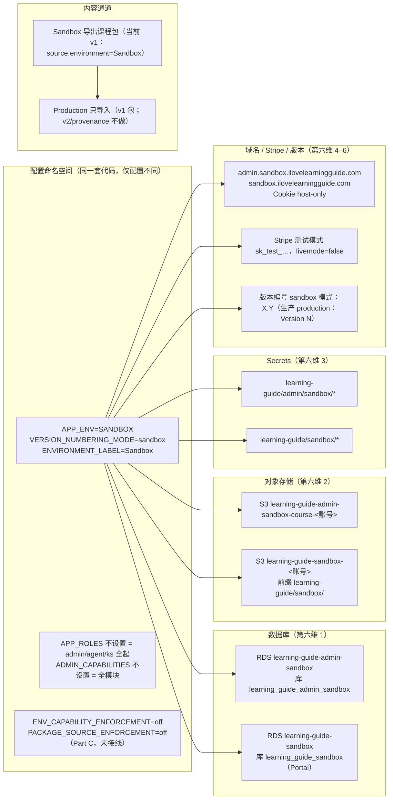

# Sandbox 逻辑分区、命名规则与能力契约

> Owner 2026-11-16 拍板。本文件是 Sandbox 的**逻辑分区规范**：环境 = 配置命名空间（DB / 对象存储 / Secrets / 域名 / Stripe / 版本编号模式 / 能力开关），命名规则一致；**禁止环境专属代码分支**。
> 配套：`docs/sandbox/environments.md`（环境矩阵）、`docs/sandbox/provisioning-request.md`（申请单）、`deploy/sandbox.example.env`（变量模板）。

## 0. 总图



## 1. 环境 = 配置命名空间

| 维度 | Sandbox 取值/命名 | 规则 | 证据 |
|---|---|---|---|
| DB | `learning-guide-admin-sandbox` / `learning_guide_admin_sandbox` / `lg_admin_sandbox`；Portal 侧 `learning-guide-sandbox` / `learning_guide_sandbox` | 每环境独立实例、独立库与账号；不共库、不跨库授权 | `scripts/provision-admin-dev.mjs`（`dbId = learning-guide-admin-${environment}`）；`deploy/sandbox-infrastructure.yml` |
| 对象存储 | Admin 桶 `learning-guide-admin-sandbox-course-<账号>`；Portal 桶 `learning-guide-sandbox-<账号>`，对象前缀 `learning-guide/sandbox/` | 桶名带 sandbox 与账号；运行时角色只读写本桶/本前缀 | `provision-admin-dev.mjs`（`-sandbox-` 桶名）；`sandbox-infrastructure.yml`（BucketName/前缀/角色策略） |
| Secrets | `learning-guide/admin/sandbox/<key>`、`learning-guide/sandbox/<key>` | 一环境一命名空间；真实值只进 Secrets Manager，仓库/日志/GitHub/工单不出现；`admin_api_key` 部署时映射为 `AUTH_TOKEN` | `provision-admin-dev.mjs`；`deploy/sandbox.example.env` |
| 域名 | `admin.sandbox.ilovelearningguide.com`、`sandbox.ilovelearningguide.com` | 独立子域；会话 Cookie host-only（无 Domain 属性）；`ADMIN_HOSTS` 只列本环境 | `docs/sandbox/acceptance-checklist.md` A3/B6 |
| Stripe | 测试账号/测试模式：`sk_test_…`、`STRIPE_SANDBOX=1`、独立 webhook | 禁止 `sk_live_`；webhook 只指向 sandbox 域名；Checkout `livemode=false` | `deploy/sandbox.example.env`；`commerce.config.ts` |
| 版本编号模式 | `VERSION_NUMBERING_MODE=sandbox` → 发布 `X.Y`（导出后系列 +1）；`ENVIRONMENT_LABEL=Sandbox` | 生产/PPE 必须显式 `production` → `Version N`；不设时缺省 sandbox，属历史语义 | `server/src/commerce-courses/commerce.config.ts:46-56` |
| 能力开关 | `ENV_CAPABILITY_ENFORCEMENT=off`、`PACKAGE_SOURCE_ENFORCEMENT=off` | 默认 off；Sandbox 永远 off；生产/UAT 演练后再开 | `docs/sandbox/environments.md` §4 |

## 2. 命名规则（一致、可推导）

```text
资源名   learning-guide-<组件>[-sandbox][-<用途>][-<AWS 账号>]
          组件：admin | portal(缺省) | admin-course(课程桶)
          例：learning-guide-admin-sandbox
              learning-guide-admin-sandbox-course-851987565851
              learning-guide-sandbox（Portal 服务/RDS 栈）
              learning-guide-sandbox-runtime（Portal 运行时角色）
              learning-guide-admin-sandbox-runtime（Admin 运行时角色）
Secrets  learning-guide/<admin/|>sandbox/<snake_case 键名>
          例：learning-guide/admin/sandbox/database_url
              learning-guide/admin/sandbox/admin_api_key
              learning-guide/sandbox/session_secret
```

要点：

- 环境标识出现在**资源名与命名空间**中（`sandbox`），同一用途在不同环境同名同构，只有环境段不同。
- 账号相关资源（桶）把 `<AWS 账号>` 拼在末尾；跨账号迁移只需改后缀。
- Secrets 键名与 App Runner 变量名解耦：secret 名用 snake_case，变量映射在部署配置里显式声明（如 `AUTH_TOKEN ← admin_api_key`）。
- 共享令牌（如 `admin_api_key`）**只建一份**，跨命名空间由 IAM 精确授权读取，不复制值。

## 3. 隔离边界（IAM / 网络）

- Portal 运行时角色（`learning-guide-sandbox-runtime`）：只读 `learning-guide/sandbox/*`，只读写本桶 `learning-guide/sandbox/*` 前缀；另由 `shared-admin-tokens-read` 精确授权读 `learning-guide/admin/sandbox/admin_api_key`（Portal 的 `ADMIN_PORTAL_API_TOKEN` 用它）。
- Admin 运行时角色（`learning-guide-admin-sandbox-runtime`，ops 预建）：只读 `learning-guide/admin/sandbox/*`，只读写 Admin 课程桶。Helpdesk/Portal 集成已启用；`learning-guide/sandbox/` 下的配对令牌由 ops 配置后按需精确授权（未配置时对应接口按设计 503）。
- 网络：私有子网（建议 `172.31.68.0/24`、`172.31.69.0/24`，与 SIT 64/65、UAT 66/67 不重叠）+ 独立 NAT + S3 Gateway Endpoint；DB 5432 只接受应用安全组。
- 红线：Sandbox 不得读取其它环境的桶/密钥，其它环境不得读取 Sandbox 桶/密钥；除课程包（Sandbox → Production）外没有跨环境数据通道。

## 4. 无环境专属代码分支

- 产品代码（Admin/Portal 的 `server/src`、`app/`、`client/` 等）**不得**出现 `if (SANDBOX)` / sandbox 专用接口/行为；Sandbox 与生产运行同一套代码，差异只由环境变量表达。
- 唯一允许按环境参数化的是**部署工具**（如 `scripts/provision-admin-dev.mjs` 按 `ADMIN_ENV` 生成资源名/桶名/分支约束），它描述“怎么部署”，不改变产品行为。
- 能力差异用**能力开关 + 环境矩阵**表达（见 §5），不在路由里写环境判断。
- `APP_ENV=SANDBOX` 只是运行标识（健康检查、审计、helpdesk seed 判定）；`AppEnvName` 已把它作为独立值保留，不借用 DEV/UAT 语义（`server/src/backoffice/lib/env.ts`，本分支）。
- **唯一允许的环境安全断言（2026-11-25）**：Sandbox 课程内容重置（`/api/backoffice/sandbox/reset`）在服务端 fail-closed 要求 `APP_ENV` 显式等于 `SANDBOX`，并叠加配置开关 `SANDBOX_RESET_ENABLED=true`（默认关）与 ADMIN 角色。这是破坏性运维动作的环境断言，不是产品行为分支：不按环境隐藏任何产品功能，只在非 Sandbox 环境拒绝该运维接口（403 `SANDBOX_RESET_DISABLED`）。实现见 `server/src/commerce-courses/sandbox-reset.service.ts`；范围与保留项见 §5.3 与 `provisioning-request.md` Q5b。

## 5. 能力与角色（Owner 2026-11-16 拍板，2026-11-24 修订：全部打开）

**Sandbox Admin 开放集 = 全部上游模块**（课程管理、知识库/KS、AI Tutor、学员管理、Helpdesk、运营位、报表、订单、Settings 与账号管理）。
**不含新增编辑能力：全开只打开上游已有模块，沙箱不新增任何编辑/新建/删除能力。**

需要密钥的功能（AI Tutor/KS、Helpdesk、邮件、Portal 集成、Study Group）同样启用；密钥/ARN 由运维后续配置，未配置时按设计降级（Helpdesk 503、AI 端点返回未配置错误、邮件 NOT_CONFIGURED），不伪造密钥或假值。

### 5.1 模块能力门（已实现：`ADMIN_CAPABILITIES`）

- 单一环境变量 `ADMIN_CAPABILITIES`（逗号分隔的能力标识）：**未配置/空 = 全部启用**；Sandbox **不设置**该变量（全开）。显式列出全部标识会在新增模块时漏开，因此不作为默认写法；只有需要裁剪的环境才显式列出子集。
- 服务端：前缀→能力映射集中在 `server/src/common/capabilities.ts`；未启用能力的 API 前缀返回 404 + 既有信封 `{success:false,error:{code:'MODULE_NOT_ENABLED'}}`。豁免：`/api/health`、`/api/auth/**`、`/api/session`、`/api/preferences/**`、`/api/backoffice/environment`、非 `/api` 资源。
- 前端：菜单 = 角色权限（RBAC 继续生效）∩ 已启用能力；能力全开时菜单由角色权限单独决定。
- **无环境专属分支**：逻辑只依赖 `ADMIN_CAPABILITIES` 的值，不判断 `APP_ENV`。未知能力值启动即失败（fail-fast）。

| 能力 | 覆盖 | Sandbox |
|---|---|---|
| `course` | `/api/backoffice/courses/**`、`/api/portal/v1/**`（课程投影与媒体） | **开** |
| `accounts` | `/api/admin/employees/**`、Settings › Employee Account（含账号级功能开关） | **开** |
| `knowledge` / `ai` / `students` / `helpdesk` / `operations` / `reporting` / `order` | 对应模块与路由 | **开** |
| `settings` | 学习权限与其它 Settings 子项（支付/通知等） | **开** |

角色层也全开：**不设置 `APP_ROLES`** = `admin` + `agent` + `ks` 三角色全起（`server/src/app-roles.ts`）。`/api/user/**`（agent）与 `/api/ks/**`（ks）是服务间接口，不是用户登录入口，分别由 `AUTH_ENABLED=true` + `AUTH_TOKEN` 与 `KS_SERVICE_TOKEN`（未配置时回退 `AUTH_TOKEN`）保护。能力门与角色是两层：角色决定"起哪些服务"，能力门决定"暴露哪些模块"；Sandbox 两层都不裁剪。

### 5.2 预览语义（唯一）

- **预览 = 用同一份生产代码（Portal 投影 `toDetail`）把草稿数据渲染一遍**：不发布、不审批、不做完成度过滤；预览看到什么，生产就是什么。
- Sandbox 产品面只暴露这一种预览（草稿 + 历史版本快照）；上游"学员视角质检预览"（按完成度隐藏课时）**不提供入口**。
- 实现：`PREVIEW_ENTRY=portal`（缺省 `learner`，保持上游行为），无环境判断分支。

### 5.3 冻结项（不改动）

- **交付包规格**（`.lgcourse.zip` / manifest / import-export 格式）保持接手前原样。当前基线导出为 **v1 包**（`source.environment=Sandbox`、`sourceVersion`），**不含 v2 provenance**；v2 与 provenance 门按 owner 决定**不做**（范围外，交付以 v1 为准）。
- **媒体上传规格**（格式白名单、大小上限、分块、时长探测、封面尺寸）保持接手前原样。
- 课程管理底层不大改；上游已知行为（如 webm 无时长导致 Study 不完整、试看截止点为展示级）**记录不改**，见 `verify-takeover-20261116/upstream-preview-media-as-is.md`。
- **课程内容重置（Q5b）不改变上述冻结项**：只清理本环境课程域与对象存储中的课程媒体/staging，不修改交付包格式、媒体上传规格或课程存储模型；Sandbox → Production 仍按 PRD 68 用「导出课程包 → 导入 Production」。

**生产（目标态）= import-only**：只导入 Sandbox 导出的课程包，经 provenance 门（`provenance.sourceEnv=sandbox`）校验；生产禁止编辑/新建/结构变更（403 `CAPABILITY_DISABLED`）。

## 6. 分支契约（`sandbox` 分支 = 上游最近一次生产发布 SHA 快进）

1. `sandbox` 分支只允许 **fast-forward 到上游最近一次生产发布（当前生产 = UAT）的发布 SHA**；禁止 sandbox 专属提交，禁止把 dev/feature 分支直接部署进 Sandbox。修复合入上游 `dev` 后不会立即进入 Sandbox——**随下一次生产发布进入**（生产发布完成后把 `sandbox` 分支快进到该发布 SHA）。
2. **UAT = 当前生产，同码**：Sandbox 两服务与生产运行同一套代码、同一套功能；PRD“Production 每次发版，Sandbox 同步同码”在工程上 = `sandbox` 分支快进到该生产发布 SHA。差异只允许来自配置（环境标识、域名、Stripe key、数据库/桶/密钥命名空间、能力开关）。
3. 部署门禁：sandbox 部署工作流只从 `sandbox` 分支构建（`deploy/admin-sandbox-deploy.yml.template`）；provision 脚本对 sandbox 关闭 App Runner 分支自动部署（`AutoDeploymentsEnabled=false`），工作流是唯一发布者且先等 CI。
4. `scripts/provision-admin-dev.mjs` 在 `ADMIN_ENV=sandbox` 时强制要求显式 `ADMIN_BRANCH`（无缺省分支），防止把 Sandbox 指向 dev/feature 代码。
5. 验收：Portal `/api/health` 的 `version` == 最近一次生产发布 SHA（`sandbox` 分支快进目标；smoke `EXPECTED_VERSION`）；Admin 用 App Runner 部署记录核对。

## 7. 两个 Part C 强制开关（不做；保持默认 off）

> 按 owner 2026-11-20 决定：Part C v2/provenance 为**范围外，不做**。模块裁剪已由 §5.1 的 `ADMIN_CAPABILITIES` 实现；这两个开关仅作历史契约记录，保持默认 off。

| 开关 | 默认 | Sandbox | 生产/UAT |
|---|---|---|---|
| `ENV_CAPABILITY_ENFORCEMENT` | `off` | 永远 `off`（全模块开放） | 演练后开 `on`：禁 authoring → 403 `CAPABILITY_DISABLED` |
| `PACKAGE_SOURCE_ENFORCEMENT` | `off` | 永远 `off`（允许任意来源导入用于演练） | 演练后开 `on`：只收 `provenance.sourceEnv=sandbox` 的 v2 包，否则 422 `PACKAGE_SOURCE_NOT_ALLOWED` |

当前上游 dev 基线（87e0be2）尚未包含 Part C 能力矩阵接线（`server/src/partc/**` 不在基线；半成品在 `fix/course-category-single-source`，已 stash）。两个开关名是**已拍板的契约**：任何分支引入时默认值必须是 `off`，不得在 Sandbox 打开；本分支只新增环境标识与托管就绪语义，不引入任何 Part C 产品行为改动。

## 8. 验收对照

| 分区 | 验证方式 |
|---|---|
| DB | UAT 凭据连 Sandbox DB 失败；Sandbox 库无真实学员数据 |
| 对象存储 | IAM Policy Simulator：跨环境桶/前缀 denied；桶 Block Public Access 4 项全 true |
| Secrets | 跨环境 secret 读取 denied；仓库/日志无真实值 |
| 域名/Cookie | 会话 Cookie host-only；其它域不生效 |
| Stripe | `livemode=false`；无 `sk_live_` |
| 版本编号 | 发布 `1.1` → `1.2`；导出后再发布 `2.1` |
| 能力/角色 | 不设置 `ADMIN_CAPABILITIES` / `APP_ROLES`：全部模块菜单可见（按角色权限），`/api/helpdesk/**`、`/api/user/**`、`/api/ks/**` 已挂载；未配置密钥的 Helpdesk 返回 503、AI 端点返回未配置错误（不是 404）；显式裁剪时才出现 404 `MODULE_NOT_ENABLED` |
| 分支契约 | `git rev-parse sandbox` 与最近一次生产发布（UAT）部署 SHA 一致；CI 通过后工作流发布 |
